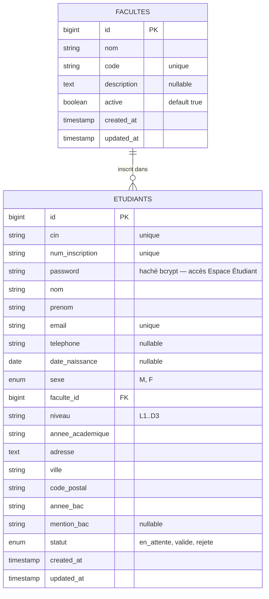

# 🎓 UniRegistre — Plateforme d'Inscription Universitaire par Faculté

Application web complète, robuste, ultra-sécurisée et ultra-performante développée avec **Laravel 13** (structure de code identique à Laravel 11/12, version actuelle du framework avec les derniers correctifs de sécurité), **MySQL**, **Blade**, **Tailwind CSS v4** et **Alpine.js**.

> 📖 **Consultez le [Manuel Complet du Projet (Guide Dev & Guide d'Utilisation)](MANUEL.md)** pour le déploiement pas-à-pas, l'architecture détaillée des modules et le guide de prise en main utilisateur.

---

## 🌟 Architecture & Fonctionnalités Clés

### 1. 📝 Portail Public d'Inscription (`/`)
- **Formulaire d'inscription responsive & ergonomique** :
  - **Identité** : Nom, Prénom, CIN (*Carte d'Identité Nationale* unique), Date de naissance, Sexe (M/F avec toggle visuel interactif).
  - **Coordonnées** : Email (unique avec normalisation automatique), Téléphone, Adresse complète, Ville, Code Postal.
  - **Parcours Baccalauréat** : Année d'obtention de la session du Baccalauréat, Mention obtenue (*Passable, Assez Bien, Bien, Très Bien, Excellent*).
  - **Affectation Universitaire** : Choix de la faculté d'accueil (chargement dynamique des facultés actives uniquement), Niveau d'études (*L1, L2, L3, M1, M2, D1, D2, D3*), Année académique.
  - **Sécurité Espace Étudiant** : Mot de passe (min. 8 caractères, au moins une lettre et un chiffre, confirmation obligatoire) avec bascule d'affichage œil (Alpine.js). Stocké **haché bcrypt** (`hashed` cast) et **jamais exposé** (`$hidden` sur le modèle).
- **Pré-remplissage automatique par CIN** (`POST /inscription/verifier-cin`, cf. [`docs/PREFILL-CIN.md`](docs/PREFILL-CIN.md)) :
  - Recherche dynamique (debounce 600 ms + blur, jamais une requête par caractère) : si le CIN existe déjà, les informations connues sont pré-remplies dans le formulaire et visuellement identifiables ; le mot de passe reste toujours vide.
  - Réponse DTO **whitelist stricte** (13 champs maximum) : jamais le mot de passe, son hash, `remember_token`, le statut ou le modèle complet.
  - **Anti-doublon** : unicité SQL du CIN + message métier orientant vers l'Espace Étudiant ; la vérification ne crée ni ne modifie jamais de compte.
  - Sécurité : POST + CSRF (CIN jamais dans les URLs/logs), validation regex stricte, requête paramétrée, `throttle:10,1` anti-énumération, transaction à l'inscription finale.
- **Scan CIN / Passeport + OCR** (`POST /inscription/identity/scan`, cf. [`docs/IDENTITY-SCAN.md`](docs/IDENTITY-SCAN.md)) :
  - Parcours optionnel en tête de formulaire : choix CIN tunisienne / passeport → scan caméra (mobile) ou import JPG/PNG/PDF → extraction automatique → **vérification humaine obligatoire** (l'OCR n'est jamais une preuve d'identité).
  - **Architecture OCR interchangeable** (`OcrEngineInterface`, moteur par défaut `NullOcrEngine` remplaçable via `IDENTITY_OCR_DRIVER` sans toucher au reste de l'application) ; parsers dédiés : CIN à libellés, passeport avec **MRZ ICAO 9303 + checksums 7-3-1**.
  - **Confiance par champ** avec seuils configurables (élevée/moyenne/faible) ; CIN ambiguë (« 1234567B ») → vérification manuelle demandée.
  - Recherche BD **fail-closed** (n° + date de naissance extraite) ; dossier existant → les données BD font foi, divergences OCR↔BD signalées, jamais écrasées.
  - **Minimisation (option A)** : document temporaire en stockage privé (nom UUID), **supprimé systématiquement** après OCR — même en cas de panne ; jamais dans `public/`, jamais dans les logs.
  - Validation serveur profonde : MIME réel (finfo), anti-polyglot, PDF `%PDF-`, image décodable, taille, path traversal ; rate limiting dédié `identity.scan` (5/min/IP).
  - **OCR arabe — CIN tunisienne** (cf. [`docs/IDENTITY-SCAN.md`](docs/IDENTITY-SCAN.md)) : libellés arabes extensibles (اللقب، الاسم، تاريخ الولادة…), normalisation arabe (diacritiques محمّد ≡ محمد, chiffres arabo-indiques ٠-٩), **translittération déterministe** des noms propres (محمد → Mohamed, بن علي → Ben Ali — jamais de traduction sémantique), originaux arabes conservés pour vérification comparative, lieux via table administrative extensible (صفاقس → Sfax), comparaison intelligente OCR arabe ↔ BD latine avec tolérance OCR.
- **Génération automatique du Numéro d'Inscription** :
  - Format officiel séquentiel et unique : `INS-YYYY-00001` (ex : `INS-2026-00001`).
- **Validation serveur stricte** avec normalisation (`prepareForValidation`) et messages d'erreur clairs en français.
- **Protection Anti-Spam** : Rate Limiting (`throttle:10,1`) sur la soumission du formulaire.
- **Page de Confirmation dédiée (`/inscription/success`)** :
  - Mise en valeur du numéro d'inscription généré.
  - Bouton de **copie dans le presse-papier en un clic** avec feedback visuel animé (Alpine.js).
  - Bouton d'**impression / export PDF direct** du récépissé d'inscription (`window.print()`).

---

### 2. 🛡️ Espace Administration (`/admin`)
- **Gestion des Étudiants (`/admin/etudiants`)** :
  - **Compteurs synthétiques en direct** : Total inscrits, En attente, Validés, Rejetés.
  - **Recherche multicritère instantanée** : Recherche par `nom`, `prenom`, `cin`, `num_inscription`, `email`, `telephone`, `ville`.
  - **Filtres combinés** par faculté, statut et niveau d'études.
  - **Double affichage optimisé** :
    - *Sur Desktop* : Grand tableau avec colonnes N° Inscription, Étudiant, CIN, Faculté/Niveau, Ville, Statut, Date et Actions.
    - *Sur Mobile* : Cartes tactiles compactes avec accès direct aux détails et boutons adaptés aux pouces.
- **Fiche Étudiant Complète (`/admin/etudiants/{id}`)** :
  - Vue d'ensemble en 3 blocs (Identité & Contact, Résidence & Baccalauréat, Inscription Universitaire).
  - **Mise à jour rapide du statut** en un clic (`en_attente`, `valide`, `rejete`) avec notifications flash.
  - **Suppression sécurisée** avec fenêtre modale de confirmation.
- **Gestion des Facultés — CRUD Complet (`/admin/facultes`)** :
  - Liste, création, modification et suppression des facultés.
  - **Protection d'intégrité** : interdiction absolue de supprimer une faculté ayant des étudiants rattachés.

---

### 4. 👤 Espace Étudiant Authentifié (`/etudiant`)
- **Connexion sécurisée (`/etudiant/connexion`)** :
  - Identifiant : **email ou CIN** (normalisation automatique minuscules/majuscules) + **mot de passe** haché bcrypt.
  - Design desktop avec panneau branding dégradé ; formulaire compact sur mobile.
  - **Message d'erreur générique** (« Identifiants incorrects ») pour empêcher l'énumération de comptes.
  - **Régénération de l'ID de session** à la connexion (protection contre la fixation de session).
- **Mon Profil (`/etudiant/profil`)** :
  - Carte héros : avatar initiales, nom, n° d'inscription, badge de statut, faculté et niveau.
  - Bannière contextuelle selon le statut (en attente / validé / rejeté) avec consignes.
  - 4 cartes : **Identité** (lecture seule, gérée par la scolarité), **Parcours académique** (lecture seule), **Mes coordonnées** (modifiables), **Sécurité** (changement de mot de passe).
- **Mise à jour des coordonnées (`/etudiant/profil/modifier`)** :
  - Champs modifiables : email (unique, vérifié hors propre dossier), téléphone, date de naissance, adresse, ville, code postal.
  - **Anti-escalade de privilèges** : CIN, n° d'inscription, statut, faculté et niveau sont filtrés par la validation (`validated()` ne retourne que les champs autorisés) — toute injection de `statut`/`cin`/`niveau` est ignorée.
- **Changement de mot de passe** : exige le mot de passe actuel (vérifié par `Hash::check`), nouveau mot de passe robuste (8+ caractères, lettre + chiffre, confirmation, différent de l'actuel).
- **Déconnexion** : invalidation complète de la session + régénération du token CSRF.
- **Mon Dossier Académique (`/etudiant/archives`)** : consultation **en lecture seule** de son parcours universitaire (années, semestres, notes, moyennes, crédits, décisions) et de ses documents officiels téléchargeables — l'étudiant est **toujours résolu depuis sa session** (aucune consultation croisée possible).
- **Sections dédiées en lecture seule (§3)** : `/etudiant/inscriptions` (une inscription par année universitaire, rattachée au dossier permanent), `/etudiant/notes`, `/etudiant/documents`, `/etudiant/historique` (journal de son dossier).

---

### 5. 📚 Module Archives Académiques (`/admin/archives`)

Dossier académique **historique complet** par étudiant — modèle relationnel normalisé (aucune table « fourre-tout ») :

- **Registre** : recherche par CIN, nom, prénom, email, n° d'inscription ou **matricule** ; filtres (faculté, année universitaire, niveau, statut) ; CIN masquée dans les listes.
- **Fiche dossier** : synthèse (moyenne générale, crédits cumulés, années validées, décision), parcours universitaire en accordéons (par année → semestres → matières → notes), saisie/correction de notes avec **recalcul automatique** des moyennes semestrielles, annuelles et générale, **verrouillage des notes** (`locked_at` — correction réservée aux rôles supérieurs), documents archivés, journal d'audit complet.
- **Configuration académique** : années universitaires + catalogue des matières (coefficient, crédits, niveau, semestre).
- **Documents sensibles** : stockés hors de `public/` (`storage/app/private/archives/etudiant_{id}/…`), nom interne UUID, hash SHA-256, double validation (extension + MIME réel + taille 10 Mo), téléchargement contrôlé et **journalisé**.
- **Journal d'audit** (`historique_academique`) : consultation, création/modification/suppression (dossier, inscription, note, document), upload, téléchargement, verrouillage, export — avec acteur, IP, user-agent, anciennes et nouvelles valeurs. **Aucun secret n'y figure jamais.**
- **Calculs déterministes** (`AcademicCalculationService`) : moyennes pondérées par coefficients en **arithmétique entière** (pas d'erreur de flottant), rattrapage remplaçant la note normale, crédits des matières ≥ 10, décisions académiques.
- **Transactions** : toute opération multi-table (inscription + S1/S2, note + recalculs + audit, suppression en cascade) est atomique ; notes protégées par `lockForUpdate` (anti-concurrence).
- **Export** : CSV journalisé du parcours (architecture prête pour PDF/Excel).
- Documentation dédiée : [`docs/ARCHIVES.md`](docs/ARCHIVES.md) · [`docs/SECURITY.md`](docs/SECURITY.md)

---

### 7. 🔌 Interopérabilité — API REST v1, imports & exports (`/api/v1`)

- **API REST versionnée** (`/api/v1`, une future v2 ne cassera jamais la v1) : étudiants, dossiers académiques, notes, documents (métadonnées uniquement) — via **API Resources** (surface de données strictement contrôlée, jamais de modèle brut).
- **Export académique multicritère** (§70-90) : moteur unique (`AcademicExportEngine`) — 7 types d'export (roster, notes par matière, relevé collectif à colonnes dynamiques, moyennes 4 niveaux, synthèse filière, statistiques), ~20 filtres combinables (faculté → filière → niveau → groupe → année → semestre → matière → session + statuts, décisions, intervalles de moyenne/note/crédits, identification individuelle), colonnes personnalisables (§78), permission `exports.personal` (§85), expiration configurable + purge horaire (§82), interface web dédiée `/admin/exports` avec prévisualisation et modèles d'export réutilisables (§79, §87).
- **Authentification Sanctum** : un token **par système externe** (jamais de token global), scopes moindre privilège (`students:read`, `grades:write`, `exports:create`…), révocation immédiate. Gestion par artisan : `integration:token-create`, `integration:tokens`, `integration:token-revoke`.
- **Imports en deux phases** (aucune écriture sans confirmation explicite) : analyse + prévisualisation (lignes valides / doublons / erreurs) → confirmation **atomique** (rollback complet) ou **partielle** ; rapports `EXCH-YYYYMMDD-NNNNN` (§40) ; idempotence par clés naturelles (CIN, semestre+matière+session).
- **Modèles d'importation prêts à remplir** (§91-117) : 6 types (étudiants, notes, inscriptions, matières, résultats, documents-métadonnées) en XLSX multi-feuilles (IMPORT + INSTRUCTIONS + RÉFÉRENCES dynamiques) / CSV / JSON — ligne d'exemple 100 % fictive ou modèle vierge, version `v1` dans le nom + métadonnées, validation STRICTE des colonnes à l'import (manquantes/inconnues/dupliquées/renommées détectées §105), détection automatique du type par la structure (§104), export du rapport d'erreurs (§109), permissions par type (§102), API `/api/v1/import-templates` (§114) — **modèle = schéma d'import = validation (§117)**.
- **Formats** : CSV, JSON, XML, XLSX — parsers/serializers dédiés (`app/Services/Io/`), **anti-XXE** (DTD/entités interdites, `LIBXML_NONET`), **anti CSV/formula injection** (`= + - @` neutralisés), XLSX via OpenSpout en flux (aucune évaluation de formule).
- **Exports à profils restreints** : `administratif` (identité+contact), `academique` (résultats, sans CIN/email), `statistique` (agrégats anonymes) ; filtres en liste blanche stricte ; téléchargement propriétaire uniquement.
- **Webhooks HMAC-SHA256** : signature + fenêtre temporelle + anti-replay 24 h + validation du payload — jamais d'URL nue acceptée.
- **File d'attente** : imports/exports volumineux via jobs (`ImportStudentsJob`, `ExportStudentsJob`…) — 202 Accepted + rapport consultable.
- **Journal des intégrations** (`integration_logs`) : chaque échange API/import/export/webhook tracé (statut, durée, request-id, empreinte SHA-256 — jamais de payload ni de secret).
- **Interface web scolarité** : `/admin/integrations` (import avec prévisualisation, export, rapports, journal des échanges).
- Documentation : [`docs/API.md`](docs/API.md) · [`docs/openapi.yaml`](docs/openapi.yaml)

---

### 8. 🔒 Sécurité & Performance

- **En-têtes HTTP de Sécurité** injectés via un middleware dédié (`SecurityHeadersMiddleware`) :
  - `X-Frame-Options: SAMEORIGIN` (Protection anti-clickjacking)
  - `X-Content-Type-Options: nosniff` (Protection contre le MIME-sniffing)
  - `X-XSS-Protection: 1; mode=block`
  - `Referrer-Policy: strict-origin-when-cross-origin`
  - `Permissions-Policy: camera=(), microphone=(), geolocation=()`
- **Protection CSRF** native sur tous les formulaires Blade.
- **Rate Limiting** : `POST /inscription` (10/min), `POST /etudiant/connexion` (5/min), `POST /admin/connexion` (5/min), consultation de dossier (60/min), saisie de notes (30/min), upload/téléchargement de documents (10-20/min).
- **Rate Limiting API** : lectures 60/min par token, imports 5/min, exports 10/min, webhooks 30/min — valeurs configurables (§49), 429 avec headers.

---

- **Back-office authentifié + RBAC** : 5 rôles (`super_admin`, `admin_scolarite`, `agent_scolarite`, `consultation`, `admin_faculte`) × 15 permissions (Gates + Policies) ; un rôle insuffisant reçoit 403 sans même atteindre la ressource.
- **Séparation stricte des profils (cf. [`docs/PROFILS-ET-SCOPING.md`](docs/PROFILS-ET-SCOPING.md))** :
  - **`admin_faculte`** : administrateur **rattaché à une faculté** (`users.faculte_id`) — registre, archives, notes et documents automatiquement **limités à SA faculté** (policies anti-IDOR + requêtes scopées, filtres client ignorés) ; dashboard dédié `/admin/ma-faculte` ; sans `configuration.manage` ni `notes.unlock` ni `archives.delete`.
  - Middlewares de rôle dédiés (`EnsureStudent`, `EnsureBackOffice`, `EnsureFacultyAdmin`, `EnsureSuperAdmin`) : rôle, statut (`users.actif`) et faculté **lus en base à chaque requête**, jamais depuis le client.
  - **Isolation API** : même avec un token Sanctum valide, un admin_faculte n'obtient que sa faculté (scoping + 404 hors périmètre) ; ses exports sont forcés à sa faculté.
  - **Gestion des administrateurs** (`/admin/administrateurs`, super admin uniquement) : création de comptes, rattachement faculté, activation/désactivation audité — un admin_faculte ne peut pas créer de compte ni s'auto-désactiver.
- **Anti-IDOR** : les routes étudiant sont résolues depuis la session ; le téléchargement d'un document d'autrui renvoie 404.
- **Journal d'audit** immuable sur toutes les actions académiques sensibles.
- **Content-Security-Policy** ajoutée aux en-têtes existants (compatible Vite + Alpine.js).
- **Protection Mass Assignment** stricte via `$fillable` sur les modèles Eloquent + champ `password` masqué (`$hidden`).
- **Mots de passe hachés bcrypt** (cast `hashed` de Laravel) — jamais stockés en clair, jamais exposés en JSON.
- **Indexations de performance** sur la base MySQL (`cin`, `num_inscription`, `statut`, `niveau`, `faculte_id`, composite `[nom, prenom]`).
- **Chargement optimisé des relations** (`with('faculte')`, `withCount('etudiants')`).

---

## 🗄️ Schéma de la Base de Données



---

## 📦 Données de Test (Seeders)

Le projet contient un seeder complet (`DatabaseSeeder`) initialisant :
- **8 facultés réalistes** :
  1. `FST` : Faculté des Sciences et Techniques
  2. `FDEG` : Faculté de Droit, Économie et Gestion
  3. `FMP` : Faculté de Médecine et de Pharmacie
  4. `FLSH` : Faculté des Lettres et des Sciences Humaines
  5. `FSIT` : Faculté des Sciences de l'Ingénieur et Technologies
  6. `FSE` : Faculté des Sciences de l'Éducation
  7. `FMD` : Faculté de Médecine Dentaire
  8. `FASE` : Faculté d'Agronomie (inactive pour test de validation)
- **25 étudiants d'exemple** avec des CIN uniques, numéros d'inscription (`INS-2026-00001` à `INS-2026-00025`), adresses réelles et statuts variés.
  - **Comptes de démonstration** : tous les étudiants seedés partagent le mot de passe **`etudiant123`** (haché à la volée par le cast `hashed`). Exemple de connexion à l'Espace Étudiant : `mehdi.alami@email.com` (ou CIN `BK712345`) + `etudiant123`.

---

## 🚀 Installation & Lancement en Local

### 1. Accéder au répertoire
```bash
cd /Users/mohamedyassine/Desktop/PFE/inscription-etudiants
```

### 2. Installer les dépendances
```bash
composer install
npm install
```

### 3. Configuration MySQL (`.env`)

**Cas A — MySQL standard (Homebrew, Docker…) :**
```env
DB_CONNECTION=mysql
DB_HOST=127.0.0.1
DB_PORT=3306
DB_DATABASE=inscription_etudiants
DB_USERNAME=root
DB_PASSWORD=votre_mot_de_passe
```

**Cas B — MAMP (configuration actuelle du projet) :**
```env
DB_CONNECTION=mysql
DB_HOST=localhost:8889
DB_PORT=3306
DB_DATABASE=inscription_etudiants
DB_USERNAME=root
DB_PASSWORD=root
```
> ⚠️ Avec MAMP, `DB_HOST` doit contenir `localhost:8889` (host + port MAMP). Créez la base si nécessaire :
> ```bash
> mysql -u root -p -e "CREATE DATABASE inscription_etudiants CHARACTER SET utf8mb4 COLLATE utf8mb4_unicode_ci;"
> ```

### 4. Migrations et Seeders
```bash
php artisan migrate:fresh --seed
```

### 5. Compiler les assets
```bash
npm run build
```

---

## ▶️ Commandes d'Exécution

### Option recommandée (2 terminaux) :

**Terminal 1 — Serveur Laravel :**
```bash
php artisan serve
```
> Application accessible sur : **http://127.0.0.1:8000**
> - Formulaire d'inscription : [http://127.0.0.1:8000/](http://127.0.0.1:8000/)
> - Espace Étudiant (connexion) : [http://127.0.0.1:8000/etudiant/connexion](http://127.0.0.1:8000/etudiant/connexion)
> - Espace Scolarité (connexion back-office) : [http://127.0.0.1:8000/admin/connexion](http://127.0.0.1:8000/admin/connexion)
> - Archives Académiques (authentifié) : [http://127.0.0.1:8000/admin/archives](http://127.0.0.1:8000/admin/archives)
> - Exports Académiques multicritères : [http://127.0.0.1:8000/admin/exports](http://127.0.0.1:8000/admin/exports)
> - Espace Admin Étudiants : [http://127.0.0.1:8000/admin/etudiants](http://127.0.0.1:8000/admin/etudiants)
> - Espace Admin Facultés : [http://127.0.0.1:8000/admin/facultes](http://127.0.0.1:8000/admin/facultes)

**Comptes scolarité de démonstration** (à changer en production) :

| Rôle | Email | Mot de passe |
|---|---|---|
| Super administrateur | `admin@universite.ac.ma` | `Admin@2026` |
| Responsable scolarité | `scolarite@universite.ac.ma` | `Scolarite@2026` |
| Agent scolarité | `agent@universite.ac.ma` | `Agent@2026` |
| Consultation (lecture seule) | `consultation@universite.ac.ma` | `Consult@2026` |
| Admin Faculté Sciences (FST) | `admin.fst@universite.ac.ma` | `Faculte@2026` |
| Admin Faculté Médecine (FMP) | `admin.fmp@universite.ac.ma` | `Faculte@2026` |

> Les comptes **admin_faculte** ne voient que les données de leur faculté
> (scoping serveur) — parfait pour valider l'isolation inter-facultés.

**Terminal 2 — Vite Hot-Reload (Développement) :**
```bash
npm run dev
```

---

## 🧪 Tests Automatisés

Exécutez la suite de tests complète :
```bash
php artisan test
```
**Résultat : 302 tests passés avec succès (1195 assertions)** — dont les 10 suites du module Archives Académiques, les 6 suites de l'interopérabilité (API, imports, exports multicritères, webhooks), la suite des modèles d'importation, la suite du pré-remplissage par CIN (`CinPrefillTest`), la suite de séparation des profils (`SeparationProfilsTest`) et les suites du scan d'identité (`IdentityParsersTest`, `IdentityScanTest`, `ArabicIdentityTest` : normalisation arabe, translittération, libellés arabes, matcher OCR↔BD ; `ArabicCinScanTest` : parcours HTTP arabe complet, XSS/SQL via OCR neutralisés, utf8mb4).
