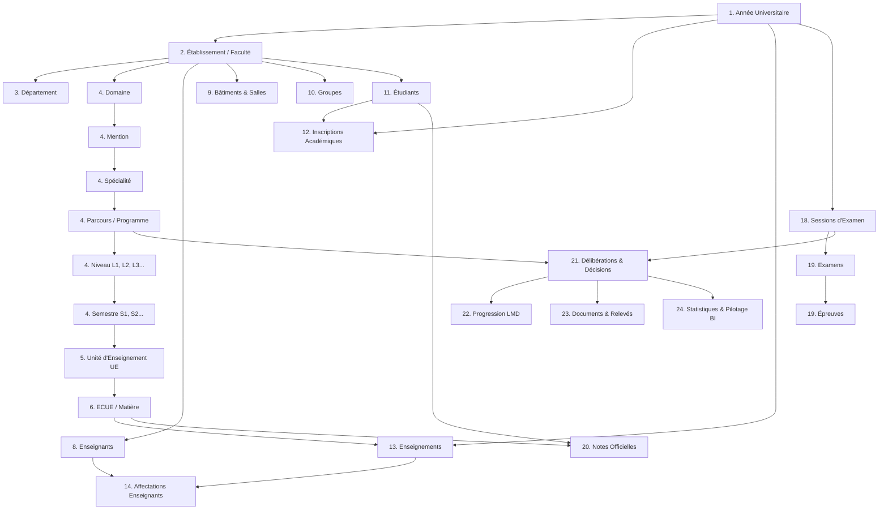

# Pipeline Complet d’Importation Académique et Administrative LMD / SALIMA

Ce document détaille l'architecture, le graphe de dépendances strict, les définitions de données, les règles d'idempotence, le mode dry-run, la sécurité et l'isolation Faculty Scope du centre d'importation unifié `DataExchange`.

---

## 1. Principes Fondamentaux & Non-Duplication

1. **Unicité du pipeline** : Aucune couche d'import parallèle n'est créée. L'ensemble des 24 lots s'appuie sur le moteur unifié `DataExchange` (`DataImportService`, `DefinitionRegistry`, `ImportDependencyService`, `ImportReport`, `IntegrationLog`).
2. **Ordre strict LMD** : Aucun import dépendant ne peut être confirmé si ses prérequis ne sont pas préalablement présents dans la base de données.
3. **Zéro duplication de modèle** :
   - Établissement = `Faculte`
   - ECUE = `Matiere` (avec `ue_id` lié à `unites_enseignement`)
   - Parcours = `Programme`
   - Délibérations = `Deliberation` & `evaluation_decisions`
4. **Idempotence garantie** : Tout import exécuté deux fois avec le même fichier n'altère pas les comptages et ne crée aucun doublon.
5. **Dry-Run obligatoire** : La phase de prévisualisation (preview) est stateless et n'écrit absolument rien en base.

---

## 2. Graphe Global des Dépendances

---

## 3. Matrice des Entités et Définitions d’Import

| Lot | Entité | Clé Métier | Dépendances Prérequises | Colonnes Requises |
|---|---|---|---|---|
| **Lot 1** | `annees-universitaires` | `libelle` (AAAA-AAAA) | *Aucune* | `libelle` |
| **Lot 2** | `facultes` | `code` | *Aucune* | `code`, `nom` |
| **Lot 3** | `departements` | `code` + `faculte` | `facultes` | `code`, `nom`, `faculte` |
| **Lot 4** | `domaines` | `code` + `faculte` | `facultes` | `code`, `nom`, `faculte` |
| **Lot 4** | `mentions` | `code` + `domaine` | `domaines` | `code`, `nom`, `domaine` |
| **Lot 4** | `specialites` | `code` + `mention` | `mentions` | `code`, `nom`, `mention` |
| **Lot 4** | `type-diplomes` | `code` (LIC, MST...) | *Aucune* | `code`, `nom` |
| **Lot 4** | `programmes` | `code` + `faculte` | `facultes` | `code`, `nom`, `faculte` |
| **Lot 4** | `niveaux` | `code` + `programme` | `programmes` | `code`, `programme` |
| **Lot 4** | `semestres` | `code` + `niveau` + `programme` | `niveaux` | `code`, `niveau`, `programme` |
| **Lot 5** | `ues` | `code` + `programme` | `programmes`, `semestres` | `code`, `nom`, `programme`, `semestre` |
| **Lot 6** | `ecues` | `code` | `ues` | `code`, `nom`, `ue` |
| **Lot 7** | `matieres` | `code` | *Aucune* | `code`, `nom` |
| **Lot 8** | `enseignants` | `email` ou `matricule` | `facultes` | `nom`, `prenom`, `email` |
| **Lot 9** | `salles` | `code` | `facultes` | `code` |
| **Lot 10** | `groupes` | `code` + `faculte` + `niveau` | `facultes` | `code`, `nom`, `faculte`, `niveau` |
| **Lot 11** | `etudiants` | `cin` ou `matricule` | `facultes` | `nom`, `prenom`, `email`, `sexe`, `faculte`, `niveau`, `annee_academique` |
| **Lot 12** | `inscriptions-academiques` | `cin`/`matricule` + `annee` | `etudiants`, `annees-universitaires` | `annee_universitaire`, `niveau` |
| **Lot 12** | `inscriptions-pedagogiques` | `matricule` + `ecue` + `annee` | `inscriptions-academiques`, `ecues` | `matricule`, `ecue`, `annee` |
| **Lot 13** | `enseignements` | `ecue` + `type` + `annee` | `ecues`, `annees-universitaires` | `ecue`, `type`, `annee` |
| **Lot 14** | `affectations-enseignants` | `enseignement` + `teacher` | `enseignements`, `enseignants` | `ecue`, `type`, `annee`, `enseignant_email` |
| **Lot 15** | `affectations-groupes` | `etudiant` + `groupe` + `annee` | `etudiants`, `groupes` | `matricule`/`cin`, `groupe`, `annee` |
| **Lot 18** | `sessions-examen` | `code` | `annees-universitaires` | `code`, `nom`, `annee` |
| **Lot 19** | `examens` | `session` + `libelle` | `sessions-examen` | `libelle`, `session` |
| **Lot 19** | `epreuves` | `examen` + `ecue` + `date` | `examens` | `session`, `libelle`, `code_ecue` |
| **Lot 20** | `notes` | `cin`/`matricule` + `matiere` + `session` | `etudiants`, `matieres` | `code_matiere`, `note` |
| **Lot 21** | `deliberations` | `session` + `programme` + `cin` | `sessions-examen`, `programmes` | `session`, `programme`, `niveau`, `decision` |

---

## 4. Modes d'Importation & Stratégies

Chaque import supporte les modes suivants selon la définition :
- **`creer`** : N'insère que les nouvelles entités. Les doublons déjà présents en base sont ignorés avec avertissement explicite.
- **`upsert`** : Met à jour les entités existantes si elles sont modifiables (non verrouillées) et insère les nouvelles.
- **`remplacer`** : Mode destructif/remplacement disponible uniquement pour les référentiels sans contrainte d'intégrité descendante (exige confirmation explicite).

---

## 5. Sécurité, Contrôles & Isolation Faculty Scope

1. **Vérification stricte des uploads** :
   - Extensions autorisées : `.csv`, `.xlsx`, `.json`, `.xml`.
   - Inspection MIME réelle via finfo côté serveur.
   - Protection anti-XXE sur XML (DDoSP/Entity resolution désactivée).
   - Protection contre les injections CSV (échappement des préfixes formule `=`, `+`, `-`, `@`).
2. **Faculty Scope (Anti-IDOR / BOLA)** :
   - Un administrateur rattaché à une faculté (`admin_faculte`) est strictement cantonné à son périmètre :
     - Les lignes ciblant une autre faculté sont rejetées avec le code `FACULTY_SCOPE_VIOLATION`.
     - Les clés primaires ou identifiants falsifiés dans le fichier ou le formulaire sont interceptés côté serveur.
3. **Audit & Traçabilité** :
   - Chaque opération génère un enregistrement dans `import_reports` (statut, lignes valides, erreurs, auteur, durée, empreinte SHA256).
   - Les opérations sensibles sont auditées dans `integration_logs` et `journal_audit` sans stocker de PII superflue.
