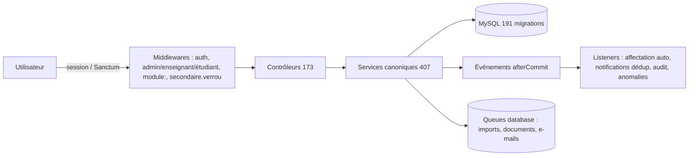
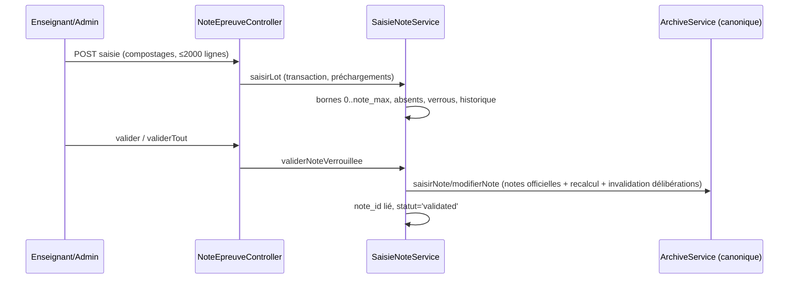
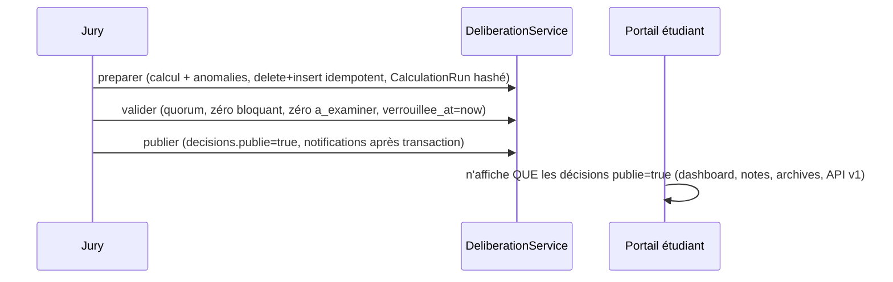

# Knowledge Base – UniRegistre

> Base de connaissances d'architecture générée le 23/10/2026 à partir du code réel (vérifications
> `path:line` effectuées au fil des audits LOOP). Cible : LLM/RAG, développeurs, onboarding.
> Version du socle au moment de la génération : PHP 8.5.11 · Laravel 13.33.0 · Node 26.

---

## 1. Vue d'ensemble

- **Description** : plateforme universitaire complète d'inscription et de gestion académique —
  inscriptions en ligne (nouveaux + réinscriptions), vérification des dossiers, affectations
  pédagogiques, notes & délibérations, finances, documents officiels, portails par rôle.
- **Type** : monolithe Laravel modulaire (Blade-first + fragments Alpine/Livewire), API REST v1
  (Sanctum) pour les intégrations.
- **Stack technique** :

| Couche | Technologie |
|---|---|
| Backend | PHP 8.5, Laravel 13.33, MySQL 8 |
| Frontend | Blade, Tailwind CSS **v4** (`@source ../**/*.blade.php`, variant `dark` par classe), Vite 8, Alpine.js 3.17 (via Livewire), Livewire 4 (usages ciblés), GSAP 3.15 + Lenis (mouvement) |
| Documents | dompdf (PDF), openspout (XLSX/ODS/CSV streaming) |
| Tests | PHPUnit 12.5, sqlite en mémoire (`phpunit.xml`), MySQL dédié uniquement pour tests de concurrence opt-in |
| IA (module `AssistantIa`) | Ollama local (OpenAI-compatible) par défaut ; distant désactivé par politique (LOOP 17) |



**Architecture** : MVC à **modules verticaux** (CORE + MODULES). Le cœur ne dépend d'aucun module ;
chaque module `app/Modules/Xxx/` apporte `Controllers/Models/Services/Routes/web.php` et est
activé par flag (`config/modules.php`, env `MODULE_XXX`). Les modules sont montés par
`ModuleServiceProvider` (routes, listeners, registre d'outils IA, widgets).

---

## 2. Structure du projet

```text
app/
  Http/Controllers/        # Admin/ · Etudiant/ · Enseignant/ · Api/V1 — thin controllers
  Models/                  # Socle : Etudiant, InscriptionAcademique, Note, Semestre, …
  Services/                # CANONIQUE : InscriptionService, ArchiveService, PeriodeInscriptionService,
                           # DocumentsRequisService, BlocageInscriptionService, AffectationService,
                           # NotificationService, CommunicationDispatcher, AuditService, AcademicCalculationService…
  Support/Permissions.php  # Matrice RBAC (source de vérité rôles/permissions)
  Modules/ (17)            # Announcements, Calendar, Evaluation, Finances, OnlineRequests,
                           # ParcoursAcademique, Referentiel, Schedule, StudentDossiers, StudentArchive,
                           # Attendance, Tasks, AssistantIa, AiAssistant (inactif), Sentinel, Versioning, Enseignement
  Policies/                # NotePolicy, DossierPaiementPolicy…
database/migrations/       # 191 migrations ADDITIVES (jamais destructives)
docs/                      # engineering (rapports LOOP), architecture, règles métier
resources/views/           # Blade ; composants partagés x-btn/x-alert/x-status-badge/x-empty-state/x-page-header…
routes/web.php             # ≈700+ routes ; modules → app/Modules/*/Routes/web.php
tests/                     # 518 fichiers (Feature + Unit) ; sqlite isolé
```

**Patterns dominants** : services métier en `app/Services` (une responsabilité = un service),
machines à états avec `TRANSITIONS` constantes côté modèle/service, transactions + `lockForUpdate`
sur toute écriture critique, événements métier `$afterCommit = true`, audit append-only,
idempotence par clés uniques (`cle_unique`, empreintes SHA-256, dédup notifications).

---

## 3. Modèle de données

### Entité : `Etudiant` (`app/Models/Etudiant.php`)
- **Champs clés** : `cin` (unique), `num_inscription` (`INS-YYYY-XXXXX`), `nom`, `prenom`, `email`
  (unique), `faculte_id`, `niveau`, `annee_academique`, `statut` (non mass-assignable).
- **Statuts + transitions** : `en_attente → valide | rejete` ; `valide → en_attente | rejete` ;
  `rejete → en_attente | valide` — **source de vérité** : `StudentStatusService::TRANSITIONS`
  (`app/Services/StudentStatusService.php:24`). Écriture unique via `definirStatut()`
  (idempotent no-op si même statut, verrou + re-vérification).
- **Relations** : `inscriptionsAcademiques()` 1-N ; `dossierAcademique()` 1-1 (GED) ;
  `notifications` 1-N (`AppNotification`).

### Entité : `InscriptionAcademique` (`app/Models/InscriptionAcademique.php`)
- **Statuts** : `en_cours | valide | ajourne | abandon` — **terminaux sans retour arrière**.
  Source de vérité : `InscriptionService::TRANSITIONS` (`InscriptionService.php:30-35`) ;
  unique porte d'écriture : `InscriptionService::transiter()` (:117) — transaction + `lockForUpdate`
  + re-vérification sous verrou.
- **Relations** : `semestres()` 1-N (`Semestre`, numéros 1/2) ; `notes()` 1-N ; `dossierPaiement()`
  1-1 (`DossierPaiement`) ; `documentsInscription()` 1-N (pièces annuelles).
- **Règle** : unicité annuelle (étudiant, année) — contrainte unique, traduite en `DomainException`
  métier (`UniqueConstraintViolationException` → idempotent).

### Entité : `RegistrationPeriod` (périodes d'inscription)
- `STATUTS = [active, revoquee, utilisee]` ; résolution canonique `PeriodeInscriptionService` :
  normale ouverte → exception ouverte → `REGISTRATION_PERIOD_CLOSED` ; **aucune période configurée =
  autorisé** (`SANS_PERIODE`). Exception individuelle à usage unique (`marquerUtilisee()`).

### Entité : `Note` (officielle, table `notes`)
- 1 ligne / (semestre, matière, session) — **unique index** ; `note` CHECK 0..20 ; écriture
  uniquement via `ArchiveService::saisirNote/modifierNote` (recalcul immédiat semestre + année via
  `AcademicCalculationService`) ; verrouillage `locked_at` (déverrouillage = `notes.unlock`).

### Entité : `NoteEpreuve` (module Evaluation, table `evaluation_notes`)
- Note brute par (épreuve, étudiant) ; `STATUTS = [draft, entered, submitted, validated, locked,
  correction_demandee]` avec `TRANSITIONS` serveur ; CHECK `valeur IS NULL OR 0..note_max` ;
  historique `NoteEpreuveHistorique` (ancienne/nouvelle valeur, motif, auteur).

### Entité : `Deliberation` / `DecisionDeliberation`
- `STATUTS = [draft, prepared, in_review, convened, in_progress, validated, published, locked,
  archived]` (`Deliberation.php:19-32`) ; validation exige quorum (président + ≥2 présents),
  zéro anomalie bloquante, zéro `a_examiner` ; publication flagge `publie=true` (seule source
  affichée au portail étudiant) ; correction de note → `resultats_invalides_le` (re-préparation
  exigée) tant que non verrouillée.

### Entité : `DossierPaiement` (module Finances)
- `NON_PAYE → RECU_DEPOSE → EN_VERIFICATION → VALIDE | REFUSE` ; un seul reçu VALIDE par dossier ;
  commentaire obligatoire si écart de montant. **Non bloquant pour la validation d'inscription**
  (décision métier documentée).

### Autres référentiels
- LMD : `Programme → Niveau → SemestreLmd → UniteEnseignement → Matiere` (UE/ECUE, coefficients,
  crédits) — module `Referentiel` avec **prévalidation de maquettes** (rapport
  BLOCKER/WARNING/INFO).
- `Matiere.semestreRelatif()` (1|2) : pont matière → semestre académique.
- Groupes : `Group` (module Schedule), affectations `Etudiant ↔ Group` historisées
  (`SituationEtudiant` append-only).

---

## 4. API / Endpoints

> ≈700 routes ; les routes admin partagent `['auth','admin','mfa.obligatoire','secondaire.verrou']`.
> Chaque route de module est enveloppée par `module:xxx` (404 si désactivé) et une gate `can:`.

### POST `/inscription` (public)
- **Description** : création d'un dossier d'inscription (nouveau bachelier).
- **Auth** : aucune (anti-bot + rate-limit `throttle:10,1`) ; CSRF.
- **Request** : champs identité (`cin`, `nom`, `prenom`, `email`, `date_naissance`, `sexe`…),
  `confirmation` (attestation sur l'honneur) **requis** ; token d'idempotence.
- **Response** : 302 vers récapitulatif ; référence officielle `INS-YYYY-XXXXX`.
- **Erreurs** : validation stricte (422), doublon CIN idempotent (retour dossier existant),
  rejeu < 60 s sans session = idempotent, période fermée → `DomainException`
  `REGISTRATION_PERIOD_CLOSED`.

### POST `/admin/inscriptions/{inscription}/valider` (canonique)
- **Auth** : session admin + permission gestion ; **délégation** : `InscriptionService::transiter()`.
- **Préconditions** (`transiter`, cible `valide`) : pièces obligatoires complètes
  (`DocumentsRequisService::exigerPourValidation()`) **et** verdict non-BLOQUANT du moteur
  (`BlocageInscriptionService::blocages()`).
- **Effets** : `SituationEtudiant`, audit `HistoriqueAcademique`, notification centre, `PopulationChanged`,
  event `InscriptionValidee` **afterCommit** → affectation automatique (fail-soft).

### Notes (module Evaluation, préfixe `admin/evaluations`)
- `GET  evaluations/epreuves/{epreuve}/notes` — `can:notes_eval.view` — grille de saisie anonyme
  (compostages `CMP-######`).
- `POST evaluations/epreuves/{epreuve}/notes` — `can:notes_eval.enter` + `throttle:20,1` — lot ≤2000
  lignes ; absent ⇒ aucune note ; note verrouillée ignorée et signalée.
- `POST evaluations/epreuves/{epreuve}/notes/valider-tout` — `can:notes_eval.validate` — validation
  collective (préchargements, erreurs partielles collectées).
- `POST evaluations/notes/{note}/valider|verrouiller|correction-demander|correction-autoriser` —
  cycle `entered→validated→locked→correction_demandee` ; synchronisation unique vers `notes`.
- `POST …/notes/import-multi(/confirmer|/annuler)` — `can:notes_eval.enter`, aperçu 2 étapes
  anti-TOCTOU, CSV/XLSX/ODS/JSON/XML, flux **strictement anonymes** (rejet de toute colonne
  `student_id/etudiant_id`).

### Délibérations
- `POST evaluations/deliberations` (`deliberations.prepare`) → `preparer|valider|publier|releves|pv`
  avec permissions différenciées (`deliberations.validate/publish`) ; publication notifie chaque
  étudiant (`CommunicationDispatcher`, dédup 60 min) **après fermeture de transaction**.

### API v1 (Sanctum)
- `GET /api/v1/...` — tokens à périmètre (`grades:read`…) ; sans décision publiée → enveloppe nulle
  (zéro note exposée) ; scoping faculté obligatoire (`verifierPerimetreFaculte`).

### Centre de travail (`admin/centre-travail`)
- `GET admin.centre-travail.index` — `tasks.view || archives.view` — file unifiée de tâches
  (filtres validés serveur, tri priorité/échéance/FIFO, pagination 15, KPI cliquables = listes
  exactes) ; `GET …/{inscription}` → diagnostic explicable (`InscriptionEligibilityService::evaluer`,
  dry-run strict, anti-IDOR 404).

---

## 5. Services & Logique métier

### Service : `InscriptionService` (`app/Services/InscriptionService.php`)
- **Responsabilité** : cycle de vie académique (création annuelle, réinscription, transitions).
- **Méthodes** : `creerInscriptionAnnuelle()`, `reinscrire()` (verrous `RegistrationPeriod` +
  `Etudiant::lockForUpdate`), `transiter()` (porte unique), `regulariserInscriptionsManquantes()`.
- **Dépendances** : `DocumentsRequisService`, `BlocageInscriptionService`,
  `PeriodeInscriptionService`, `SituationEtudiant`, `HistoriqueAcademique`.

### Service : `ArchiveService`
- Écriture des notes officielles : `saisirNote/modifierNote/supprimerNote/basculerVerrou` —
  cohérence matière/niveau/semestre stricte, recalcul immédiat, invalidation des délibérations
  dépendantes (`DeliberationService::marquerResultatsInvalides`).

### Service : `AcademicCalculationService`
- `moyennePonderee` (centièmes entiers anti-flottants), `notesValideesParMatiere` (rattrapage
  **remplace** la normale), `creditsObtenus` (≥ 10), `recalculerSemestre/recalculerInscription`,
  `moyenneGenerale`. Seuils codés 10/8 (divergence documentée avec `evaluation_regles` versionnées).

### Service : `AffectationService` / `AffectationAutomatiqueService`
- `controler()` (codes structurés, lecture seule), `affecter()` (verrous ordre fixe étudiant→groupe,
  capacité re-vérifiée, idempotent même groupe/année), `affecterLot()`, `repartitionAutomatique()`
  (simulation sans écriture). Auto : `tenter()` idempotent (EXISTING/LOCKED), jamais bloquant ;
  déclenché par `InscriptionValidee` / `DossierDecisionPrise`.

### Service : `NotificationService` / `CommunicationDispatcher`
- `notifierEtudiant(..., cleDedup)` — idempotent par clé ; `dispatcher` — gabarits versionnés +
  dédup fenêtrée 60 min ; masse : `notifierPlusieursEtudiants` (insert par 500, **sans** dédup).

### Service : `AuditService` (`app/Services/AuditService.php`)
- `tracer(Etudiant, action, entite, entiteId, ancienne?, nouvelle?, sourceSysteme)` →
  `HistoriqueAcademique` **immuable** (IP, user-agent, JSON avant/après) ;
  `tracerReferentiel()` hors dossier étudiant (sans PII).

### Module AssistantIa (Knowledge Hub)
- `OrchestrateurAgentIa::traiterMessage` : filtre entrant → intention (`RouteurIntentionsIa`) → RAG
  (`MoteurRechercheDocumentaire`, filtré permissions) → boucle tool-calling ≤5 → purge sortie →
  persistance.
- `PolitiqueRoutageIa::evaluer` (LOOP 17) : LOCAL par défaut ; distant = 6 gardes (activation,
  permission, sensibilité → REFUSE, volume ≤32k, anti-contournement `allow_remote`, jeton HMAC
  signé lié à `sha256(prompt|sources)`). `FiltreSecuriteIa::minimiserTextePourDistant()` avant
  tout envoi. **Aucun fallback cloud** (504 local = fin de chaîne).
- `WorkflowApprobationService` : verrou pessimiste, 4-yeux, expiration, anti-rejeu, intégrité
  sha256 ; l'assistant **ne s'auto-exécute jamais**.

---

## 6. Authentification & Autorisation

- **Rôles** (`Permissions::ROLES`) : `super_admin`, `admin_scolarite`, `agent_scolarite`,
  `consultation`, `admin_faculte`. Matrice exhaustive dans `Permissions::MATRICE` —
  `super_admin` = `TOUTES`.
- **Portails** : sessions distinctes par espace (`etudiant_auth_id`, `enseignant_auth_id`) ≠ guard
  back-office ; portails étudiant/enseignant scopés par session (jamais par paramètre URL).
- **Middlewares** : `auth`, `admin` (+ `mfa.obligatoire`), `module:xxx` (404 si module inactif),
  `secondaire.verrou` (verrouillage opérationnel secondaire), `throttle:*` par route sensible,
  `can:permission` (gates).
- **Isolation facultaire** : `User::faculteRestreinteId()` + `peutAccederFaculte()` (fail-closed) —
  réimplémentée dans chaque policy/service (anti-IDOR/BOLA), convention : scope → 404 avant Gate.
- **API v1** : Sanctum, tokens à périmètres (`grades:read`…), webhook HMAC + timestamp anti-replay.
- **PDAF/conventions sécurité** : OCR fail-soft, pièces temporaires supprimées après extraction,
  validation serveur (extension + MIME réel + max), zéro PII dans les logs.

---

## 7. Flux métier importants

### Flux 1 — Validation d'une inscription (canonical)

```mermaid
sequenceDiagram
    participant A as Agent (scolarité)
    participant C as InscriptionGestionController
    participant S as InscriptionService::transiter
    participant D as DocumentsRequis/Blocages
    participant DB as MySQL
    participant EV as InscriptionValidee (afterCommit)
    A->>C: POST valider
    C->>S: transiter(inscription, 'valide')
    S->>D: pièces complètes ? verdict BLOQUANT ?
    D-->>S: OK / DomainException
    S->>DB: BEGIN; lockForUpdate; re-vérifier transition
    S->>DB: update statut='valide'; SituationEtudiant; audit; notification
    S->>DB: COMMIT
    S->>EV: dispatch (afterCommit)
    EV->>EV: TenterAffectationAutomatique (fail-soft)
```

**Invariants** : transition re-vérifiée sous verrou (concurrence) ; terminals sans retour ;
échec d'affectation n'invalide jamais la validation.

### Flux 2 — Notes : saisie anonyme → note officielle



**Invariants** : la note officielle ne change **que** à la validation ; une re-saisie d'une note
validée repasse en `entered` (revalidation exigée) ; correction verrouillée = 2 étapes (demande +
autorisation) avec déverrouillage contrôlé.

### Flux 3 — Délibération → portail étudiant



---

## 8. Conventions & Best practices du projet

1. **Une responsabilité = un service canonique** ; jamais de seconde implémentation d'une règle
   (règle LOOP récurrente : « ne pas créer de second moteur »).
2. **Français systématique** : noms, messages, exceptions, commentaires.
3. **Machines à états explicites** : constantes `STATUTS`/`TRANSITIONS` + `peutTransiterVers()` ;
   transitions serveur uniquement (le frontend ne décide jamais).
4. **Écritures critiques** : `DB::transaction` + `lockForUpdate` + **re-vérification sous verrou** ;
   verrous dans un ordre fixe pour éviter les deadlocks.
5. **Événements afterCommit** ; listeners fail-soft (un échec d'effet de bord n'annule jamais la
   transaction métier).
6. **Idempotence** : contraintes uniques + traduction des violations en exceptions métier ; clés
   `cle_unique` (tâches), empreintes SHA-256 (verdicts, documents, consentements), dédup
   notifications.
7. **Erreurs** : `DomainException` (métier, message lisible) vs erreurs techniques (jamais de 500
   pour un cas métier) ; contrôleur → `back()->withErrors` ou réponse contrôlée.
8. **Audit** : `AuditService::tracer` à chaque écriture sensible ; logs sans PII (masquage CIN/
   e-mail/téléphone/tokens via `JournalisationIa::masquerDonneesSensibles`).
9. **Tests** : sqlite isolé (`Tests\TestCase` interdit MySQL sauf opt-in concurrence dédiée) ;
   tests de caractérisation avant correction ; gardes anti-N+1 par comptage de requêtes ;
   conventions de nommage de suites par LOT (`<Domaine>Test`, `Loop*Test`).
10. **Modules** : nouveau module = dossier `app/Modules/Xxx/` + routes propres + flag
    `config/modules.php` — jamais de route métier dans `routes/web.php` central ni de colonne dans
    une table centrale.
11. **Composants Blade partagés** : `x-btn` (cible tactile 44px), `x-alert`, `x-status-badge`,
    `x-empty-state`, `x-page-header` (fil d'Ariane), `x-modal` (x-trap + Échap) ; anti
    double-soumission global (`resources/js/form-guard.js`).
12. **Loop engineering** : tout changement majeur produit un rapport
    `docs/engineering/LOOP-*.md` (inventaire → audit → preuves → verdict) ; AUCUN commit/push sans
    décision explicite.

---

## 9. Points d'attention / Pièges connus

- **Trois vocabulaires de statuts** : français minuscules (inscriptions, périodes), MAJUSCULES
  (DossierPaiement `VALIDE`), anglais GED (`validated/pending`) — toujours mapper via la source de
  vérité, jamais comparer en dur.
- **Deux niveaux de notes** : `notes` (officielle, unique source des moyennes) ≠ `evaluation_notes`
  (brouillons par épreuve) — pont unique : `SaisieNoteService::valider()`. Une note de matière =
  la **dernière épreuve validée** (pas une composition multi-épreuves : décision métier D-A ouverte).
- **Deux moteurs de décision** : cœur académique (seuils 10/8, 2 décimales) vs règles versionnées
  `evaluation_regles` (seuils + arrondi) — incohérence possible au même seuil (décision D-B ouverte).
- **Paiement non bloquant** pour la validation d'inscription (motif `PAIEMENT_NON_CONFIRME` =
  étiquette de file seulement) — politique à ne pas « corriger » sans décision.
- **Période non configurée = autorisé** (`SANS_PERIODE`) — ne pas bloquer par défaut.
- **Faux fournisseurs IA** : `assistant-ia.fournisseur` défaut `faux` (simulateur déterministe) ;
  le distant est **désactivé par politique** (`routage.distant_autorise=false`) et exige un jeton
  HMAC serveur — jamais de bascule silencieuse.
- **Modules désactivés en prod par défaut** : les tests activent explicitement les flags ; une page
  « manquante » peut être un 404 `module:xxx`.
- **Deux piles IA** : `AssistantIa` (actif) vs `AiAssistant` (désactivé, concurrent) — ne pas
  confondre les tests (`AiAssistant*Test` cible le module inactif).
- **Migration** : jamais `migrate:fresh`/`db:wipe` (garde anti-catastrophe dans `Tests\TestCase`) ;
  migrations additives uniquement.
- **`x-alert`** n'hérite pas des attributs arbitraires (`class="mt-4"` ignoré) — styliser via le
  composant ou un wrapper.
- **Zoom/width headless** : Chrome headless impose largeur minimale 500 px pour les captures.

---

## 10. Glossaire

| Terme | Définition |
|---|---|
| **CIN** | Carte d'identité nationale (identifiant principal, unique, 8 chiffres) |
| **INS-YYYY-XXXXX** | Référence officielle de dossier générée (`Etudiant::genererNumInscription`) |
| **LMD** | Licence-Master-Doctorat : Programme → Niveau → Semestre → UE → ECUE (Matiere) |
| **UE / ECUE** | Unité d'Enseignement / Élément Constitutif (Matiere), avec coefficient + crédits |
| **Compostage** | Numéro anonyme `CMP-######` permettant la saisie de notes sans identité (réolution serveur uniquement) |
| **Délibération** | Instance de jury (machine à 9 états) produisant des `DecisionDeliberation` par étudiant |
| **Verdict BLOQUANT** | Résultat du moteur de vérification (`BlocageInscriptionService`) interdisant la validation |
| **SituationEtudiant** | Journal append-only des événements de vie académique (statuts, affectations) |
| **File de traitement** | Vue FIFO des dossiers `en_attente` avec action attendue (`FileTraitementService::determinerActionAttendue`) |
| **Centre de travail** | Surface unifiée `admin.centre-travail` : file de tâches + diagnostic d'inscription explicable |
| **LOOP** | Programme d'audit-correctif itératif avec rapport et verdict (`docs/engineering/LOOP-*.md`) |
| **4-yeux** | Séparation demandeur/approbateur (corrections, propositions d'actions IA) |
| **Verrou secondaire** | `secondaire.verrou` : double contrôle opérationnel des espaces admin |
| **Knowledge Hub** | Base documentaire indexée (`ai_documents_index`, `ai_sources_connaissances`) consommée par l'assistant IA en RAG lexical filtré permissions |
| **Politique de routage** | Décision LOCAL/DISTANT/CONSENTEMENT/REFUSE/INDISPONIBLE avant tout appel fournisseur IA |
