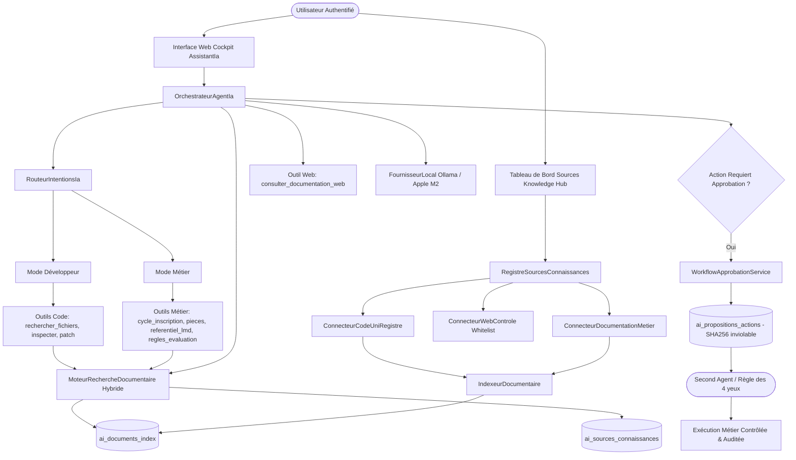

# Architecture & Guide Technique : UniRegistre AI Knowledge Hub

**Projet :** UniRegistre (Système d'Information et de Scolarité Universitaire)  
**Module :** `app/Modules/AssistantIa`  
**Inspiration :** Amazon Q Business (métier académique & scolarité LMD) + Amazon Q Developer (ingénierie logicielle & exploration du code Laravel)  
**Cible Locale Souveraine :** Mac Apple Silicon M2, 8 Go RAM unifiée, Ollama local  
**Statut :** Validé — 130 tests (529 assertions) — Zéro dépendance cloud obligatoire

---

## 1. Vision et Principes Fondamentaux

UniRegistre AI Knowledge Hub fournit un assistant intelligent souverain, local et intégré directement au cœur du système d'information universitaire.

### Principes directeurs :
1. **Souveraineté des données :** Aucune donnée étudiante, CIN, note ou code source ne transite vers une API de LLM externe en mode local cible.
2. **Double mode complémentaire :**
   - **Mode Développeur (Amazon Q Developer) :** Compréhension de l'architecture Laravel, recherche de contrôleurs, services, migrations, diagnostic d'exceptions, inspection de tests.
   - **Mode Métier (Amazon Q Business) :** Réglementation LMD, semestrialisation, crédits ECTS, compensations, cycle d'inscription, pièces justificatives, règles de jury.
3. **Recherche Hybride Vérifiable :** Combinaison de recherche lexicale (symboles exacts, routes, classes) et sémantique avec citations claires (fichier source, ligne, statut, date de consultation).
4. **Approbation Humaine Stricte (Règle des 4 yeux) :** Le modèle n'exécute **jamais** d'action sensible de manière autonome. Toute modification administrative ou technique prépare une proposition cryptographiquement scellée (sha256) soumise à un tiers approbateur.

---

## 2. Diagramme d'Architecture Cible



---

## 3. Guide d'Installation et Configuration Locale Ollama sur Apple Silicon M2

### 3.1. Diagnostic Matériel Apple M2
- **Architecture :** ARM64 Apple Silicon M2
- **Mémoire Unifiée :** 8 Go (partagée GPU/CPU)
- **Espace Disque Requis :** ~10 Go disponibles

### 3.2. Installation d'Ollama
```bash
# Installation directe via Homebrew sur macOS
brew install ollama

# Démarrage du service d'arrière-plan
ollama serve
```

### 3.3. Modèles Recommandés et Téléchargement
En raison de la configuration à 8 Go de mémoire unifiée, les modèles 14B ou non-quantifiés 9B risquent d'entraîner du swapping mémoire vers le SSD. Le dimensionnement optimal validé est :

```bash
# Modèle de raisonnement et de code recommandé (4.7 Go, 4-bit quantization)
ollama pull qwen2.5-coder:7b-instruct-q4_K_M

# Alternative ultra-légère (2.0 Go) pour faible consommation mémoire
ollama pull qwen2.5-coder:3b

# Modèle d'embeddings multilingues pour recherche sémantique (1.2 Go)
ollama pull bge-m3
```

### 3.4. Configuration Laravel (`config/assistant-ia.php`)
Le module est configuré par défaut pour cibler le fournisseur local :
```php
'fournisseur' => env('ASSISTANT_IA_FOURNISSEUR', 'local'),

'fournisseurs' => [
    'local' => [
        'driver' => 'ollama',
        'url' => env('OLLAMA_HOST', 'http://127.0.0.1:11434'),
        'modele' => env('OLLAMA_MODEL', 'qwen2.5-coder:7b-instruct-q4_K_M'),
        'timeout' => 45,
    ],
],
```

---

## 4. Connecteurs du Knowledge Hub

| Connecteur | Source | Périmètres Autorisés | Exclusions Strictes |
|---|---|---|---|
| `ConnecteurCodeUniRegistre` | `project_code` | `app/`, `routes/`, `config/`, `database/migrations/`, `resources/views/`, `tests/` | `.env`, `vendor/`, `node_modules/`, `storage/`, secrets, regex passwords/tokens |
| `ConnecteurDocumentationMetier` | `internal_document`, `business_procedure`, `loop_report` | `docs/`, `docs/regles-metier/`, `docs/architecture/` | Documents obsolètes marqués, données personnelles d'étudiants |
| `ConnecteurWebControle` | `approved_web_source` | Whitelist stricte : `laravel.com`, `php.net`, `dev.mysql.com`, `ollama.com`, `owasp.org` | Adresses privées, `localhost`, SSRF, métadonnées cloud, injection |

---

## 5. Moteur de Recherche Hybride

Le moteur `MoteurRechercheDocumentaire` implémente :
1. **Recherche par symboles exacts :** Boost de pertinence (+50 points) si la requête contient un nom de classe, méthode ou route présent dans l'en-tête de symboles.
2. **Recherche textuelle pondérée :** Match dans le titre (+10) et contenu (+1 par occurrence).
3. **Isolation de sécurité par rôle :** Filtre dynamique `AiDocumentIndex::accessiblePar($user)`.
4. **Exclusion des documents obsolètes :** Les documents annotés `statut_document = 'obsolete'` sont exclus par défaut pour éviter de fournir des règles abrogées.
5. **Citations normalisées :** Chaque fragment retourné comporte le type de source, le chemin relatif, le statut et un extrait pertinent.

---

## 6. Sécurité et Règle des 4 Yeux (Approbation Humaine)

### Classification des Risques :
- **R0 (Lecture publique) :** Règlements généraux, structure LMD, documentation officielle.
- **R1 (Lecture interne) :** Exploration du code source, routes, métriques (`assistant_ia.mode_developpeur`).
- **R2 (Proposition) :** Préparation de patch ou d'action de scolarité (`assistant_ia.action_proposer`).
- **R3 (Action sensible) :** Modification de statut de dossier, délibération de jury.

### Mécanisme de validation 4-yeux :
1. L'assistant formule un `ResultatOutil::requiertApprobation(...)`.
2. Le `WorkflowApprobationService` persiste la proposition avec une empreinte cryptographique inviolable :
   $$\text{SHA256}(\text{type\_action} + \text{ressource} + \text{parametres})$$
3. **Interdiction absolue d'auto-approbation :** L'utilisateur ayant initié la proposition ne peut pas l'approuver.
4. **Protection anti-altération :** Si le payload en base est modifié sans recalcul d'empreinte, l'approbation échoue immédiatement.
5. **Délai de caducité :** Les propositions expirent après 60 minutes.

---

## 7. Tableau de Bord d'Administration (`/admin/assistant-ia/sources`)

L'interface réservée aux administrateurs (`assistant_ia.admin` ou `super_admin`) permet de :
- Visualiser toutes les sources de connaissance enregistrées.
- Vérifier le statut de chaque source (`actif`, `suspendu`, `erreur`).
- Consulter le diagnostic matériel Apple Silicon M2 (RAM disponible, espace disque, statut serveur Ollama).
- Déclencher la synchronisation incrémentale manuelle.
- Suspendre ou réactiver une source en un clic.
- Contrôler le nombre de fragments indexés et les documents obsolètes écartés.

---

## 8. Benchmark de Validation (15 Scénarios Automatisés)

Le benchmark synthétique officiel (`BenchmarkValidationKnowledgeHubTest.php`) certifie les 15 exigences fondamentales :
- **Scénario 01 (Routes & Contrôleurs) :** PASS
- **Scénario 02 (Services Métier) :** PASS
- **Scénario 03 (Inspection des Tests) :** PASS
- **Scénario 04 (Cycle d'Inscription) :** PASS
- **Scénario 05 (Pièces Manquantes & Catalogue) :** PASS
- **Scénario 06 (Référentiel LMD & ECTS) :** PASS
- **Scénario 07 (Examens & Délibérations) :** PASS
- **Scénario 08 (Recherche Web Whitelistée) :** PASS
- **Scénario 09 (Réponse Absente Non-Inventée) :** PASS
- **Scénario 10 (Exclusion Documents Obsolètes) :** PASS
- **Scénario 11 (Tentative Accès Traversal Rejetée) :** PASS
- **Scénario 12 (Détection et Rejet des Secrets) :** PASS
- **Scénario 13 (Barrière Anti-Injection de Prompt) :** PASS
- **Scénario 14 (Refus d'Action sans Droit - 403) :** PASS
- **Scénario 15 (Interdiction d'Auto-Approbation - 4 Yeux) :** PASS

---

## 9. Limites Connues et Recommandations
1. **Ollama local en arrière-plan :** Sur les postes de développement, s'assurer que `ollama serve` est actif sur le port 11434 avant de solliciter le modèle génératif. En cas d'indisponibilité, le système bascule gracieusement en mode dégradé avec message clair (fail-soft).
2. **Quota mémoire Apple M2 :** Ne pas charger simultanément un modèle 14B et un modèle d'embeddings lourd. Préférer `qwen2.5-coder:7b-instruct-q4_K_M`.
3. **Indexation initiale :** La première synchronisation complète du code (`app/`, `routes/`, `docs/`) peut prendre 10 à 20 secondes ; les synchronisations suivantes sont instantanées grâce au hachage différentiel sha256.
