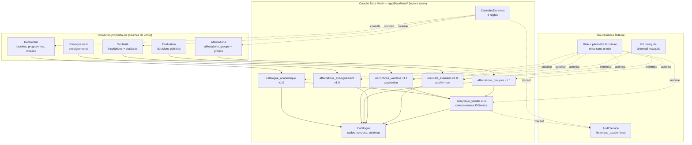
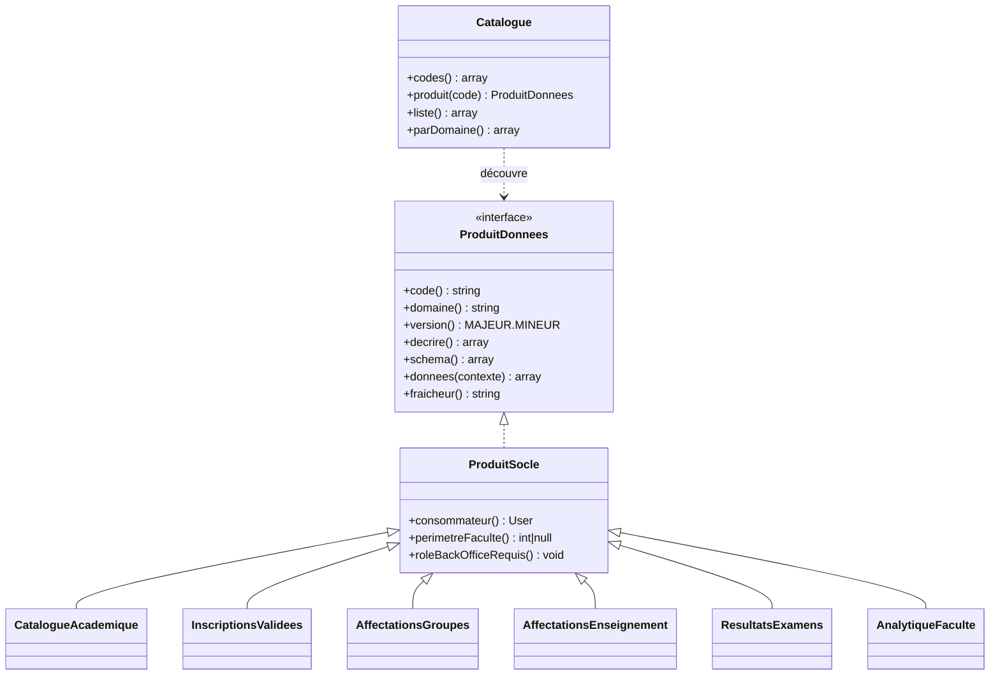
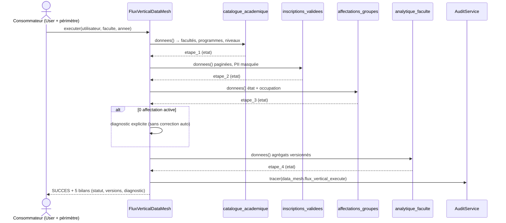
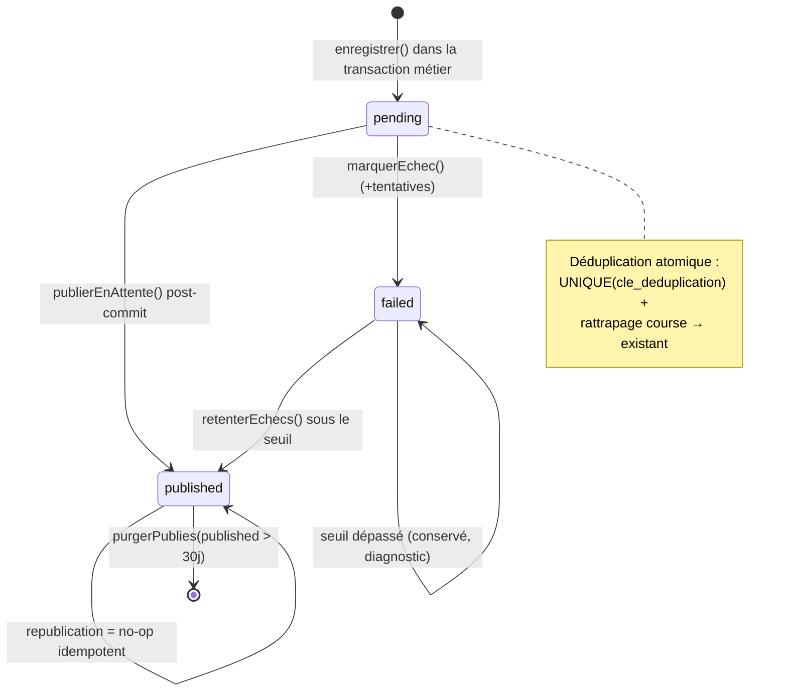
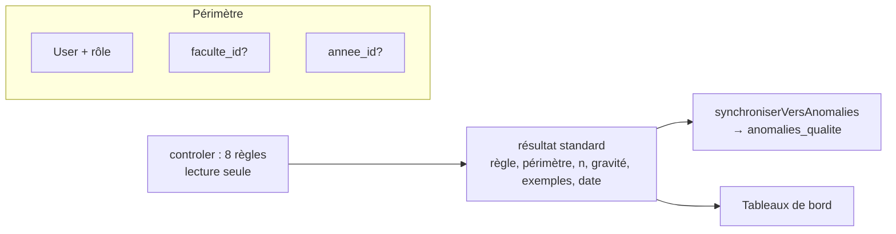
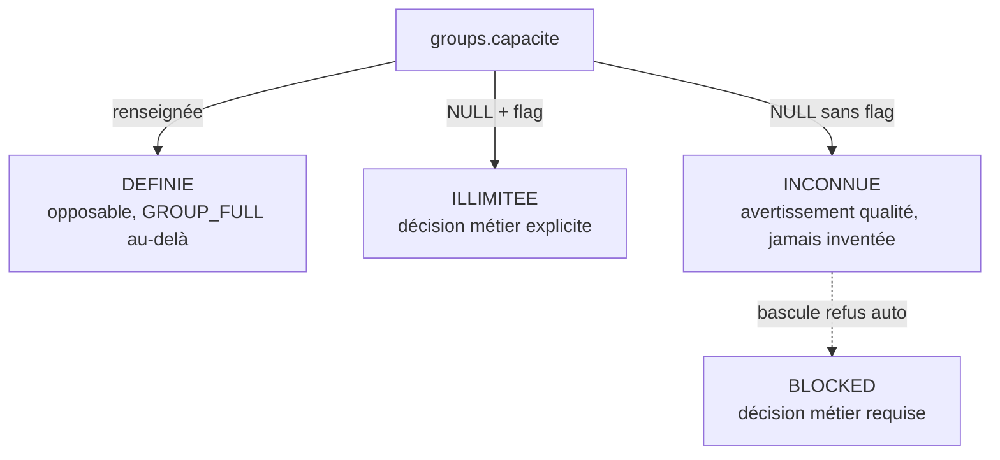

# Data Mesh — Diagrammes d'architecture

Rendu : Markdown + Mermaid (GitHub, GitLab, VS Code). Source de vérité : `app/DataMesh/`.

## 1. Architecture globale

## 2. Contrat produit (`ProduitDonnees`)

Règle de compatibilité : ajout de champ = MINEUR (ex. v1.0 → v1.1 pagination) ; retrait/renommage = MAJEUR.

## 3. Flux vertical (`FluxVerticalDataMesh::executer`)

Chaque étape expose `etat` : `terminee` | `terminee_sans_resultat` (jamais de succès masqué).

## 4. Outbox transactionnelle (cycle de vie)

Commande planifiée : `datamesh:outbox-publier [--limite=50] [--retenter] [--purge-jours=30]`.
Garantie : **au-moins-une-fois + consommation idempotente** (jamais d'exactement-une-fois revendiqué).

## 5. Qualité des données (`ControlesDonnees::controler`)

| Règle | Gravité |
|---|---|
| doublons_affectations, groupes_surcharges, affectations_incompatibles, inscriptions_sans_niveau, inscriptions_sans_programme, references_lmd_incoherentes | bloquant |
| capacites_inconnues, incoherences_effectifs_agregats | avertissement |
| fraicheur_produits_depassee | info |

Principe : signalement uniquement, **aucune correction automatique** des données ambiguës.

## 6. Capacités des groupes (triptyque)

`Group::modeCapacite()` expose l'état ; le moteur conserve son comportement historique tant que la bascule n'est pas validée.
