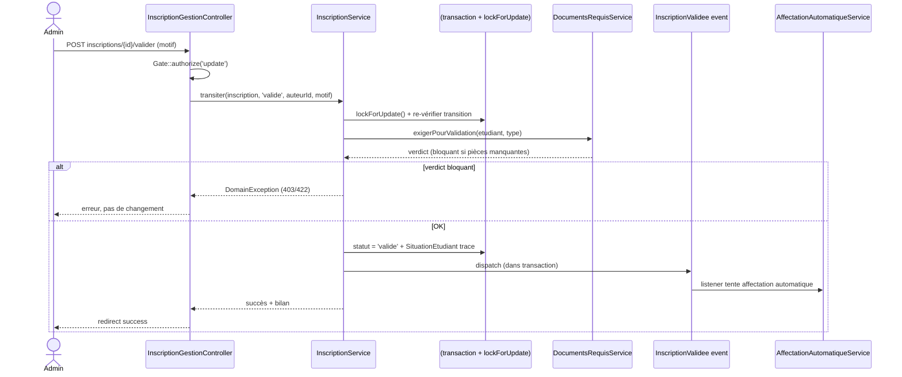
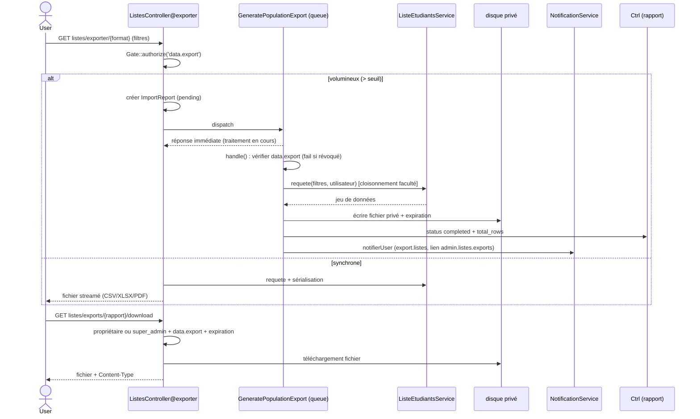

# Knowledge Base – UniRegistre

## 1. Vue d’ensemble

**Description courte.** UniRegistre est une plateforme de gestion académique (inscriptions, scolarité, évaluations, emplois du temps, documents, paiements) à destination des administrateurs, enseignants et étudiants. C’est un monolithe Laravel fullstack avec une API REST, trois portails (back-office admin, enseignant, étudiant) et des fonctionnalités d’IA (assistant Knowledge Hub) et de Data Mesh.

**Stack technique.**
- Backend : PHP 8.5.11, Laravel Framework 13.33.0
- Base de données : MySQL en développement, SQLite en mémoire pour les tests (`RefreshDatabase`)
- Frontend : Blade, Tailwind CSS, Alpine.js, Livewire, Vite
- Auth : Laravel Sanctum (tokens API), sessions web, double facteur (MFA), rôles/permissions RBAC via `app/Support/Permissions.php`
- Filesystem/Jobs : files privés, queues, notifications
- Tests : PHPUnit, `RefreshDatabase`, `Storage::fake()`

**Architecture globale.**
- Monolithe modulaire : cœur dans `app/Http/Controllers/Admin/`, `app/Services/`, `app/Models/` ; domaines métier isolés sous `app/Modules/*` (Evaluation, Tasks, Finances, StudentDossiers, StudentArchive, Schedule, Referentiel, ParcoursAcademique, Enseignement, Attendance, Calendar, Sentinel, Versioning, Announcements, OnlineRequests, DataExchange, AiAssistant, AssistantIa).
- Couches : routes → contrôleurs → services → modèles ; policies/gates pour l’autorisation ; événements/listeners/jobs pour l’asynchrone.
- Trois portails : `admin.*` (back-office), `enseignant.*`, `etudiant.*` ; API `api/v1.*`.
- 952 routes recensées (voir `docs/engineering/INVENTAIRE_TACHES_ET_URLS.md`).

## 2. Structure du projet

```
app/
├── Http/
│   ├── Controllers/
│   │   ├── Admin/          # Contrôleurs back-office (Listes, InscriptionGestion, FileTraitement, Cockpit, CentreTravail…)
│   │   ├── Api/V1/         # Contrôleurs API REST (students, exports, imports, referentiel, registrations…)
│   │   ├── Enseignant/     # Contrôleurs portail enseignant
│   │   └── Etudiant/       # Contrôleurs portail étudiant
│   ├── Middleware/         # EnsureBackOffice, EnsureTeacher, EnsureStudent, MFA, sécurité
│   ├── Requests/           # Form requests de validation
│   └── Kernel.php
├── Models/                 # Modèles Eloquent transversaux (Etudiant, InscriptionAcademique, Note, Faculte, Groupe, User, ImportReport, Task…)
├── Modules/*/              # Domaines métier (Evaluation, Tasks, Finances, StudentDossiers, …)
│   ├── Controllers/
│   ├── Models/
│   ├── Services/
│   ├── Policies/
│   ├── Routes/web.php
│   └── Events/, Listeners/, Jobs/
├── Services/               # Services cœur (InscriptionService, FileTraitementService, ListeEtudiantsService, DataExchange, Exports…)
├── Policies/               # Policies d’autorisation (InscriptionAcademiquePolicy, EtudiantPolicy…)
├── Support/                # Permissions, NavigationDestination, SaisieIdentification…
├── Providers/              # AppServiceProvider, ModuleServiceProvider
├── Jobs/                   # Jobs asynchrones (GeneratePopulationExport…)
├── Listeners/              # Listeners d’événements
├── Events/
├── DataMesh/               # Observabilité / outbox
└── Exceptions/

bootstrap/                  # app.php, providers.php
config/                     # modules.php, integrations.php, student-dossiers.php, ai-assistant.php, assistant-ia.php, retention.php, security.php, datamesh_observabilite.php…
database/
├── migrations/             # Schéma (additives, jamais de migrate:fresh en prod)
├── seeders/
└── factories/
public/
resources/
│   ├── css/, js/           # Vite, Tailwind, Alpine, Livewire
│   ├── views/
│   │   ├── admin/          # Vues back-office
│   │   ├── enseignant/     # Vues portail enseignant
│   │   ├── etudiant/       # Vues portail étudiant
│   │   ├── components/     # Composants Blade réutilisables
│   │   └── modules/*/      # Vues des modules métiers
└── layouts/
routes/
│   ├── web.php             # Routes admin / enseignant / etudiant / inscription
│   └── api.php             # Routes API v1
tests/
│   ├── Feature/            # Tests fonctionnels par domaine
│   └── Unit/
```

**Conventions de nommage.**
- Routes : `admin.*.*`, `enseignant.*`, `etudiant.*`, `api.v1.*`.
- Contrôleurs : suffixe `Controller`, namespace `App\Http\Controllers\Admin\`, `App\Modules\*\Controllers\`.
- Modèles : `app/Models/` (transversaux) et `app/Modules/*/Models/` (domaine).
- Services : `app/Services/` (cœur) et `app/Modules/*/Services/` (domaine).

## 3. Modèle de données (entités clés)

Le schéma est défini par les migrations sous `database/migrations/` (additives uniquement, aucun `migrate:fresh` en production). Les modèles Eloquent résident dans `app/Models/` (transversaux) et `app/Modules/*/Models/` (domaine).

### Etudiant (`app/Models/Etudiant.php`)
- **Champs clés** : `cin`, `nom`, `prenom`, `email`, `telephone`, `date_naissance`, `sexe`, `faculte_id`, `groupe_id`, `niveau`, `annee_academique`, `statut`, `adresse`, `ville`, `code_postal`, `annee_bac`, `password`, `matricule_ou_cin`.
- **Relations** : `inscriptionsAcademiques()`, `inscriptionAcademique()`, `dossiers`, `candidats()`, `notes()`.
- **Règles** : un étudiant a un dossier longitudinal ; plusieurs inscriptions académiques (une par année).

### InscriptionAcademique (`app/Models/InscriptionAcademique.php`)
- **Champs clés** : `etudiant_id`, `annee_universitaire_id`, `programme_id`, `niveau`, `statut` (`en_attente`, `valide`, `rejete`, `abandon`), `type` (`premiere`, `reinscription`), `date_depot`.
- **Relations** : `etudiant()`, `anneeUniversitaire()`, `programme()`.
- **Transitions** (`InscriptionAcademique::TRANSITIONS`) : `en_cours` → `{valide, ajourne, abandon}` ; `valide`, `ajourne`, `abandon` sont terminaux.
- **Règle** : contrainte SQL `uniq_inscription_etudiant_annee` sur `(etudiant_id, annee_universitaire_id)`.

### Note / NoteEpreuve
- **Note** (`app/Models/Note.php`) : note officielle centrale (`note`, `coefficient`, `inscription_academique_id`, `matiere_id`, `session`). Synchronisée à la validation d’une `NoteEpreuve`.
- **NoteEpreuve** (`app/Modules/Evaluation/Models/NoteEpreuve.php`) : table `evaluation_notes` (`epreuve_id`, `etudiant_id`, `valeur`, `note_max`, `coefficient`, `statut`, `saisi_par`, `valide_par`, `verrouillee_at`).
- **Statuts NoteEpreuve** : `draft`, `entered`, `submitted`, `validated`, `locked`, `correction_demandee`.
- **Règle F-01** : modifier une note `validated` la repasse en `entered` (`valide_par = null`) — revalidation exigée.
- **Règle F-02** : absent sans valeur ne crée pas d’enregistrement fantôme.
- **Historique** : `NoteEpreuveHistorique` (`ancienne_valeur`, `nouvelle_valeur`, `motif`, `auteur_id`, `created_at`).

### Faculte / Programme / Matiere / Niveau / Groupe / SousGroupe
- **Faculte** : `id`, `nom`, `code`, `description`, `active`.
- **Programme** : `code`, `nom`, `niveau`, `semestre`, `credits`, `faculte_id`.
- **Matiere** : `code`, `nom`, `niveau`, `semestre`, `credits`, `programme_id`.
- **Groupe** : `code`, `nom`, `faculte_id`, `niveau`, `capacite`, `actif`.
- **SousGroupe** : rattaché à un Groupe.

### Examen / Epreuve / SessionExamen / Candidat
- **SessionExamen** : `annee_universitaire_id`, `code`, `nom`, `type`, `date_debut`, `date_fin`, `statut` (`open`, `ongoing`, `closed`, `archived`).
- **Examen** : `session_id`, `libelle`, `type`, `statut` (`scheduled`, `published`, `ongoing`, `completed`, `locked`, `cancelled`, `archived`).
- **Epreuve** : `examen_id`, `matiere_id`, `groupe_id`, `salle_id`, `date`, `heure_debut`, `heure_fin`, `statut`.
- **Candidat** : `epreuve_id`, `etudiant_id`, `statut` (`present`, …).

### User / Authentification
- **User** (`app/Models/User.php`) : `name`, `email`, `password`, `faculte_id`, `actif`, `role`.
- **Rôles** (`app/Support/Permissions.php`) : `super_admin`, `admin_scolarite`, `agent_scolarite`, `consultation`, `admin_faculte`, … Permissions ex. `data.export`, `exports.personal`, `archives.view/update/delete`, `notes_eval.*`, `deliberations.*`, `tasks.*`, `qualite.*`.
- **Gate** : chaque permission définie dans `AppServiceProvider` via `Gate::define($permission, fn ($user) => $user->hasPermission($permission))`.

### Import / Export
- **ImportReport** : `user_id`, `integration`, `direction`, `type`, `format`, `status` (`pending`, `processing`, `completed`, `failed`, `expired`), `file_path`, `expires_at`, `preview` (filtres/colonnes), `total_rows`.
- **ExportJob / ExportTemplate** : profils d’export (filtres, colonnes, format, titre).
- **Règle** : téléchargement réservé au propriétaire ou `super_admin` + permission `data.export` ; expiration + purge (`estExpire()`).

### Tasks (Centre de travail)
- **Task** : `cle_unique` (une source = une tâche active), `titre`, `description`, `source`, `priorite` (`critical`/`high`/`normal`), `statut`, `echeance_a`, `lien`, `data`, `faculte_id`, `assigne_a`.
- **TaskGenerationService** : génération idempotente depuis inscriptions, demandes SLA, justifications, délibérations, épreuves, sans-groupe, factures.
- **Priorités** : `critical` si période officielle expire < 48h ; `high` si blocage métier ou attente ≥ 7j ; `normal` sinon.
- **Règle** : une tâche devient obsolète si le dossier source change ; jamais de validation implicite.

### Autres entités notables
- `AnneeUniversitaire` (`libelle`, `date_debut`, `date_fin`, `active`).
- `RegistrationPeriod` (périodes d’inscription, `closed_at`).
- `Deliberation` / `DecisionDeliberation` (`publie`, snapshot immuable, `resultats_invalides_le` si correction).
- `DocumentAcademique` / `GeneratedDocument` / `DocumentTemplate` (génération documentaire, téléchargement verrouillé hors publication).
- `CampagneCourriel` / `Courriel` (envois, files, tentatives).
- `AffectationGroupe` / `AffectationMasseLot` / `AffectationProposal` (affectations étudiants ↔ groupes).
- `CampagneCourrielDestinataire`, `Notification`, `AppNotification`.
- `IntegrationLog`, `DocumentEvent`, `DocumentNumberingSequence` (Data Mesh / traçabilité).

## 4. API / Endpoints

952 routes recensées (détail complet : `docs/engineering/INVENTAIRE_TACHES_ET_URLS.md`). Les routes sont regroupées en trois portails + API. L’authentification est assurée par `auth` + `admin` (rôle back-office) + `mfa.obligatoire` + `secondaire.verrou` pour l’admin ; `enseignant.auth` pour l’enseignant ; sessions web pour l’étudiant ; Sanctum pour l’API v1.

### 4.1 Back-office Admin (`admin.*`, groupe `['auth', 'admin', 'mfa.obligatoire', 'secondaire.verrou]`)

| Domaine | Routes principales | Méthodes | Notes |
|---------|-------------------|----------|-------|
| Listes & impression | `admin.listes.index`, `preview`, `exports`, `exports.download`, `exporter/{format}`, `imprimer`, `profils.store/destroy` | GET / POST / DELETE | `imprimer` exige `data.export` ; `exporter` exige `data.export` ; téléchargement propriétaire + `data.export` |
| Inscriptions | `inscriptions/{id}/valider`, `/rejeter`, `/reinscrire`, `/progresser`, `/reaffecter`, `/attestation`, `/verification`, `/ecues` | POST / GET | `valider` = `transiter('valide')` + pieces obligatoires + verrou ; `rejeter` = motif requis |
| Étudiants | `etudiants.index/show/update/destroy`, `/{id}/archive`, `/{id}/verification`, `/{id}/statut`, `/{id}/suspendre` | GET / POST / PATCH / DELETE | Périmètre faculté (`peutAccederFaculte`) |
| Groupes | `groupes.index/show/etudiants/sous-groupes`, `/{id}/update/destroy` | GET / POST / PUT / DELETE | |
| Examens & Évaluations | `evaluations/epreuves/*`, `notes/*`, `deliberations/*`, `sessions/*`, `surveillances/*`, `types`, `regles`, `planning`, `affectations/*` | GET / POST / PUT / DELETE | `notes.valider` / `valider-tout` ; `deliberations.preparer/valider/publier` ; `epreuves.verrouiller` |
| Emploi du temps | `emplois-du-temps/*`, `creneaux/*`, `generation`, `equilibrage/*`, `indisponibilites/*` | GET / POST / PATCH / DELETE | |
| Finances | `finances.factures/*`, `paiements-inscriptions/*`, `tarifs/*`, `recus/*/apercu|telecharger` | GET / POST / PATCH | |
| Présences | `presences.index/store`, `feuille/*`, `modeles/*`, `regularisations/*`, `qr/scanner` | GET / POST / DELETE | |
| Documents & archives | `archives.*`, `documents-center/{document}/approuver|emettre|envoyer|imprimer|revoquer|telecharger`, `lots/*` | GET / POST | Téléchargement verrouillé si délibération non publiée |
| Centre de travail | `centre-travail.index/show`, `/{inscription}/valider|rejeter|corrections/decider`, `actions-groupees` | GET / POST | File de tâches inscriptions |
| Tâches | `taches.index/show`, `/{tache}/assigner|transiter/{cible}`, `actions-groupees` | GET / POST | `tasks.view/update/assign/complete` |
| Qualité | `qualite.index`, `/{anomalie}/assigner|transiter` | GET / POST | Détection anomalies |
| Référentiel | `referentiel/ecues/*`, `maquettes/*`, `entites/*`, `prevalidation/*`, `tableau-bord`, `pilotage` | GET / POST / PUT / DELETE | |
| Périodes | `periodes.index/store`, `/{periode}/prolonger|revoquer`, `etat` | GET / POST | |
| Qualité / Annonces / Courriels | `qualite/*`, `annonces/*`, `courriels/*`, `campagnes/*`, `smtp/*` | GET / POST / PATCH | |
| Sauvegardes / Système | `system/backups/*`, `systeme`, `maintenance/*` | GET / POST | |
| Utilisateurs / Rôles / MFA | `administrateurs/*`, `personnel/*`, `roles/*`, `double-facteur/*`, `smtp/*` | GET / POST / PUT / DELETE | `archives.*`, `mfa.*` |

### 4.2 Espace Enseignant (`enseignant.*`, middleware `enseignant.auth` + `module:evaluation`)

| Domaine | Routes principales | Notes |
|---------|-------------------|-------|
| Notes | `enseignant/notes`, `notes/{epreuve}/saisie|store|import|exporter`, `/{epreuve}/emargement` | Saisie anonyme (compostage résolu serveur), pas de validation |
| Épreuves | `enseignant/epreuves/{id}`, `/{id}/emargement`, `/{id}/incidents` | Consultation + signalement incidents |
| Présences | `enseignant/presences`, `export-csv`, `/{id}` | |
| Appel | `enseignant/appel/selection`, `appel/ouvrir/{slot}`, `/{appel}/cloturer|corriger|enregistrer|export|qr/{etudiant}` | |
| Réclamations | `enseignant/reclamations/*` | Créer, cloturer, pièce jointe |
| Ressources | `enseignant/ressources/*` | Créer, publier, archiver, télécharger |
| Profil | `enseignant/profil.*` | Mot de passe, modification |

### 4.3 Espace Étudiant (`etudiant.*`, sessions web)

| Domaine | Routes principales | Notes |
|---------|-------------------|-------|
| Dossier | `etudiant/dossier.show`, `dossier/documents/*`, `dossier/pdf/*` (generer|preview|print|download|fichier) | PDF verrouillé si délibération non publiée |
| Notes | `etudiant/notes`, `historique`, `parcours`, `parcours.pdf` | Consultation notes publiées uniquement |
| Examens | `etudiant/examens`, `/{candidat}/convocation` | |
| Inscriptions | `etudiant/inscriptions.index`, `suivi` | |
| Paiements | `etudiant/paiements`, `inscriptions/{id}/recus/*` | Aperçu / téléchargement reçus |
| Demandes | `etudiant/demandes/*` (nouvelle|show|annuler|messages|pieces|soumettre) | |
| Rendez-vous | `etudiant/rendez-vous/*` | Créer, annuler, déplacer |
| Profil / Auth | `etudiant/profil.*`, `etudiant/mot-de-passe/*`, `etudiant/connexion.*`, `etudiant/recepisse` | |

### 4.4 API REST (`api/v1.*`, Sanctum)

| Domaine | Routes principales | Notes |
|---------|-------------------|-------|
| Étudiants | `api/v1/students`, `/{student}`, `/{student}/grades|documents|results|timeline|verification|parcours*|registration-period|reenrollment-context|academic-progression|academic-record` | GET |
| Inscriptions | `api/v1/registrations`, `/{registration}`, `/reenroll/{student}` | GET / POST |
| Exports / Imports | `api/v1/exports`, `/{report}/download`, `api/v1/imports`, `/{report}/confirm`, `import-templates/*` | POST / GET |
| Referentiel | `api/v1/referentiel/maquettes|matieres|niveaux|programmes|semestres|ues` | GET |
| Schedules | `api/v1/schedules/import/preview|confirm` | POST |
| Assignments | `api/v1/assignments/simulate`, `simulations/*`, `groups/{groupe}/confirm`, `students/{student}` | POST / GET |
| Version / Health | `api/v1/version*`, `api/v1/health`, `api/v1/ready` | GET |
| Webhooks | `api/v1/webhooks/external-system` | POST |

### 4.5 Points d’attention
- `admin.listes.imprimer` : requête directe refusée (403) sans `data.export` (défaut corrigé).
- `admin/document-center/{document}/telecharger` : 403 si délibération non publiée.
- `admin/evaluations/notes/{note}/valider` : échoue si délibération invalidée (`resultats_invalides_le`).
- Imports : prévisualisation (`preview`) obligatoire avant confirmation (`confirm`) ; mode `creer`/`upsert`/`remplacer` selon définition ; anti-rejeu par token.

## 5. Services & Logique métier

### 5.1 Services cœur (`app/Services/`)

| Service | Responsabilité | Dépendances clés |
|---------|---------------|------------------|
| `InscriptionService` | Transitions d’inscription (`transiter` : `en_cours → valide/ajourne/abandon`), pièces obligatoires, verdict bloquant, verrou `lockForUpdate`, trace `SituationEtudiant`, événement `InscriptionValidee`. | `DocumentsRequisService`, `AffectationAutomatiqueService`, `NotificationService` |
| `FileTraitementService` | File de traitement inscriptions : `ACTIONS_ATTENDUES`, `CATEGORIES_FILE`, `PROCHAINES_ACTIONS`, détermination de l’action attendue, filtres, cloisonnement faculté. | `ListeEtudiantsService` |
| `ListeEtudiantsService` | Moteur central de listes : `requete()` (cloisonnement faculté), `jeuDonnees()` (masquage CIN/e-mail/telephone selon `exports.personal`), `sectionsRegroupees()`, filtres, tris. | `ExportColumnPolicy` |
| `ExportColumnPolicy` | Politique colonnes : catalogues, masquage CIN (`masquerCin`), retrait email/téléphone sans `exports.personal`. | — |
| `ExportOrchestrator` / `IoFactory` | Sérialisation CSV/XLSX/PDF, téléchargement (`telecharger`), expiration, purge. | `Storage` disque privé |
| `AcademicProgressionService` / `AcademicCalculationService` | Calcul des moyennes semestrielles/annuelles, progression académique. | `Note` |
| `DocumentsRequisService` | Exigence des pièces obligatoires à la validation (`exigerPourValidation`). | — |
| `PeriodeInscriptionService` | Évaluation des périodes d’inscription, échéance (`closed_at`). | `RegistrationPeriod` |
| `CommunicationDispatcher` / `CourrielService` | Envoi d’emails, files, tentatives, gabarits. | `SmtpConfiguration` |
| `BackupService` | Sauvegardes, restauration, planification. | — |

### 5.2 Services de domaine (`app/Modules/*/Services/`)

| Service | Module | Responsabilité |
|---------|--------|---------------|
| `SaisieNoteService` | Evaluation | `saisirLot()` (transactions, verrous, upsert par chunk, N+1 éliminé), `valider()` (resynchronise `Note`), `validerTout()`, `verrouiller()`, `demanderCorrection()`, `autoriserCorrection()`, `saisirLotParCompostages()`. |
| `DeliberationService` | Evaluation | `preparer()` (snapshot immuable `evaluation_decisions`, `publie=false`), `simuler()`, `decider()` (concurrence optimiste `updatedAt`), `valider()`, `publier()`, `marquerResultatsInvalides()` (blocke revalidation si correction de note). |
| `CalculEvaluationService` / `GradeCheckSuite` | Evaluation | Anomalies de délibération : `note_hors_bornes`, `coefficient_nul`, `candidat_sans_note`, `moyenne_epreuve_anormale`, `ecart_session` (non bloquantes sauf `note_non_validee`/`sans_note`). |
| `TaskGenerationService` | Tasks | Génération idempotente des tâches (`cle_unique`), priorités, clôture des résolues (`cloturerResolues`). |
| `TaskService` | Tasks | `synchroniser()`, `actionGroupee()`, index/tri/périmètre faculté. |
| `DataImportService` | DataExchange | `confirmer()` (revalidation anti-TOCTOU, revue incomplète, mode créer/upsert/remplacer), `mettreEnFile()` (job idempotent), `detecterMimeReel()` (finfo). |
| `EvaluationWorkflowService` | Evaluation | Transitions `soumettre` des notes d’épreuve. |
| `EvaluationQualityService` | Evaluation | Détection d’anomalies qualité. |
| `EvaluationDocumentBatchService` | Evaluation | Génération documentaire groupée. |
| `EvaluationAuditService` | Evaluation | Audit des modifications. |
| `ScheduleGenerationService` / `ScheduleConstraintRegistry` / … | Schedule | Moteur génération emploi du temps, contraintes, scénarios, versions, optimisation, réparation. |
| `EligibiliteParcoursService` / `ExperienceInscriptionService` | ParcoursAcademique | Parcours, simulations, risque. |
| `DossierComplementService` / `DossierExistantService` | (divers) | Compléments de dossier, dossiers existants. |
| `ScheduleAuditReport` / `ScheduleBenchmarkService` | Schedule | Rapports d’audit, benchmarks. |

### 5.3 Règles métier critiques
- **F-01** : note `validated` modifiée → repasse en `entered`, `valide_par = null`, revalidation requise.
- **F-02** : absent sans valeur → aucun enregistrement fantôme.
- **F-03 / D-03** : pas de dé-publication automatique après délibération publiée (décision institutionnelle).
- **F-04** : verrous pessimistes `lockForUpdate()` sur inscription, notes d’épreuve, notes officielles (anti-course).
- **F-05** : portail étudiant n’affiche que les inscriptions avec décision publiée + note officielle.
- **F-06** : téléchargement relevé refusé (403) si délibération non publiée.
- **F-07** : périmètre faculté = faculté épreuve ET faculté étudiant.
- **F-08** : import < 50 requêtes pour 1 000 lignes (préchargement mémoire, upsert par chunk).
- **F-09** : MIME strict, limite 2 000 lignes, délimiteur auto, rejet doublons compostage.
- **F-10** : auteur de saisie tracé (`saisi_par`, `NoteEpreuveHistorique`), pas de PII dans logs.
- **F-11** : navigation clavier, état de sauvegarde (4 états), `beforeunload`, hors-barème détecté immédiatement.
- **F-12** : notes verrouillées → message flash explicite, pas ignorées silencieusement.
- **D-01..D-06** : décisions institutionnelles en attente (seuil absence, dispenses, dé-publication, alignement live/snapshot, relevés provisoires, annulation note validée).

### 5.4 Flux important : validation d’inscription
`InscriptionGestionController@valider` → `Gate::authorize('update')` → `InscriptionService::transiter('valide')` → `DB::transaction` + `lockForUpdate` → re-vérification transition → `DocumentsRequisService::exigerPourValidation` → verdict moteur (bloquant si échec) → `SituationEtudiant` trace → événement `InscriptionValidee` (dans la transaction) → listener synchrone tente affectation automatique → retour `success` + bilan.

### 5.5 Flux important : génération d’export différé
`ListesController@exporter` → `Gate::authorize('data.export')` → si volumineux (`> SEUIL_ASYNC`) : `ImportReport` (status `pending`) + `GeneratePopulationExport::dispatch` → job `handle` : vérifie `data.export` au moment de l’exécution (fail si révoqué/désactivé/introuvable) → `ListeEtudiantsService::requete()` (filtres + cloisonnement) → sérialisation → fichier disque privé + expiration → notification `export.listes` → `telechargerExport` (propriétaire/super_admin + `data.export` + expiration).

## 6. Authentification & Autorisation

### 6.1 Mécanismes
- **Web (admin / enseignant / etudiant)** : sessions Laravel + middlewares `auth`, `admin` (`EnsureBackOffice` : rôle valide, compte actif, faculté pour `admin_faculte`), `mfa.obligatoire`, `secondaire.verrou`.
- **API v1** : Sanctum tokens avec scopes restreints ; webhooks HMAC + timestamp anti-replay.
- **Double facteur (MFA)** : `MfaController`, codes de secours, vérification.
- **Portails** : `enseignant.auth` (résolution `teacher_id` depuis la session uniquement, anti-IDOR) ; pas de route d’attribution/transition/paramétrage côté enseignant.

### 6.2 Rôles et permissions (`app/Support/Permissions.php`)
Permissions définies via `Gate::define()` dans `AppServiceProvider` (`$user->hasPermission()`).
- `data.export`, `exports.personal` : exports de listes (CIN masquée / email-téléphone retirés sans `exports.personal`).
- `archives.view/create/update/delete` : dossiers étudiants.
- `notes_eval.view/enter/update/validate/lock/correct/import/export` : saisie et validation des notes.
- `deliberations.view/prepare/manage/validate/publish` : délibérations.
- `tasks.view/create/update/assign/complete/cancel` : centre de travail (permissions graduées par action dans `TaskController::actionGroupee`).
- `qualite.view/manage` : centre qualité anomalies.
- `epreuves.*`, `sessions_examen.*`, `surveillances.*` : évaluations.
- `groupes.*`, `salles.*`, `enseignants.*` : référentiel.

### 6.3 Rôles par défaut (extrait)
- `super_admin` : toutes permissions.
- `admin_scolarite` : `data.export` + `exports.personal` + `archives.*` + `tasks.*` (assign inclus).
- `agent_scolarite` : `data.export` (pas `exports.personal`) + `tasks.view/update` (pas assign).
- `consultation` : lecture seule, ni `data.export` ni `exports.personal`.
- `admin_faculte` : `data.export` + `exports.personal` + périmètre restreint à sa faculté (`faculteRestreinteId()`).

### 6.4 Vérifications côté serveur (pas d’UI-only)
- `Gate::authorize()` / `abort_unless($user->can('data.export'), 403)` sur `imprimer`, `exporter`, `exports`, `telechargerExport`.
- `abort_if($tache->faculte_id ... && !peutAccederFaculte, 404)` (anti-énumération faculté).
- `Gate::authorize($ability, $tache)` par tâche dans `transiter`/`assigner` (`complete` vs `update` vs `assign`).
- Propriété du rapport d’export (`user_id === auth()->id()` ou `super_admin`).
- CSRF sur les formulaires web ; validation serveur (jamais confiance au navigateur).

## 7. Flux métier importants

### 7.1 Validation d’une inscription (séquence)


### 7.2 Export différé de listes (séquence)


### 7.3 Saisie et validation de notes d’épreuve (séquence)
```mermaid
sequenceDiagram
    actor Enseignant
    participant Ctrl as NoteEpreuveController
    participant Svc as SaisieNoteService
    participant DB as transaction
    participant Hist as NoteEpreuveHistorique

    Enseignant->>Ctrl: POST epreuves/{id}/notes (lot)
    Ctrl->>Ctrl: Gate::authorize('notes_eval.enter') + épreuve non verrouillée
    Ctrl->>Svc: saisirLot(epreuve, lignes, auteurId)
    Svc->>DB: lockForUpdate() épreuve + notes existantes
    Svc->>DB: upsert / insert par chunk (valeur, statut, saisi_par)
    Svc->>Hist: trace ancienne/nouvelle valeur + motif + auteur
    Svc-->>Ctrl: résultat (saisies, erreurs par ligne)
    Ctrl-->>Enseignant: succès / erreurs granulaires

    Enseignant->>Ctrl: POST notes/{id}/valider (validateurId, motif)
    Ctrl->>Ctrl: Gate::authorize('validerNote')
    Ctrl->>Svc: valider(note, validateurId, motif)
    Svc->>DB: statut = 'validated', valide_par = validateurId
    Svc->>Svc: resynchroniserNoteOfficielle() (table Note cœur)
    Svc-->>Ctrl: succès
    Ctrl-->>Enseignant: "Note validée et synchronisée"

## 8. Conventions & Best practices du projet

### 8.1 Conventions de code (francophone)
- **Nommage** : variables, méthodes, commentaires et messages utilisateur en français.
- **Contrôleurs** : namespacés par domaine (`Admin\…`, `Api\V1\…`, `Etudiant\…`, `Enseignant\…`).
- **Pas de duplication** : avant de créer un Modèle/Service/Policy, vérifier l’existant, identifier la responsabilité, vérifier la réutilisabilité, justifier la nouvelle abstraction.
- **Modules** : `config/modules.php` + `ModuleRegistry` + `ModuleServiceProvider`. Nouveau module = dossier `app/Modules/Xxx/` + vues `resources/views/modules/xxx/`. Jamais de colonne ajoutée à une table centrale ni de route dans `routes/web.php` hors convention.
- **Architecture CORE + MODULES** : le cœur ne dépend d’aucun module.

### 8.2 Règles de sécurité
- **OCR fail-soft** : aucun moteur OCR ne lève d’exception vers l’utilisateur ; fallback = saisie manuelle + alertes de vérification.
- **Fichiers d’identité** : temporaires et privés dans `storage/app/private`, supprimés immédiatement après extraction (`finally`), jamais d’archivage dans le dossier étudiant.
- **Validation serveur** : extension + MIME réel (finfo) + image ré-exécutable + taille max ; jamais de confiance navigateur.
- **CSRF** : routes web d’inscription protégées ; API v1 = Sanctum tokens avec scopes restreints ; webhooks HMAC + timestamp anti-replay.
- **Pas de PII dans les logs** : aucune donnée OCR/PII dans les logs ; audit centralisé admin.

### 8.3 Gestion d’erreurs
- Pas d’exception OCR utilisateur (fail-soft).
- Messages d’erreur granulaires par ligne (imports).
- `DomainException` pour les règles métier (transitions interdites, verrou, permission).
- Aucun secret/jeton dans les logs d’audit.

### 8.4 Tests
- Après changement notable : `vendor/bin/pint --dirty`, `php artisan test --compact` ou ciblé (`--filter`).
- OCR/Identity scan : `php artisan test --filter="IdentityScanTest|PpocrEngineTest|TesseractEngineTest|HfVlmOcrEngineTest"`.
- Si comportement métier modifié dans `docs/` : mettre à jour le doc et ajouter/adapter les tests.
- Ne jamais annoncer un test non exécuté.

### 8.5 Performance
- Éviter les N+1 : `with()` eager loading (pas de `cursor()` qui ignore les `with()`), `chunk(1000)` plutôt que `cursor()`.
- Prechargement mémoire pour les imports (O(1) amorti), upsert / insert par chunk.
- Budget : < 50 requêtes pour 1 000 lignes d’import.

## 9. Points d’attention / Pièges connus

- **Arbre de travail avec ~630 entrées WIP / non suivies** : ne pas lancer de suite globale (risques de sessions concurrentes) ; exécuter uniquement les suites ciblées. Tous les fichiers préexistants et non suivis doivent être préservés.
- **Pas de commit, push, migration par défaut, opération destructive ni suppression de données historiques.**
- **`admin.listes.imprimer`** : défaut historique (pas de `data.export` côté serveur) corrigé ; ne pas considérer le masquage UI comme protection.
- **`GeneratePopulationExport`** : ne revérifie pas `data.export` à l’exécution (risque résiduel documenté).
- **`admin.listes.exports`** : historique accessible ; métadonnées uniquement (pas de PII) ; téléchargement verrouillé propriétaire/super_admin.
- **Lien « Candidats CSV » (`epreuves-show`)** : gaté par `epreuves.view` mais serveur exige `data.export` → lien mort 403 sans permission (incohérence UI documentée).
- **D-03** (seuil d’alerte assiduité) : bloqué, décision institutionnelle requise ; ne pas traiter dans ce lot.
- **Job différé** : permission `data.export` non revérifiée à l’exécution ; fichier généré avant révocation reste inaccessible sans permission + propriétaire, puis purgé à expiration.
- **Ollama / Knowledge Hub** : Ollama non installé sur le poste de développement ; les tests du module AssistantIa passent sur un faux fournisseur (`Http::fake`) — la validation réelle du modèle local n’est pas exécutée.
- **Tests visuels navigateur** : non exécutés (environnement non vérifié) ; à déclarer comme limite.
- **Aucune donnée réelle d’étudiant / CIN / document personnel** dans les tests, embeddings ou journaux.

## 10. Glossaire

| Terme | Définition |
|-------|------------|
| Inscription académique | Dossier d’inscription d’un étudiant pour une année universitaire donnée (une par année et étudiant). |
| Note officielle | Valeur centrale dans la table `Note`, synchronisée à partir de `NoteEpreuve` lors de la validation. |
| Note d’épreuve | Copie d’examen dans `evaluation_notes` avec statut de saisie (draft…locked). |
| Délibération | Instance qui produit un snapshot immuable des décisions (`evaluation_decisions`), avant publication. |
| Publication | Passage d’une délibération à `publie = true` ; rend les notes/notes officielles consultables et téléchargeables. |
| Rejet / Ajournement | États terminaux d’une inscription non validée. |
| Cle unique (task) | Identifiant d’une tâche du centre de travail (une source = une tâche active). |
| Cloisonnement faculté | Périmètre de données limité à la(les) faculté(s) autorisées pour l’utilisateur connecté. |
| Exports personnels | E-mail, téléphone, CIN brute ; accessibles uniquement avec `exports.personal` (sinon CIN masquée, email/téléphone retirés). |
| Fail-soft (OCR) | Aucun moteur OCR ne lève d’exception utilisateur ; fallback = saisie manuelle + alertes. |
| SEUIL_ASYNC | Seuil au-delà duquel un export devient asynchrone (job + notification) au lieu d’une réponse synchrone. |
| Anti-rejeu | Mécanisme de token/cache empêchant l’exécution double d’un import. |
| Data Mesh | Couche d’observabilité / traçabilité des flux de données (`IntegrationLog`, `DocumentEvent`, outbox). |


```


