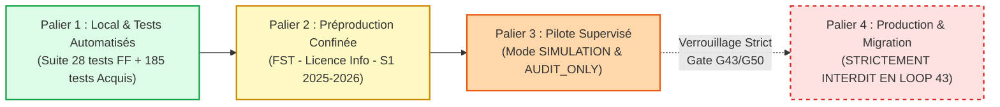

# LOOP 43 — PLAN DE DÉPLOIEMENT PROGRESSIF CONTRÔLÉ
## UniRegistre — Déploiement étagé, jalons de validation et confinement strict

**Date :** 31 octobre 2026  
**Auteur :** Antigravity Engine — UniRegistre Core Team  
**Statut de la phase :** AUDITÉ ET PLANIFIÉ (GATE G43)  
**Référence contractuelle :** ADDENDUM LOOP 42-C + AUTORISATION LOOP 43 — Phase C, E & H  

---

## 1. Philosophie et Principes du Déploiement

Le déploiement progressif des mécanismes d'acquis pédagogiques et de droits de redoublement dans UniRegistre est soumis aux impératifs institutionnels suivants :

> [!IMPORTANT]
> **Interdiction Formelle de Mise en Production Directe :**
> Aucune mise en production ni mutation effective des dossiers étudiants n'est autorisée lors de la phase LOOP 43. L'ensemble des opérations s'exécute sous le statut **`PASS_WITH_RESERVATIONS`**, confiné aux environnements d'expérimentation et d'audit.

Le déploiement s'effectue selon un modèle à 4 paliers étanches, chaque palier franchi nécessitant un audit d'intégrité sans réserve :



---

## 2. Décomposition des Paliers de Déploiement

### 2.1 Palier 1 : Environnement Local et Intégration Continue (CI / Tests)
- **Objectif** : Valider la solidité intrinsèque du code, le comportement fail-closed et la non-régression.
- **Environnement** : `local`, `testing`.
- **Conditions de franchissement** :
  - 100 % des tests unitaires et d'intégration validés (suite `FeatureFlagLoop43Test` : 28 tests, `PiloteAcademiqueLoop42Test` : 20 tests, domaine `Acquis` : 185 tests).
  - Contrôle de formatage strict PSR-12 validé via `vendor/bin/pint --dirty --test`.
  - Écouteurs SQL confirmant 0 écriture intempestive en base de données.
- **Statut** : **VALIDÉ (AUTO-PASS)**.

### 2.2 Palier 2 : Environnement de Préproduction Confiné
- **Objectif** : Tester le comportement en conditions réelles avec le serveur web, le cache applicatif et les middlewares HTTP complets.
- **Environnement** : `preproduction` (ou image miroir isolée).
- **Configuration active** :
  ```php
  'FEATURE_FLAGS_ENVIRONNEMENTS' => 'local,testing,preproduction',
  'flags' => [
      'pilote_academique' => [
          'enabled' => false, // Désactivé par défaut, activé sur session de recette
          'facultes' => [1],  // FST exclusivement
          'programmes' => [21], // Licence Informatique exclusivement
          'annees' => [6],     // 2025-2026 exclusivement
          'modes' => ['AUDIT_ONLY', 'SIMULATION'], // Zéro écriture autorisée
          'pourcentage' => null,
      ],
  ]
  ```
- **Contrôles requis** :
  - Tentatives d'accès cross-faculté interceptées et renvoyées en 404/403.
  - Tentatives de soumission avec paramètres falsifiés (`?faculte_id=1`) rejetées.
  - Vérification de l'absence totale de dégradation sur les autres modules (Inscription, Paiement, Examens).

### 2.3 Palier 3 : Pilote Confiné en Recette Scolarité (Modes AUDIT_ONLY & SIMULATION)
- **Objectif** : Permettre aux gestionnaires désignés de la scolarité FST de confronter les simulations du système aux 5 décisions officielles publiées (`REC-01` à `REC-05`).
- **Population concernée** : Strictement les 5 dossiers de référence de L1 Informatique Semestre 1 2025-2026.
- **Mode opératoire** :
  - Mode `AUDIT_ONLY` : Visualisation des crédits et maquettes sans calcul.
  - Mode `SIMULATION` : Calcul en mémoire de la compensation semestrielle et comparaison avec le PV officiel `DELIB-L1-2025-2026`.
- **Règle absolue** : Les tables `notes`, `evaluations`, `acquis_pedagogiques` et `redoublements` restent en lecture seule stricte. Aucun job asynchrone ne doit émettre de mutation.

### 2.4 Palier 4 : Généralisation et Migration Réelle en Production
- **Objectif** : Application pérenne des décisions académiques et bascule officielle de base.
- **Statut en LOOP 43** : **STRICTEMENT BLOQUÉ (`BLOCKED_BUSINESS`)**.
- **Prérequis futurs obligatoires** :
  - Clôture complète des LOOP 44 (Gouvernance), 45 (Recours), 46 (Explicabilité), 47 (Planification), 48 (KPI), 49 (Continuité/PRA).
  - Certification finale LOOP 50 avec arrêté ministériel formel et approbation de la commission rectorale.

---

## 3. Matrice de Passage et Dépendances

| Étape de Validation | Critère d'Entrée | Outil de Contrôle | Critère de Sortie | Décision |
|---|---|---|---|:---:|
| **E1 : Test Unitaire Fail-Closed** | Code source modifié | `FeatureFlagLoop43Test` | 28 tests verts, 271 assertions | **OK** |
| **E2 : Isolation Interfacultaire** | Middleware actif | Tests HTTP injectant faux contextes | Rejet 404 étanche | **OK** |
| **E3 : Zéro Mutation SQL** | Mode simulation actif | `DB::listen` surveillant mutations | 0 INSERT/UPDATE/DELETE | **OK** |
| **E4 : Test de Désactivation Immédiate** | Flag positionné à `true` | Bascule `enabled => false` | Fermeture instantanée de l'accès | **OK** |
| **E5 : Déploiement Production** | Aucune autorisation | Plafond environnemental | Rejet catégorique | **BLOQUÉ** |

---

## 4. Rôles et Responsabilités

- **Antigravity Engine / Équipe Technique** : Fournit le code durci, le middleware fail-closed, l'outillage de test et les preuves de non-mutation.
- **Responsable Scolarité FST** : Valide la conformité des données issues de la simulation en regard du PV officiel de délibération.
- **Comité de Gouvernance / Commission Rectorale** : Seule autorité habilitée à autoriser un élargissement de périmètre ou le passage aux LOOP ultérieures.

