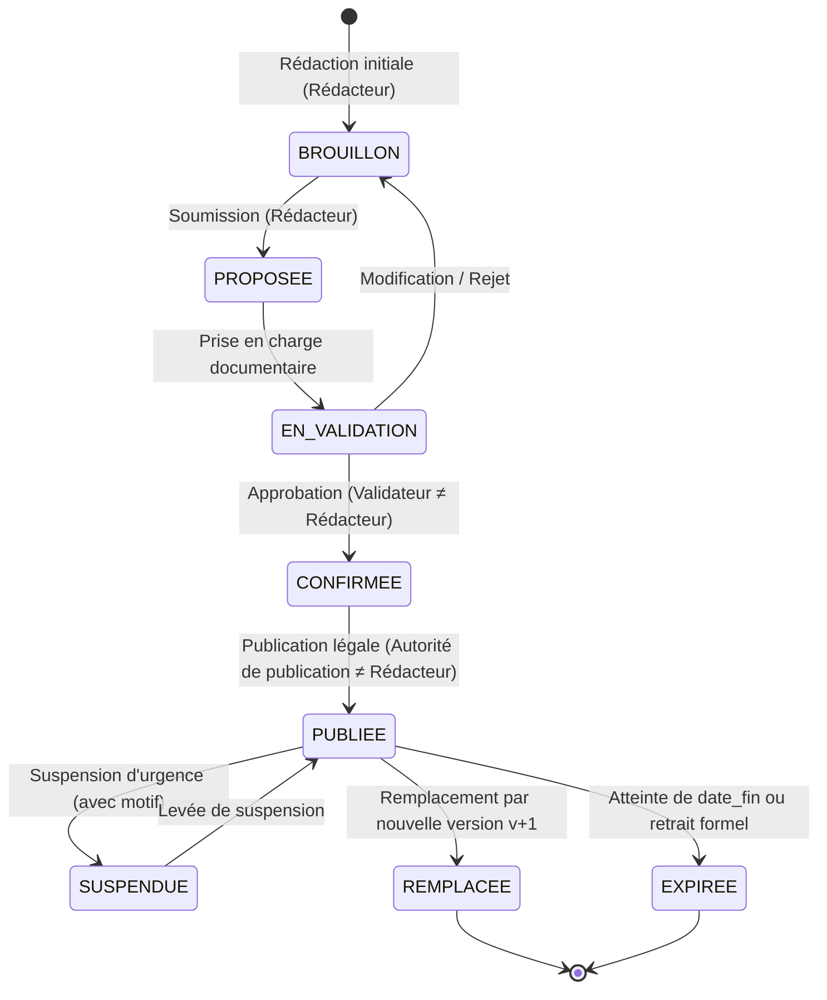
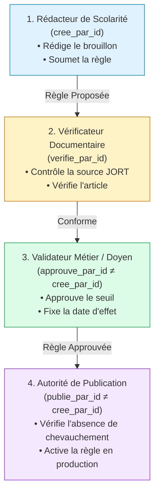

# LOOP 44 — CYCLE DE VIE, WORKFLOW ET VALIDATION À QUATRE YEUX
## UniRegistre — États d'une règle académique, transitions autorisées et séparation des pouvoirs

**Date :** 31 octobre 2026  
**Auteur :** Antigravity Engine — UniRegistre Core Governance Team  
**Statut :** AUDITÉ ET CONFORME (PHASE 3 - LOOP 44)  
**Référence contractuelle :** LOOP 44 — Phase 3 & 10  

---

## 1. Machine à États et Cycle de Vie Officiel

Le cycle de vie d'une règle académique dans UniRegistre est strictement séquentiel, contrôlé et audité. Aucune règle n'entre en vigueur de manière implicite.

---

## 2. Définition et Prérequis des Statuts

| Statut | Signification Métier | Modifiable ? | Applicable au Moteur ? | Prérequis d'Entrée |
|---|---|:---:|:---:|---|
| `BROUILLON` | Version en cours de saisie technique. | **OUI** | **NON** | Code valide, contenu sérialisable. |
| `PROPOSEE` | Soumise pour instruction formelle. | OUI (annule la revue) | **NON** | Statut précédent `BROUILLON`. |
| `EN_VALIDATION` / `EN_REVUE` | Examen documentaire et juridique en cours. | OUI (retour brouillon) | **NON** | Dossier complet transmis. |
| `CONFIRMEE` / `APPROUVEE` | Validée sur le fond par une autorité tierce. | **NON (Figée)** | **NON** | **Auteur ≠ Approbateur** (4 yeux), Référence officielle non vide, Date d'effet présente. |
| `PUBLIEE` | Entrée en vigueur officielle. | **NON (Immuable)** | **OUI** (si date atteinte) | **Auteur ≠ Publicateur**, Aucun chevauchement temporel avec une version active. |
| `SUSPENDUE` | Règle temporairement gelée par l'autorité. | **NON (Immuable)** | **NON** | Statut antérieur `PUBLIEE`, Motif de suspension obligatoire (≥ 10 caractères). |
| `REMPLACEE` | Succédée par une nouvelle version `v+1`. | **NON (Historique)** | **OUI** (pour audits passés) | Nouvelle version approuvée, `date_fin` ajustée la veille de la nouvelle date d'effet. |
| `EXPIREE` / `RETIREE` | Règle abrogée ou arrivée à échéance. | **NON (Historique)** | **OUI** (uniquement pour dates < retrait) | Motif de retrait obligatoire, traçabilité de l'acteur et de la date. |

---

## 3. Séparation des Fonctions et Validation à Quatre Yeux

Pour prévenir toute fraude, conflit d'intérêts ou inadvertance dans la définition des barèmes d'examens et des droits d'étudiants, UniRegistre impose une stricte séparation des pouvoirs :

### Règles Régaliennes de Validation :
1. **Règle des Quatre Yeux Stricte** : `regle.approuve_par_id !== regle.cree_par_id`. Un gestionnaire qui crée une proposition ne peut en aucun cas l'approuver lui-même.
2. **Indépendance de la Publication** : `regle.publie_par_id !== regle.cree_par_id`. L'acte de publication requiert l'intervention de l'autorité compétente habilitée (ex. Conseil Scientifique, Présidence).
3. **Interdiction de Publication Anticipée** : Une règle ne peut **JAMAIS** être publiée sous prétexte qu'elle a été testée avec succès dans un script unitaire. Seul le circuit d'approbation institutionnel donne force exécutoire.

