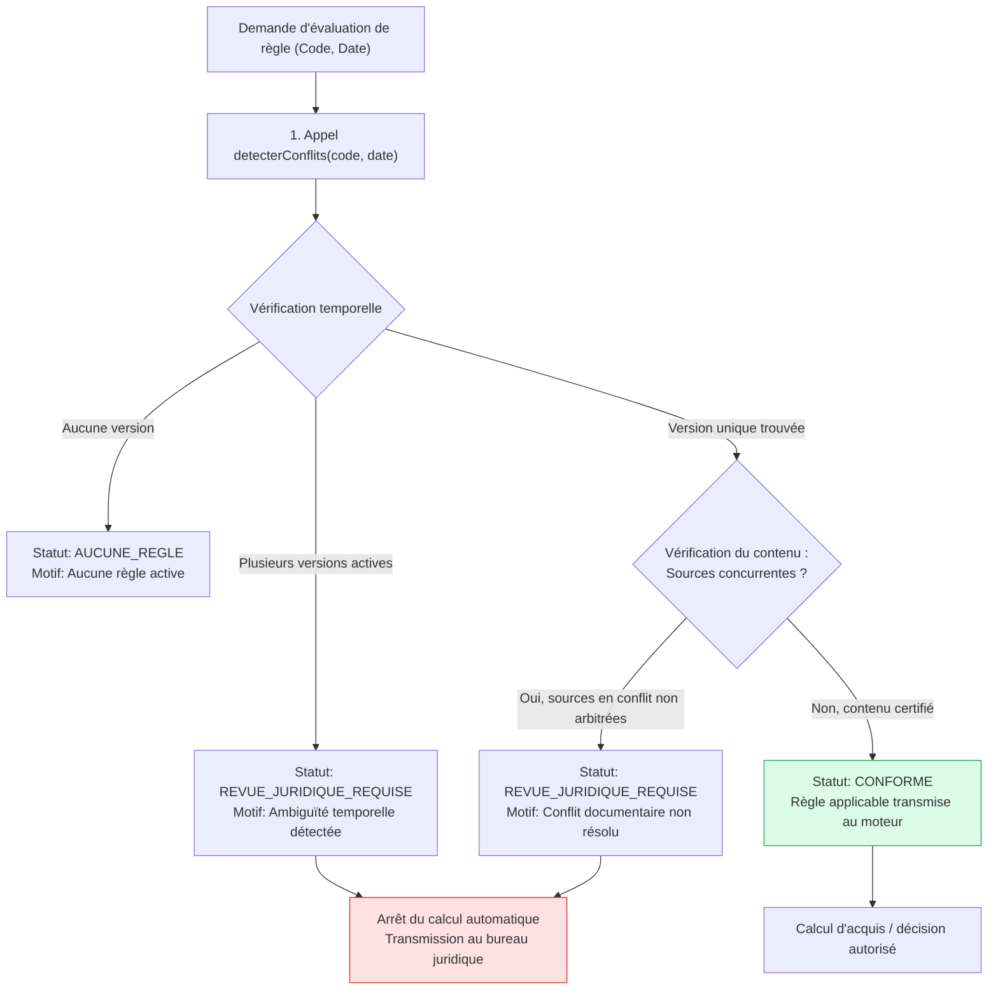

# LOOP 44 — GESTION DES CONFLITS RÉGLEMENTAIRES ET ARBITRAGE INSTITUTIONNEL
## UniRegistre — Détection des divergences inter-sources et protocole « REVUE_JURIDIQUE_REQUISE »

**Date :** 31 octobre 2026  
**Auteur :** Antigravity Engine — UniRegistre Core Governance Team  
**Statut :** AUDITÉ ET CONFORME (PHASE 6 - LOOP 44)  
**Référence contractuelle :** LOOP 44 — Phase 6 & 10  

---

## 1. Problématique des Conflits Réglementaires

Dans l'enseignement supérieur, des tensions peuvent survenir entre plusieurs textes juridiques :
- Un **Décret national général** (ex. Décret 95-2602 fixant les études d'ingénieur).
- Un **Règlement intérieur d'école** (ex. règlement ENIT ou ENSIT fixant un seuil de module).
- Une **Maquette d'habilitation ministérielle** d'un parcours spécifique.
- Une **Décision de jury souverain** ou une **Dérogation rectorale**.

> [!CAUTION]
> **Interdiction d'Arbitrage Informatique Arbitraire :**
> Le logiciel UniRegistre ne doit en aucun cas « inventer » une règle d'arbitrage (ex: choisir aveuglément la règle la plus restrictive, ou la règle la plus récente, ou privilégier automatiquement le texte local sur le texte national sans base légale explicite).  
> Dès qu'un conflit non arbitrable est détecté, le système produit impérativement le statut **`REVUE_JURIDIQUE_REQUISE`** et suspend toute décision automatique.

---

## 2. Typologie des Conflits Détectés par `detecterConflits()`

| Type de Conflit | Définition & Causes | Détection dans le Code | Statut Émis |
|---|---|---|:---:|
| **Conflit d'Ambiguïté Temporelle** | Deux versions publiées du même code prétendent être actives au même instant sur la même formation. | `regleApplicable()` lève `DomainException` (count > 1). | `REVUE_JURIDIQUE_REQUISE` |
| **Conflit Inter-Sources (National vs Établissement)** | Le texte national autorise la compensation à 10.0/20, mais le règlement intérieur de l'école exige 12.0/20 sans arrêté de dérogation ministériel. | Mention `sources_concurrentes` dans le contenu de la règle sans clé d'arbitrage validée. | `REVUE_JURIDIQUE_REQUISE` |
| **Conflit Maquette vs Textes Généraux** | La maquette prévoit 5 crédits pour une UE mais le référentiel national n'autorise pas la capitalisation partielle. | Divergence détectée lors de l'audit de maquette. | `REVUE_JURIDIQUE_REQUISE` |
| **Conflit Versionnaire Non Clôturé** | Publication d'une v2 sans clôture de la v1 (chevauchement d'intervalles). | `intervallesSeChevauchent()` retourne `true`. | `DomainException` au `publier()` |

---

## 3. Algorithme et Flux de Traitement des Conflits

---

## 4. Protocole de Levée de la « REVUE_JURIDIQUE_REQUISE »

Pour débloquer un dossier académique placé sous le statut `REVUE_JURIDIQUE_REQUISE` :
1. **Instruction Juridique Formelle** : La direction des affaires juridiques de l'université ou du ministère examine les textes en conflit.
2. **Émission d'un Acte de Clarification** : Décision rectorale, arrêté modificatif ou délibération du Conseil Scientifique établissant la primauté formelle.
3. **Publication d'une Version Corrective `v+1`** :
   - Création d'une nouvelle version de la règle intégrant la référence officielle de l'acte de clarification.
   - Suppression de l'ambiguïté par fixation explicite des dates et périmètres.
   - Passage par le circuit de validation à 4 yeux et publication officielle.
4. **Reprise Sécurisée** : Dès publication de la nouvelle version conforme, le statut repasse en `CONFORME` et les calculs peuvent reprendre sans risque de contentieux.

