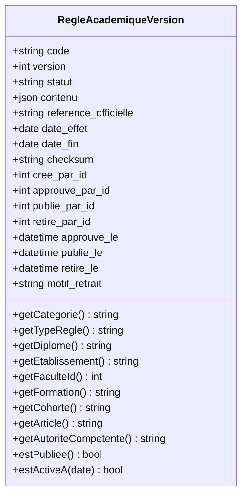

# LOOP 44 — MODÈLE CANONIQUE DE RÈGLE ACADÉMIQUE
## UniRegistre — Structure de données unifiée, typologie institutionnelle et empreinte cryptographique

**Date :** 31 octobre 2026  
**Auteur :** Antigravity Engine — UniRegistre Core Governance Team  
**Statut :** AUDITÉ ET CONFORME (PHASE 2 - LOOP 44)  
**Référence contractuelle :** LOOP 44 — Phase 2 & 10  

---

## 1. Conception du Modèle Canonique

Le modèle canonique unifie la définition de chaque règle académique au sein de la table additive [`regles_academiques_versions`](file:///Users/mohamedyassine/Desktop/PFE/inscription-etudiants/app/Models/RegleAcademiqueVersion.php). Il encapsule l'ensemble des dimensions juridiques, organisationnelles, temporelles et techniques exigées par la gouvernance universitaire.

---

## 2. Attributs Obligatoires de Chaque Règle

| Attribut Canonique | Champ / Emplacement | Type | Description & Rôle |
|---|---|---|---|
| **Identifiant stable** | `code` | `VARCHAR(120)` | Identifiant pérenne normalisé (majuscules, chiffres, tirets, underscores). |
| **Numéro de version** | `version` | `UNSIGNED INT` | Numérotation strictement croissante par code (v1, v2, v3...). |
| **Statut de gouvernance** | `statut` | `VARCHAR(20)` | État dans le cycle de vie (`BROUILLON`, `EN_REVUE`, `APPROUVEE`, `PUBLIEE`, `SUSPENDUE`, `REMPLACEE`, `RETIREE`). |
| **Type de règle** | `contenu['type_regle']` | `VARCHAR(50)` | Typologie fonctionnelle (`COMPENSATION`, `CAPITALISATION`, `REDOUBLEMENT`, `SEUIL_COMPETENCE`, `RACHAT`). |
| **Diplôme concerné** | `contenu['diplome']` | `VARCHAR(50)` | Code ou intitulé du diplôme (`LICENCE`, `INGENIEUR`, `MASTER`, `DOCTORAT`). |
| **Établissement** | `contenu['etablissement']` | `VARCHAR(100)` | Sigle de l'établissement d'enseignement supérieur (ex. `FST`, `ENSIT`, `FSJPS`). |
| **Faculté (ID interne)** | `contenu['faculte_id']` | `INT` | Clé étrangère pour l'isolation stricte multi-facultés. |
| **Formation / Parcours** | `contenu['formation']` | `VARCHAR(100)` | Code de la mention/parcours (ex. `LIC-INFO-REG`). |
| **Spécialité** | `contenu['specialite']` | `VARCHAR(100)` | Spécialité académique (ex. `Informatique et Multimédia`). |
| **Maquette pédagogique** | `contenu['maquette_id']` | `VARCHAR(50)` | Identifiant de la maquette d'habilitation ministérielle. |
| **Cohorte applicable** | `contenu['cohorte']` | `VARCHAR(20)` | Année d'entrée ou promotion ciblée (ex. `2025-2026`). |
| **Source juridique** | `contenu['source_juridique']` | `VARCHAR(255)` | Intitulé complet du texte fondateur (ex. `Décret présidentiel n° 2022-631`). |
| **Référence exacte** | `reference_officielle` | `VARCHAR(255)` | Publication légale et référence JORT (ex. `JORT n° 80 du 19 juillet 2022, p. 2269`). |
| **Article précis** | `contenu['article']` | `VARCHAR(50)` | Article spécifique du texte (ex. `Article 9`, `Article 13`). |
| **Date d'effet (Vigueur)** | `date_effet` | `DATE` | Date précise à laquelle la règle entre en vigueur. Obligatoire à l'approbation. |
| **Date de fin de validité** | `date_fin` | `DATE` (nullable) | Date d'expiration programmée ou abrogatoire. |
| **Autorité compétente** | `contenu['autorite_competente']` | `VARCHAR(100)` | Instance habilitée (ex. `Ministre MESRS`, `Conseil d'Université`, `Conseil Scientifique`). |
| **Référence de validation** | `contenu['reference_validation']`| `VARCHAR(100)` | Numéro d'acte de validation institutionnelle (ex. `PV-CS-FST-2026-04`). |
| **Empreinte documentaire** | `checksum` | `VARCHAR(64)` | Hash SHA-256 déterministe garantissant l'intégrité absolue du contenu. |
| **Historique & Traçabilité** | Clés étrangères `users` | `BIGINT` | `cree_par_id`, `approuve_par_id`, `publie_par_id`, `retire_par_id` et horodatages. |

---

## 3. Séparation Étanche des 6 Catégories Non Interchangeables

Conformément à la directive de la PHASE 2, chaque règle appartient impérativement à l'une des **6 catégories étanches** suivantes, lesquelles ne doivent en aucun cas être confondues ou interverties :

| Catégorie | Constante Modèle | Portée Juridique | Autorité Habilitée | Exemples Types |
|---|---|---|---|---|
| **1. Texte National** | `CATEGORIE_TEXTE_NATIONAL` | Régalienne, nationale, impérative | Présidence, Ministère MESRS | Décret 2022-631 (LMD), Arrêté du 7 juillet 2023 (Crédits), Décret 95-2602 (Ingénieur). |
| **2. Règlement d'Établissement**| `CATEGORIE_REGLEMENT_ETABLISSEMENT` | Locale à l'école / faculté | Conseil d'Université, Conseil Scientifique | Règlement intérieur FST, dispositions de passage ENIT, assiduité aux TP. |
| **3. Maquette Pédagogique** | `CATEGORIE_MAQUETTE_PEDAGOGIQUE` | Spécifique au diplôme habilité | Commission d'Habilitation Pédagogique | Coefficients d'UE, crédits ECTS par élément constitutif, prérequis de modules. |
| **4. Décision de Jury** | `CATEGORIE_DECISION_JURY` | Circonscrite à une session d'examen | Jury de délibération souverain | Rachat exceptionnel (Art. 16), validation conditionnelle de semestre. |
| **5. Dérogation Individuelle** | `CATEGORIE_DEROGATION_INDIVIDUELLE` | Nominative à un étudiant unique | Doyen de Faculté, Président d'Université | Autorisation de 3ème redoublement exceptionnel pour force majeure médicale. |
| **6. Paramètre Technique** | `CATEGORIE_PARAMETRE_TECHNIQUE` | Système informatique / applicatif | Administrateur Système UniRegistre | Algorithme d'arrondi au centième, drapeaux de déploiement (Feature Flags). |

> [!WARNING]
> **Interdiction Absolue d'Interchangeabilité :**
> Un paramètre technique ne peut jamais se substituer à une décision de jury. Une maquette pédagogique ne peut pas enfreindre un texte national. Tout conflit non résolu formellement bascule en statut `REVUE_JURIDIQUE_REQUISE`.

