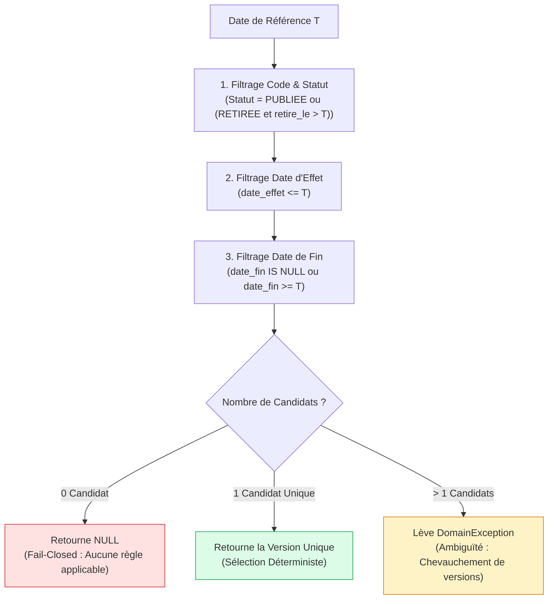

# LOOP 44 — VALIDITÉ TEMPORELLE ET HISTORISATION NON RÉTROACTIVE
## UniRegistre — Déterminisme temporel, gestion des cohortes et dispositions transitoires

**Date :** 31 octobre 2026  
**Auteur :** Antigravity Engine — UniRegistre Core Governance Team  
**Statut :** AUDITÉ ET CONFORME (PHASE 5 - LOOP 44)  
**Référence contractuelle :** LOOP 44 — Phase 5 & 10  

---

## 1. Principes de Déterminisme et de Non-Rétroactivité

Le principe fondamental du droit public universitaire tunisien régit la validité temporelle sous UniRegistre :

> [!IMPORTANT]
> **Principe de Non-Rétroactivité des Actes Réglementaires :**
> Un arrêté ou décret publié en 2024-2025 s'applique aux situations académiques nées sous son empire, ou à la cohorte expressément désignée par ses dispositions transitoires. Il ne modifie **JAMAIS** rétroactivement les crédits capitalisés ou les moyennes de délibération des années antérieures.

L'évaluation de la règle applicable doit être **strictement déterministe** : pour un code et une date donnés, le système doit renvoyer la même version unique de règle, ou lever une anomalie explicite en cas d'ambiguïté.

---

## 2. Dimensions Temporelles Prises en Charge

| Dimension Temporelle | Attribut Modèle | Rôle et Traitement dans UniRegistre |
|---|---|---|
| **Date d'effet (Vigueur)** | `date_effet` | Point de départ de l'application de la règle. Avant cette date, la règle est inactive (`estActiveA()` retourne `false`). |
| **Date de fin de validité** | `date_fin` | Point d'arrêt de l'application. Au-delà, la règle est expirée et retourne `false`. |
| **Horodatage de Publication** | `publie_le` | Date et heure de l'acte de publication officielle par l'autorité. |
| **Horodatage d'Approbation** | `approuve_le` | Date et heure de la validation par le tiers habilité (4 yeux). |
| **Horodatage de Retrait** | `retire_le` | Date à partir de laquelle la règle retirée cesse d'être applicable pour les événements postérieurs. |
| **Cohorte Pédagogique** | `contenu['cohorte']` | Permet d'isoler une promotion (ex. cohorte entrée en 2025-2026 sous la nouvelle maquette). |
| **Dispositions Transitoires** | `contenu['dispositions_transitoires']` | Règles dérogatoires prévues par les textes (ex. maintien de l'ancien régime pour les redoublants de L2). |

---

## 3. Algorithme de Résolution Déterministe (`regleApplicable`)

La résolution de la règle applicable à un instant `T` (date d'évaluation d'un examen, date de délibération d'un jury ou date d'inscription) respecte le filtrage suivant :

---

## 4. Scénarios Testés et Comportements Certifiés

1. **Règle Future** :
   - Règle publiée le 31/10/2026 avec `date_effet = 2027-09-01`.
   - Interrogée pour une session de rattrapage en juin 2026 : renvoie `null` (règle non encore entrée en vigueur).
2. **Règle Expirée** :
   - Règle applicable du 01/09/2023 au 30/06/2024.
   - Interrogée pour l'année 2024-2025 : renvoie `null` (expirée).
3. **Audit d'un Procès-Verbal Passé** :
   - Règle retirée le 31/10/2026.
   - Interrogée pour vérifier un PV de délibération du 15/06/2025 : **la règle retirée est correctement renvoyée**, permettant de reproduire fidèlement le calcul d'époque sans anachronisme réglementaire.
4. **Cohorte Non Couverte** :
   - Règle restreinte à la cohorte `2025-2026`.
   - Interrogée sur un dossier d'étudiant inscrit sous l'ancienne maquette `2023-2024` : renvoie `null`, bloquant tout automatisme illégitime.

