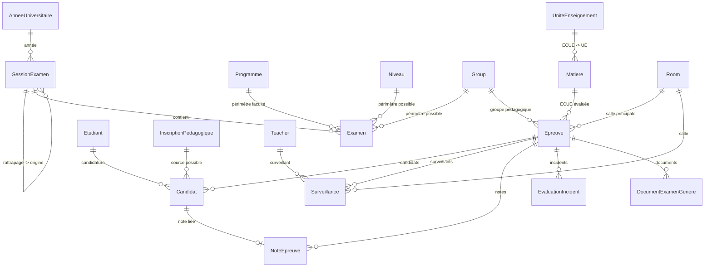

# LOOP — UniRegistre Examens Advanced

- **Date d’audit :** 2026-10-27
- **Phase :** Phase 0 — inventaire et protection, en lecture seule
- **Périmètre :** sessions d’examen, examens, épreuves, éligibilité des candidats, groupes d’examen, salles, planification, surveillance, simulation, publication, convocations, audit
- **Verdict d’audit :** `PASS_WITH_RESERVATIONS`
- **Autorisation d’implémentation :** `BLOCKED_ENVIRONMENT` + `BLOCKED_BUSINESS_DECISION`
- **Dépôt :** `/Users/mohamedyassine/Desktop/PFE/inscription-etudiants`
- **Branche au moment de l’audit :** `feature/admin-modifier-etudiant`
- **HEAD audité :** `38ef14933de9980a4c62cb805bd19bc86c2b3081`
- **État Git :** branche locale en retard de 3 commits ; dépôt fortement modifié ; aucun commit ni push effectué pendant l’audit

---

## 1. Objectif du document

Ce document constitue la cartographie initiale du module « Examens Advanced ».

Il enregistre :

1. l’inventaire réel du code existant ;
2. l’architecture métier constatée ;
3. les routes et contrôleurs concernés ;
4. la matrice de permissions ;
5. l’état des migrations et contraintes ;
6. les tests existants et les résultats réellement exécutés ;
7. les risques et écarts face au besoin ;
8. le plan d’implémentation ordonné ;
9. les questions métier non résolues ;
10. le verdict et les preuves.

Il ne déclare aucune fonctionnalité comme terminée au-delà de ce qui est prouvé.

---

## 2. Méthode et garde-fous appliqués

### 2.1 Mode d’intervention

- Audit initial strictement en lecture seule.
- Aucune modification de code pendant la Phase 0.
- Aucune migration exécutée.
- Aucune base de développement ou de production modifiée.
- Aucune opération Git destructrice.
- Tests exécutés uniquement sur la base SQLite `:memory:` définie par `phpunit.xml`.

### 2.2 Environnement vérifié

```text
Laravel Framework 13.33.0
PHP 8.5.11
PHPUnit
SQLite :memory: pour les tests
Blade + Tailwind CSS + Alpine.js pour l’interface
```

### 2.3 Protection du travail concurrent

Le dépôt contient un grand nombre de modifications locales et de fichiers non suivis, y compris dans le périmètre Évaluation/Examens.

Pendant l’audit, deux fichiers non suivis ont été modifiés concurremment :

- `app/Modules/Schedule/Services/ExamScheduleEngineService.php`
- `tests/Feature/Loop06PlanificationExamensVerificationTest.php`

Après modification, le moteur `ExamScheduleEngineService::appliquerScenario()` contenait les gardes de revalidation serveur attendues :

- appartenance de l’épreuve à l’examen ;
- refus des épreuves dupliquées ;
- refus d’un scénario incomplet ;
- salle inactive/inexistante refusée ;
- salle hors faculté refusée ;
- capacité utile contrôlée ;
- collisions salle/groupe contrôlées ;
- indisponibilités et cours réguliers contrôlés ;
- surveillants inactifs ou déjà mobilisés refusés ;
- épreuve verrouillée refusée sans forçage.

**Décision de protection :** ces fichiers sont traités comme travail concurrent actif ou récent. Aucune écriture n’a été effectuée dessus par cette session.

---

## 3. Inventaire réel

## 3.1 Répertoires et fichiers principaux

### Module Évaluation

- `app/Modules/Evaluation/Routes/web.php`
- `app/Modules/Evaluation/Controllers/`
- `app/Modules/Evaluation/Services/`
- `app/Modules/Evaluation/Models/`
- `app/Modules/Evaluation/Requests/`
- `app/Modules/Evaluation/Policies/`
- `app/Modules/Evaluation/Jobs/`
- `app/Modules/Evaluation/Events/`
- `app/Modules/Evaluation/Listeners/`
- `resources/views/modules/evaluation/`

### Moteur de planification d’examens

- `app/Modules/Schedule/Services/ExamScheduleEngineService.php`

### Modèles liés aux salles, groupes et disponibilités

- `app/Modules/Schedule/Models/Room.php`
- `app/Modules/Schedule/Models/Group.php`
- `app/Modules/Schedule/Models/ScheduleAvailability.php`
- `app/Modules/Schedule/Models/ScheduleSlot.php`
- `app/Modules/Schedule/Models/Teacher.php`

### Population centralisée

- `app/Services/PopulationService.php`
- `app/Services/Exports/ListeEtudiantsService.php`
- `app/Services/Exports/PopulationDataset.php`

### Espace étudiant

- `app/Http/Controllers/Etudiant/ExamenController.php`
- `resources/views/etudiant/examens/`

### Tests ciblés

- `tests/Feature/ExamenCreationManuelleTest.php`
- `tests/Feature/ExamensInvariantsValidationTest.php`
- `tests/Feature/ExamensInvariantsSallesTest.php`
- `tests/Feature/ExamPreparationTest.php`
- `tests/Feature/PlanificationAutomatiqueExamensTest.php`
- `tests/Feature/SchedulePhase12ExamensExtensionTest.php`
- `tests/Feature/ExamensFeatureCompleteTest.php`
- `tests/Feature/AffectationEnseignantExamenTest.php`
- `tests/Feature/ExamensCommunicationTest.php`
- `tests/Feature/Loop06PlanificationExamensVerificationTest.php`
- `tests/Feature/ExamensConcurrenceReelleTest.php`

## 3.2 Contrôleurs inventoriés

- `SessionExamenController`
- `ExamenController`
- `EpreuveController`
- `PreparationExamenController`
- `SurveillanceController`
- `AffectationEnseignantController`
- `EmploiSurveillanceController`
- `ContrainteSurveillanceController`
- `DocumentBatchController`
- `HistoriqueNotesController`
- `AnomalieController`
- `IncidentController`
- `NoteEpreuveController`
- `MesSurveillancesController`
- `MesNotesController`
- `TableauBordEvaluationController`
- `Etudiant/ExamenController`

## 3.3 Services inventoriés

- `SessionExamenService`
- `SessionPreparationService`
- `ExamenService`
- `EpreuveService`
- `ConflitEpreuveService`
- `ExamRoomAssignmentService`
- `PreparationExamenService`
- `ConvocationService`
- `SurveillanceService`
- `SurveillanceEquilibrageService`
- `SurveillanceConstraintResolver`
- `EvaluationAuditService`
- `EvaluationDocumentBatchService`
- `ExamScheduleEngineService`

## 3.4 Modèles inventoriés

- `SessionExamen`
- `Examen`
- `Epreuve`
- `Candidat`
- `Surveillance`
- `SurveillanceAssignmentRun`
- `SurveillanceConstraintConfig`
- `SurveillanceConstraintRevision`
- `DocumentExamenGenere`
- `NoteEpreuve`
- `EvaluationIncident`
- `Room`
- `Group`
- `Matiere`
- `InscriptionPedagogique`

---

## 4. Architecture existante

## 4.1 Diagramme relationnel constaté



## 4.2 Sessions d’examen

`SessionExamen` :

- types : `principale`, `rattrapage`, `exceptionnelle`
- statuts : `draft`, `open`, `ongoing`, `closed`, `locked`, `archived`
- transitions serveur définies
- rattrapage rattaché à une session principale de la même année
- session transversale, sans colonne faculté

`SessionExamenService::readiness()` bloque l’ouverture si :

- aucune épreuve n’existe ;
- une épreuve n’a pas de salle ;
- une épreuve n’a pas de surveillant ;
- une épreuve n’a pas de candidat ;
- une sur-capacité de salle est détectée ;
- la population validée a dérivé depuis le snapshot.

## 4.3 Examens

`Examen` :

- types : `examen`, `controle`, `partiel`, `devoir`, `oral`, `projet`, `soutenance`, `rattrapage`
- statuts serveur avec transitions
- périmètre faculté dérivé de `programme` ou `groupe`
- publication bloquée si `ExamScheduleEngineService::auditerSessionExamens()` détecte un conflit bloquant

## 4.4 Épreuves

`Epreuve` :

- une épreuve = une `matiere_id` (ECUE)
- champs : `ue_id`, `groupe_id`, `salle_id`, date, horaires, durée, coefficient, barème, note maximale
- statuts serveur avec transitions
- snapshot de population :
  - `population_validated_at`
  - `population_hash`
  - `population_effectif`
- numéro anonyme par candidat et par épreuve

## 4.5 Candidats

`Candidat` :

- unicité `(epreuve_id, etudiant_id)`
- unicité `(epreuve_id, numero_anonyme)`
- salle et place possibles
- statuts d’émargement : `non_pointe`, `present`, `absent`, `absent_justifie`, `absent_injustifie`, `excuse`, `retard`

## 4.6 Surveillance

`Surveillance` :

- rôles : `principal`, `adjoint`, `surveillant`, `reserve`
- statuts : `assigne`, `confirme`, `remplace`, `annule`
- historique de remplacement via `remplace_surveillance_id`
- unicité active en base via colonnes virtuelles MySQL :
  - `(epreuve_id, active_teacher_id)`
  - `(epreuve_id, active_user_id)`

## 4.7 Salles

`Room` :

- `capacite` nullable
- `min_surveillants`
- `ratio_surveillants`
- horaires d’ouverture
- équipements
- disponibilités via `schedule_availabilities`

Le moteur d’examens applique un ratio d’espacement par défaut :

```php
RATIO_CAPACITE_EXAMEN_DEFAUT = 0.50
```

---

## 5. Cartographie des routes

Les routes admin du module Évaluation sont protégées par :

```php
['auth', 'admin', 'secondaire.verrou', 'module:evaluation']
```

Le module est désactivé par défaut :

```php
'evaluation' => [
    'active' => (bool) env('MODULE_EVALUATION', false),
],
```

Résultats de `php artisan route:list` :

- `/evaluations` : **112 routes**
- `/examens` : **14 routes**
- `/epreuves` : **34 routes**
- `/surveillances` : **16 routes**

## 5.1 Familles de routes

| Famille | Route principale | Contrôleur |
|---|---|---|
| Tableau de bord évaluation | `/admin/evaluations` | `TableauBordEvaluationController` |
| Préparation globale | `/admin/examens/preparation` | `PreparationExamenController` |
| Préparation session | `/admin/examens/preparation/{session}` | `PreparationExamenController` |
| Sessions | `/admin/evaluations/sessions` | `SessionExamenController` |
| Examens | `/admin/evaluations/examens` | `ExamenController` |
| Génération de scénarios | `/admin/evaluations/examens/{examen}/planifier/scenarios` | `ExamenController` |
| Application d’un scénario | `/admin/evaluations/examens/{examen}/planifier/appliquer` | `ExamenController` |
| Audit de conformité | `/admin/evaluations/examens/{examen}/audit-conformite` | `ExamenController` |
| Épreuves | `/admin/evaluations/epreuves` | `EpreuveController` |
| Planning visuel | `/admin/evaluations/planning` | `EpreuveController` |
| Génération de candidats | `/admin/evaluations/examens/{examen}/epreuves/{epreuve}/candidats` | `EpreuveController` |
| Répartition de salles | `/admin/evaluations/epreuves/{epreuve}/repartir-salles` | `EpreuveController` |
| Émargement | `/admin/evaluations/epreuves/{epreuve}/emargement` | `EpreuveController` |
| Convocation admin | `/admin/evaluations/candidats/{candidat}/convocation` | `EpreuveController` |
| Surveillances | `/admin/evaluations/surveillances` | `SurveillanceController` |
| Affectation enseignants | `/admin/evaluations/affectations` | `AffectationEnseignantController` |
| Contraintes surveillance | `/admin/evaluations/surveillances/contraintes` | `ContrainteSurveillanceController` |
| Documents groupés | `/admin/evaluations/documents-batch` | `DocumentBatchController` |
| Historique notes | `/admin/evaluations/historique-notes` | `HistoriqueNotesController` |
| Examens étudiant | `/etudiant/examens` | `Etudiant/ExamenController` |
| Convocation étudiant | `/etudiant/examens/{candidat}/convocation` | `Etudiant/ExamenController` |

## 5.2 Écart avec les 12 menus demandés

| Menu demandé | État constaté |
|---|---|
| Tableau de bord examens | Partiel |
| Sessions d’examen | Présent |
| Configurations d’examen/modules | Absent |
| Éligibilité des candidats | Partiel, sans motifs complets |
| Groupes d’examen | Partiel : groupes pédagogiques seulement |
| Salles et capacités | Partiel : capacité générique, pas de capacité autorisée validée |
| Planification automatique | Présent via scénarios |
| Surveillance | Présent |
| Simulation et contrôle qualité | Partiel : pas de rapport versionné |
| Validation et publication | Partiel : pas de version officielle |
| Convocations | Partiel : PDF à la demande, pas de distribution tracée |
| Historique et audit | Partiel : logs et documents, pas d’audit complet examens |

---

## 6. Matrice de permissions

## 6.1 Permissions disponibles

Le projet définit notamment :

- `evaluations.view`
- `evaluations.create`
- `evaluations.update`
- `evaluations.delete`
- `evaluations.publish`
- `sessions_examen.view`
- `sessions_examen.create`
- `sessions_examen.update`
- `sessions_examen.lock`
- `epreuves.view`
- `epreuves.create`
- `epreuves.update`
- `epreuves.cancel`
- `surveillances.view`
- `surveillances.assign`
- `surveillances.manage`
- `notes_eval.*`
- `deliberations.*`
- `document_batch.run`

## 6.2 Policy active

`EvaluationPolicy` est enregistrée pour :

- `SessionExamen`
- `Examen`
- `Epreuve`
- `NoteEpreuve`
- `Deliberation`

Elle applique :

- permission RBAC ;
- périmètre faculté ;
- refus des objets hors périmètre.

## 6.3 Écarts de permission constatés

| Écart | Preuve | Risque |
|---|---|---|
| `evaluations.publish` existe mais n’est pas exigé pour publier un examen | `ExamenController::transiter()` utilise `evaluations.update` | Un utilisateur autorisé à modifier peut publier |
| `epreuves.update` permet de publier une épreuve | `EpreuveController::transiter()` | Publication non séparée de la modification |
| `document_batch.run` existe mais la génération groupée utilise `evaluations.create` | `DocumentBatchController::generer()` | Permission dédiée inutilisée |
| Les mutations de session utilisent souvent `sessions_examen.update` | `SessionExamenController` | Granularité de verrouillage/publication à clarifier |

---

## 7. État des migrations et contraintes

## 7.1 Tables existantes

- `evaluation_regles`
- `evaluation_sessions`
- `evaluation_examens`
- `evaluation_epreuves`
- `evaluation_surveillants`
- `evaluation_candidats`
- `evaluation_notes`
- `evaluation_notes_historique`
- `evaluation_deliberations`
- `evaluation_jury_membres`
- `evaluation_decisions`
- `evaluation_incidents`
- `evaluation_compostages`
- `evaluation_documents_generes`
- `surveillance_assignment_runs`
- `surveillance_constraint_configs`
- `surveillance_constraint_revisions`
- `rooms`
- `schedule_availabilities`

## 7.2 Contraintes utiles déjà présentes

- `unique(annee_universitaire_id, code)` sur les sessions
- `unique(epreuve_id, etudiant_id)` sur les candidats
- `unique(epreuve_id, numero_anonyme)` sur les candidats
- `unique(epreuve_id, etudiant_id)` sur les notes d’épreuve
- unicité active des surveillants par épreuve
- index sur sessions/statuts, salles/dates, groupes/dates, matières/sessions
- clés étrangères restrictives ou cascade selon le cycle de vie

## 7.3 Concepts absents du schéma

Aucune table dédiée n’existe actuellement pour :

- configuration d’examen (mode A/B, modules sélectionnés, épreuve combinée) ;
- décision d’éligibilité avec motif ;
- groupe d’examen temporaire ;
- capacité d’examen « autorisée » et validée ;
- version de planification ;
- publication officielle versionnée ;
- état de distribution des convocations ;
- exception approuvée ;
- rapport de simulation versionné.

Toute migration future devra être additive, justifiée et testée.

---

## 8. Comportement d’éligibilité constaté

`EpreuveService::genererCandidats()` fonctionne en deux branches :

1. **Si l’épreuve possède un `groupe_id` :**
   - la population vient de `students_by_group` ;
   - tous les étudiants du groupe sont convoqués ;
   - le lien pédagogique peut être `null`.

2. **Si l’épreuve n’a pas de groupe :**
   - la population vient de `exam_candidates` ;
   - seuls les étudiants avec une inscription pédagogique `inscrit` sur la matière sont conservés.

Cela contredit l’exigence :

> Ne jamais assimiler un groupe pédagogique à une liste de candidats éligibles.

Conséquences :

- un étudiant du groupe peut être convoqué sans inscription pédagogique active à l’ECUE ;
- aucun motif d’exclusion n’est persisté ;
- aucune liste « éligibles / non éligibles / anomalies » n’est produite ;
- la publication ne conserve pas la justification d’éligibilité par candidat et par module.

Un service central de population existe :

- `PopulationService`
- `PopulationDataset`
- `ListeEtudiantsService`

Mais il n’existe pas encore de service métier central d’éligibilité aux examens avec décisions explicables.

---

## 9. Planification et scénarios

## 9.1 Capacités actuelles

`ExamScheduleEngineService` fournit :

- capacité utile d’examen avec espacement 50 % ;
- trois scénarios :
  - étalé ;
  - compact ;
  - amphis prioritaires ;
- comparaison de scénarios ;
- recommandation ;
- audit de conformité ;
- application transactionnelle avec revalidation serveur ;
- refus des scénarios incomplets ou forgés.

## 9.2 Revalidation serveur actuelle

La version actuelle de `appliquerScenario()` contrôle notamment :

- verrou sur l’examen et les épreuves ;
- appartenance des épreuves à l’examen ;
- dédoublonnage ;
- validation de date et d’horaires ;
- salle active, existante et dans le périmètre ;
- ouverture de la salle ;
- capacité utile ;
- collisions en base et intra-scénario ;
- indisponibilités salle/groupe ;
- cours réguliers ;
- disponibilité des surveillants ;
- complétude du scénario.

## 9.3 Limite restante

Le moteur planifie principalement à partir de :

- `capacite_necessaire` ;
- sinon `groupe->capacite`.

Il ne planifie pas encore à partir de la liste réelle des candidats éligibles.

Conséquences :

- le planning peut être généré avant la construction de la population officielle ;
- la capacité est évaluée sur le groupe plutôt que sur les candidats réellement éligibles ;
- une répartition multi-salles peut exister alors que l’audit d’examen évalue surtout la salle principale.

---

## 10. Publication, convocations et audit

## 10.1 Publication

- `ExamenService::transiter()` bloque la publication si l’audit n’est pas conforme.
- Il n’existe pas de version de planning persistée.
- Il n’existe pas d’entité publication officielle immuable.
- La republication n’a pas de procédure versionnée.
- Les convocations ne sont pas rattachées à une version publiée.

## 10.2 Convocations

Existant :

- convocation PDF individuelle ;
- liste d’émargement PDF ;
- émargement par épreuve et par salle ;
- historique `evaluation_documents_generes` sans PII.

Écarts :

- l’admin peut générer une convocation sans exiger `published` ;
- le PDF n’est pas rattaché à une version de planification ;
- aucun état de distribution n’est persisté ;
- aucun envoi, échec ou reprise n’est historisé au niveau convocation.

## 10.3 Contrôle étudiant

`Etudiant/ExamenController` :

- restreint la convocation au candidat de l’étudiant connecté ;
- liste uniquement les épreuves `published`, `ongoing`, `completed`, `locked`.

Écart précis :

- la liste étudiante n’affiche que les épreuves publiées ou ultérieures ;
- mais la route directe de convocation refuse seulement `draft` et `cancelled`.

Une convocation d’une épreuve `scheduled` reste donc téléchargeable par l’étudiant concerné si l’identifiant candidat est connu.

---

## 11. Interface existante

L’interface utilise :

- Blade ;
- Tailwind CSS ;
- Alpine.js ;
- `x-page-header` ;
- `x-btn` ;
- `x-status-badge` ;
- `x-empty-state` ;
- `x-modal` ;
- `x-alert`.

Navigation existante dans `config/modules.php` :

- Évaluations ;
- Examens ;
- Épreuves & Notes ;
- Affectation enseignants ;
- Emploi des surveillances ;
- Surveillance ;
- Contraintes d’affectation.

Écarts UX :

- l’assistant `/admin/examens/preparation` n’est pas structuré en 12 menus distincts ;
- pas d’écran dédié aux configurations ;
- pas d’écran d’éligibilité avec motifs ;
- pas d’écran de validation/publication versionnée ;
- les blocages sont répartis sur plusieurs écrans sans liens systématiques vers le menu responsable.

---

## 12. Tests et résultats réels

## 12.1 Commandes exécutées

Suite ciblée principale :

```bash
vendor/bin/phpunit --do-not-cache-result --filter \
'ExamenCreationManuelleTest|ExamensInvariantsValidationTest|ExamensInvariantsSallesTest|ExamPreparationTest|PlanificationAutomatiqueExamensTest|SchedulePhase12ExamensExtensionTest|ExamensFeatureCompleteTest|AffectationEnseignantExamenTest|ExamensCommunicationTest|Loop06PlanificationExamensVerificationTest' \
tests/Feature
```

Résultat :

```text
171 tests
171 passed
665 assertions
durée : 6683 ms
```

Suite indépendante de vérification planning :

```bash
vendor/bin/phpunit --do-not-cache-result \
tests/Feature/Loop06PlanificationExamensVerificationTest.php
```

Résultat :

```text
22 tests
22 passed
71 assertions
durée : 1458 ms
```

Test de concurrence MySQL :

```bash
vendor/bin/phpunit --do-not-cache-result \
tests/Feature/ExamensConcurrenceReelleTest.php
```

Résultat :

```text
1 test
0 passed
1 skipped
```

Le test MySQL est auto-sauté faute d’opt-in et de base dédiée. Il ne doit pas être compté comme validé.

## 12.2 Couverture utile déjà présente

Les tests couvrent notamment :

- création manuelle d’examen ;
- sessions verrouillées ;
- cohérence année/session ;
- anti-IDOR programme/groupe ;
- transitions serveur ;
- génération d’épreuves depuis maquette ;
- conflits salle/groupe/horaire ;
- capacité inconnue ou insuffisante ;
- répartition multi-salles ;
- rollback sans écriture partielle ;
- revalidation après simulation ;
- statut initial `non_pointe` ;
- snapshot de population ;
- numéros anonymes ;
- dérive de population ;
- convocations PDF ;
- anti-IDOR étudiant ;
- surveillants inactifs ou en conflit ;
- scénarios planning ;
- application/refus de scénarios forgés ;
- publication bloquée si contrainte dure violée ;
- audit de conformité.

## 12.3 Contrôles non exécutés

- suite complète du projet ;
- tests navigateur/E2E ;
- tests de charge ;
- concurrence réelle MySQL ;
- migration sur base MySQL dédiée ;
- Pint, car aucun fichier code n’a été modifié pendant la Phase 0 ;
- audit d’accessibilité complet ;
- benchmark sur volume représentatif.

---

## 13. Risques et écarts principaux

## 13.1 Écarts bloquants pour le besoin demandé

1. **Éligibilité par groupe insuffisante**
   - `EpreuveService::genererCandidats()` convoque tous les étudiants du groupe.
   - Aucun motif d’exclusion persisté.
   - Aucun service d’éligibilité central.

2. **Mode B absent**
   - Pas de groupes d’examen temporaires.
   - Pas de construction multi-groupes à partir de candidats éligibles.

3. **Configuration d’examen absente**
   - Pas d’entité regroupant 1 à 3 modules.
   - Pas de mode d’organisation explicite.
   - Pas d’autorisation explicite d’épreuve combinée.

4. **Capacité « autorisée » absente**
   - `rooms.capacite` est une capacité générique.
   - Pas de capacité d’examen validée, datée et traçable.

5. **Publication non versionnée**
   - Pas de version immuable.
   - Pas de lien convocation -> version publiée.
   - Pas de procédure de republication contrôlée.

## 13.2 Risques fonctionnels et de sécurité

1. Publication sans permission dédiée.
2. Convocation pré-publication possible côté étudiant pour une épreuve `scheduled`.
3. Audit d’examen basé sur la capacité du groupe plutôt que sur les candidats réels.
4. Transition d’examen critique incohérente :
   - `Examen::estCritique()` inclut `published`, `ongoing`, `completed` ;
   - `ExamenService::transiter()` refuse alors toute transition autre que `archived`, alors que `Examen::TRANSITIONS` prévoit `published -> ongoing/cancelled`.
5. Readiness surveillance trop faible :
   - blocage seulement si aucun surveillant ;
   - pas de minimum par salle ni de réserve obligatoire.
6. Requête probablement invalide dans `DocumentBatchController::index()` :
   - `SessionExamen::where('faculte_id', ...)` ;
   - `evaluation_sessions` n’a pas de colonne `faculte_id`.
7. Libellé de session incorrect dans les PDF :
   - `ConvocationService` utilise `session?->libelle` ;
   - `SessionExamen` expose `nom`, pas `libelle`.
8. Notifications de surveillance envoyées dès l’affectation, sans attendre une publication officielle.
9. Nettoyage des lots ZIP non prouvé :
   - `expires_at` à 24 heures ;
   - aucune purge constatée dans le périmètre audité.
10. Génération d’épreuves non atomique sur l’examen :
    - `Examen::firstOrCreate()` sans verrou ni contrainte unique peut créer des examens concurrents.

---

## 14. Plan d’implémentation recommandé

Aucun lot d’implémentation n’a été commencé.

## 14.1 Conditions de déblocage

1. Confirmation que le travail concurrent sur `ExamScheduleEngineService` et ses tests est terminé.
2. Stabilité Git du périmètre Évaluation/Examens.
3. Décisions métier minimales validées :
   - portée Mode A/B ;
   - règle 1-3 modules ;
   - éligibilité rattrapage ;
   - capacité autorisée ;
   - publication/convocation.

## 14.2 Lot 1 — Socle métier

Créer un service central unique d’éligibilité :

```text
app/Modules/Evaluation/Services/ServiceEligibiliteExamen.php
```

Responsabilités :

- candidat + épreuve ;
- source officielle ;
- règle appliquée ;
- inclusion/exclusion ;
- motif ;
- anomalie de données ;
- validité au moment de la publication.

Réutiliser :

- `PopulationService`
- `InscriptionPedagogique`
- `Matiere`
- `SessionExamen`
- `Etudiant::estSuspendu()`

Ne pas créer une seconde liste de candidats concurrente.

## 14.3 Lot 2 — Sessions et configurations

- Clarifier la configuration d’examen :
  - mode A/B ;
  - modules/ECUE ;
  - limite 1-3 ;
  - épreuve distincte/combined ;
  - cohérence programme/niveau/semestre/session.

Migration seulement si l’existant ne suffit pas.

## 14.4 Lot 3 — Éligibilité explicable

- Écran dédié.
- Listes `éligibles`, `non éligibles`, `anomalies`.
- Motif par candidat/module.
- Export autorisé.
- Aucune inclusion par défaut en cas de doute.

## 14.5 Lot 4 — Groupes d’examen

- Mode A : groupes pédagogiques comme référence organisationnelle, candidats calculés par éligibilité.
- Mode B : groupes temporaires construits depuis les candidats éligibles.
- Génération idempotente.
- Historique de génération.

## 14.6 Lot 5 — Salles et surveillance

Distinguer :

- capacité théorique ;
- capacité utile examen ;
- capacité autorisée validée.

Ajouter ou réutiliser :

- indisponibilités ;
- minimum par salle ;
- réserve ;
- conflits.

## 14.7 Lot 6 — Planification et simulation

- Brancher le moteur sur la population officielle.
- Rapport de simulation versionné.
- Contraintes satisfaites/violées.
- Diagnostic exploitable.
- Aucune écriture officielle pendant la simulation.

## 14.8 Lot 7 — Validation et publication

- Permission dédiée.
- Revalidation au moment de l’écriture.
- Version candidate.
- Version officielle.
- Exceptions approuvées.
- Anti-double publication.
- Republication contrôlée.

## 14.9 Lot 8 — Convocations et audit

- Convocation depuis version publiée uniquement.
- État de génération/distribution.
- Traçabilité envoi/échec/reprise.
- Audit complet par action sensible.

## 14.10 Lot 9 — Tableau de bord et UX

- 12 menus fonctionnels.
- Liens directs depuis chaque blocage.
- États vides, chargement et erreur.
- Accessibilité et mobile.
- Pagination et tri serveur pour les listes volumineuses.

---

## 15. Décisions métier et questions restantes

### 15.1 Décisions validées le 2026-10-27

| Décision | Résultat validé | Conséquence |
|---|---|---|
| Portée Mode A / Mode B | **Mixte hiérarchique** | Un mode par défaut est choisi au niveau session, avec exception possible au niveau configuration d’examen ou épreuve. |
| Limite « 1 à 3 modules » | **Par configuration d’examen** | La limite s’applique à une configuration d’examen, pas à l’ensemble de la session ni à une épreuve isolée. |
| Épreuve combinée | **Oui, explicitement autorisée** | Une épreuve combinée n’est possible que si une configuration explicite le prévoit ; durée, notation, correction et convocation doivent être définies. |
| Capacité d’examen | **Deux niveaux** | Conserver la capacité théorique et ajouter une capacité autorisée pour examen, validée, datée et traçable. |
| Contrôle de publication | **Version officielle** | Permission dédiée + version candidate + version publiée immuable + convocations liées à cette version. |
| Convocation avant publication | **Interdite** | Aucune convocation n’est générée avant la publication officielle ; l’espace étudiant n’expose que les épreuves publiées. |

### 15.2 Questions restantes

1. Quelle est la règle officielle d’éligibilité en rattrapage ?
2. Quelles décisions académiques bloquent l’éligibilité ?
3. Le ratio d’espacement 50 % est-il une règle officielle ?
4. Le minimum réel est-il « 2 surveillants + 1 réserve » ou le minimum par salle ?
5. Quelle est la procédure de republication après correction ?
6. Qui peut approuver une exception et avec quel rôle exact ?
7. Les sessions doivent-elles rester transversales ou devenir départementales/facultaires ?

---

## 16. Livrables documentaires

| Livrable | État |
|---|---|
| `docs/engineering/LOOP-UNIREGISTRE-EXAMENS-ADVANCED.md` | Créé et mis à jour avec les décisions valides |
| `docs/engineering/UNIREGISTRE-EXAMENS-REGLES-METIER.md` | Créé |
| `docs/engineering/UNIREGISTRE-EXAMENS-MATRICE-TESTS.md` | Créé (171/171 tests vérifiés, matrice complète) |
| `docs/engineering/UNIREGISTRE-EXAMENS-REGISTRE-DECISIONS.md` | Créé (Décisions D-01 à D-06, Q-01 à Q-07) |
| `docs/engineering/UNIREGISTRE-EXAMENS-SECURITE.md` | Créé (Matrice RBAC, Anti-IDOR, PII, failles SEC-01 à SEC-05) |

---

## 17. Verdict

| Objet | Verdict / état |
|---|---|
| Audit Phase 0 | `PASS_WITH_RESERVATIONS` |
| Tests ciblés actuels | 171/171 réussis, 665 assertions |
| Concurrence MySQL réelle | `NOT_EXECUTED` / test auto-sauté |
| Décisions métier principales | Validées le 2026-10-27 |
| Stabilité du périmètre concurrent | Vérifiée en lecture seule avant écriture documentaire |
| Implémentation Lot 1 | Prête après enregistrement des décisions, sous réserve de stabilité Git |

Aucune fonctionnalité n’est déclarée terminée au-delà des preuves ci-dessus.
