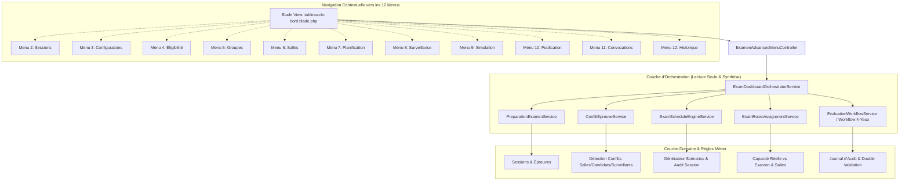

# EA-EXAMENS-01 — Phase 1 : Architecture Cible & Conception Système

**Projet :** UniRegistre — Laravel  
**Module :** Examens Advanced — Menu 1 (Enterprise Command Center)  
**Date :** 28 Octobre 2026  

---

## 1. Vue d'Ensemble Architecturale

Le Tableau de bord des examens (Menu 1) agit comme un **Command Center d'orchestration et de gouvernance** de haut niveau. Il centralise la télémétrie des 12 menus fonctionnels sans dupliquer leurs règles métier respectives.

---

## 2. Découpage en Couches Responsables

### 2.1 Couche de Présentation (`tableau-de-bord.blade.php`)
- **Rôle :** Affichage synthétique, ergonomie Enterprise, responsive, navigation par onglets/sections.
- **Principes :**
  - Aucune requête SQL ni calcul d'allocation dans la vue.
  - Distinction visuelle claire entre contraintes dures (bloquantes / rouge vif) et avertissements (jaune/orange).
  - États explicites : zéros réels vs données non configurées vs indisponibilités.
  - Boutons de redirection contextuelle vers les menus de résolution avec conservation des filtres (`annee_id`, `faculte_id`).

### 2.2 Couche d'Orchestration (`ExamDashboardOrchestratorService`)
- **Rôle :** Agrégation en lecture seule des indicateurs de préparation, audit des sessions, détection des conflits et gouvernance.
- **Garanties :**
  - **Zéro écriture en base :** Le calcul d'un tableau de bord ou d'une simulation n'insère ni ne met à jour aucune donnée académique.
  - **Cloisonnement Faculté :** Filtrage systématique par `faculte_id` pour éviter toute fuite d'informations inter-facultés.
  - **Fiabilité & Fraîcheur :** Horodatage de calcul, indice de complétude des données.

### 2.3 Moteur de Contraintes & Détection des Conflits
- Famille A : Conflits de Salles (chevauchement, surcapacité, équipement manquant).
- Famille B : Conflits de Candidats (double convocation simultanée, transition impossible).
- Famille C : Conflits de Surveillance (surveillant doublement affecté, indisponibilité).
- Famille D : Conflits de Planning (hors période de session, dépendances non respectées).

### 2.4 Moteur de Score de Préparation
- Décomposition en 7 dimensions académiques pondérées.
- Sortie binaire impérative : **Éligibilité Opérationnelle** (`ELIGIBLE` vs `BLOQUE`).
- Règle d'or : Même avec un score de 95%, si une contrainte dure (ex: salle surchargée de 50 places) est violée, la session est déclarée `BLOQUÉE`.

### 2.5 Gouvernance à 4 Yeux (Workflow de Validation)
- Séparation stricte :
  - **Proposition calculée (`PROPOSED`)** != **Décision approuvée (`APPROVED`)**.
  - **Décision approuvée (`APPROVED`)** != **Planning publié (`PUBLISHED`)**.
- L'approbation nécessite deux acteurs distincts (interdiction de s'auto-approuver).
- Traçabilité complète dans le journal d'audit.
