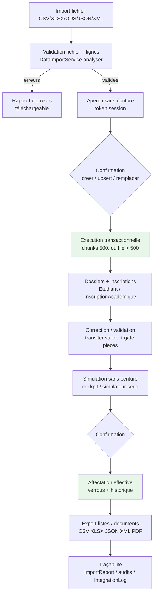
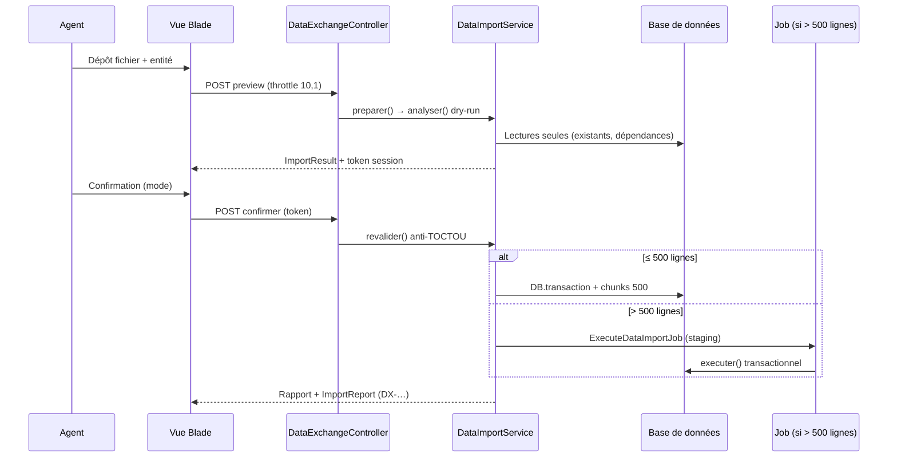
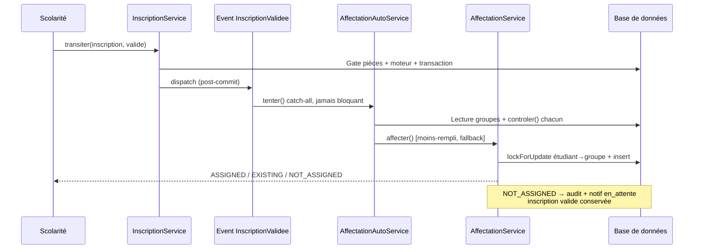

# Fonctionnement de l'import / export et de l'affectation automatique des étudiants aux groupes

> **Document d'analyse — mission exclusivement documentaire.**
> Chaque affirmation est étiquetée selon son niveau de preuve :
> - ✅ **Confirmé dans le code** — lu directement dans le fichier cité.
> - 🧪 **Confirmé par un test exécuté** — test lancé pendant cette mission (résultats ci-dessous).
> - 🔎 **Déduit de l'architecture** — inféré de structures lues, sans lecture exhaustive du corps.
> - ⚠️ **Non vérifié** — non lu pendant cette mission, à contrôler avant usage.
> - ❌ **Absent ou non implémenté** — recherché et non trouvé dans le code.

**Périmètre :** import unifié `DataExchange` (web `/admin/donnees` + API `/api/v1/data/*`), exports (listes, académiques, documents, modules), affectation étudiants→groupes (6 services, cockpit, simulateur, automatique post-validation).
**Hors périmètre assumé :** circuit legacy `ImportApiController`/`imports:*` et `/admin/integrations` (existants, cités §4.6 sans détail), affectation des enseignants/surveillances (autre moteur).

---

## 1. Résumé fonctionnel (scolarité)

**Importer.** Depuis *Données → Centre d'import/export*, un agent habilité (`data.import`) choisit un type de données (étudiants, notes, inscriptions, référentiels…), dépose un fichier (CSV, Excel `.xlsx`, `.ods`, JSON ou XML, ≤ 10 Mo, ≤ 5 000 lignes), visualise un **aperçu sans écriture** (lignes valides / erreurs codées par ligne), puis confirme en mode *créer*, *mettre à jour* ou *remplacer* (selon le type). Au-delà de 500 lignes, le traitement passe en tâche de fond avec suivi. Chaque import produit un **rapport** (créées, mises à jour, ignorées, rejetées) et les erreurs sont téléchargeables. ✅

**Exporter.** Depuis *Listes*, *Données* ou chaque module (présences, examens, délibérations…), l'agent filtre une population (année, faculté, programme, niveau, groupe, statut…) et télécharge la liste en CSV, Excel, JSON, XML ou PDF selon le canal. Les données personnelles (CIN complète, e-mail, téléphone) sont **masquées ou retirées** sans l'habilitation `exports.personal`. Les gros volumes basculent en tâche asynchrone (seuil 5 000 sur les listes). ✅

**Affecter.** Après validation d'une inscription, l'étudiant peut être affecté **automatiquement** à un groupe compatible (même faculté, même programme, **même niveau**, places disponibles), en choisissant le groupe le moins rempli. En masse, la scolarité utilise le **cockpit** : analyse sans écriture, propositions à valider une à une ou en lot, simulation avancée avec graine reproductible, lots asynchrones au-delà de 1 000. **Un étudiant de L1 n'est jamais affecté à un groupe L2** (garde `LEVEL_MISMATCH` bloquante, sauf exception manuelle autorisée `groupes.manage`). Sans groupe compatible : pas d'invention — statut explicite `NOT_ASSIGNED`, audit, notification, file « Sans groupe ». ✅

**Enchaînement.** ✅ Importer des étudiants → créer leurs inscriptions (import ou validation) → lancer une simulation → appliquer → exporter les listes : chaque étape existe et est traçée, mais **l'enchaînement reste manuel** (aucun pipeline automatique import→affectation→export).

---

## 2. Architecture technique

```
┌─────────────┐   ┌──────────────────┐   ┌─────────────────────┐
│ Vues Blade  │──▶│ Contrôleurs     │──▶│ Services métier     │──▶ Base (Eloquent)
│ + API v1    │   │ (Gates, throttle│   │ (transactions,      │   (migrations,
│             │   │  validation)     │   │  verrous, audit)    │    contraintes)
└─────────────┘   └──────────────────┘   └─────────────────────┘
        │                  │                        │
        │          ┌───────┴────────┐      ┌────────┴────────┐
        │          │ Jobs (files > │      │ Events/Listeners│
        │          │ 500 import /  │      │ (jamais bloquants│
        │          │ 5000 listes)  │      │  pour le métier) │
        └──────────┴───────────────┴──────┴─────────────────┘
```

| Couche | Import | Export | Affectation |
|---|---|---|---|
| Routes | `routes/web.php:832-872` (`donnees.*`), `routes/api.php:214-223` (`data.*`) ✅ | `routes/web.php:936-965` (`listes.*`, `exports.*`), `routes/api.php:221-258`, routes modules ✅ | `routes/web.php:568-673`, `routes/api.php:227-233` (`assignments.*`) ✅ |
| Contrôleurs | `Admin\DataExchangeController` ✅ | `Admin\ListesController`, `Admin\ExportController`, `Api\V1\DataExchangeApiController`, `Api\V1\ExportApiController` ✅ | `Admin\AffectationController`, `AutomaticAssignmentController`, `AffectationProposalController`, `Api\V1\AssignmentApiController` 🔎 |
| Services | `Services\DataExchange\DataImportService` ✅ | `Services\Exports\ListeEtudiantsService`, `Services\DataExchange\DataExportService`, `Services\Io\*Serializer`, `AcademicExportEngine`/`ExportOrchestrator` ✅ | 6 services (§7) ✅ |
| Persistance | `ImportReport`, `ImportJob/Row/Change`, `IntegrationLog` ✅ | `ImportReport` (`type=listes.*`, `data.*`), `IntegrationLog` ✅ | `AffectationGroupe` (+`verrouille`), `SituationEtudiant`, `AffectationMasseLot`, `assignment_simulations/items`, `AffectationProposal` ✅ |
| Moteurs de fichiers | `Services\Io\IoFactory` + 5 parsers (OpenSpout pour xlsx/ods) ✅ | 5 serializers + Dompdf (PDF) ✅ | — |
| Dépendances | `openspout/openspout ^5.11`, `dompdf/dompdf ^3.1` (`composer.json:10,15`) ✅ · ❌ pas de PhpSpreadsheet, pas de Snappy/Browsershot/FPDI | | |

---

## 3. Cartographie détaillée

### 3.1. Import — routes, contrôleurs, services, modèles, vues, sécurité, tests

| Élément | Référence vérifiée |
|---|---|
| Hub web | `GET /admin/donnees` (`donnees.hub`, `can:data.import`) — `DataExchangeController::hub` (`:33-40`) ✅ |
| Preview | `POST …/import/preview` (`throttle:10,1`, fichier `required\|file\|max:10240\|mimetypes:…`) → `DataImportService::preparer()` (`:52-80`) → token UUID en **session serveur**, vue `admin.donnees.preview` ✅ |
| Confirmation | `POST …/import/confirmer` (`token size:36`, `mode in:creer,upsert,remplacer`) → re-validation anti-TOCTOU → exécution ou file ✅ |
| Annulation | `POST …/import/annuler` (oubli du token en session, aucune écriture) ✅ |
| Historique / erreurs | `GET …/historique` (restreint : propres rapports si périmètre restreint), `GET …/rapports/{rapport}/erreurs/{csv,json}` (`throttle:20,1`) ✅ |
| Œil pré-import | `GET …/{entite}/donnees` (`donnees.voir`) : 404 propre si import-seul, garde `finances.view` pour `factures` ✅ |
| API | `POST /api/v1/data/{entite}/import/preview` + `/confirm` + `GET …/export/{format}` (`scope:data:exchange`, throttles `api-imports`/`api-exports`, **stateless : fichier re-transmis**, pas de `remplacer` via API) ✅ |
| Registre | `Services\DataExchange\DefinitionRegistry` : `IMPORTS` (`:60-102`, ~41 clés dont alias), `EXPORTS` (`:107-152`), `exportables()`, `consultables()` ✅ |
| Contrat | `ImportDefinitionInterface` (`entite, colonnes, colonnesRequises, regles, cleDoublon, trouverExistant, persister, modes, vider`) + contrats `ImportValidationAvancee` (métier), `ImportContextuel` (contexte serveur), `ImportSansPii` (fail-closed) ✅ |
| Graphe | `ImportDependencyService::DEPENDANCES` (ex. `etudiants→[facultes]`, `notes→[etudiants,matieres]`) vérifié en `analyser` et `confirmer` ✅ |
| File | `ExecuteDataImportJob` (`tries=1`, `timeout=600`, staging `import_jobs/rows` par chunks de 500, reprise du contexte serveur, notif auteur) ✅ |
| Rollback | `ImportRollbackService::annuler` — **refusé si dépendances** (ex. notes verrouillées) ✅ (exposition HTTP ⚠️ non cherchée) |
| Vues | `admin.donnees.*` (hub, formulaire, preview, rapport, historique) 🔎 (existence lue, contenu non détaillé) |
| Sécurité | `can:data.import/export`, throttles 10-20/min, `file_hash` anti-rejeu (avertissement `IMPORT_ALREADY_PROCESSED`), `Idempotency-Key` 24h sur le circuit legacy `imports/exports.store` **uniquement** (pas sur `data.*`) ✅ |
| Tests | `DataExchangeTest`, `ImportCenterPhase17Test`, `DataImportQueuedTest`, `NotesImportMultiTest`, `NotesImportAssociationTest`, `TeacherHomonymeImportTest`, `ReferentielLot2Test`, `LmdImportPipelineTest`, `ReferentielImportIdempotenceTest`, `VerificationOeilTest`, `Security/ImportExportSecurityTest`, `ApiImportTest` (liste relevée, contenus non relus un par un) 🔎 |

### 3.2. Export — routes, contrôleurs, services, modèles, vues, sécurité, tests

| Élément | Référence vérifiée |
|---|---|
| Listes centrales | `GET listes` (index), `GET listes/preview` (25/lignes + stats), `GET listes/exporter/{csv,xlsx,pdf}` (`throttle:10,1`, `can:data.export`), `GET listes/imprimer` (limite 1000), `GET listes/exports` + `…/download` (propriétaire ou super_admin), `POST/DELETE listes/profils` — `Admin\ListesController` ✅ |
| Moteur listes | `ListeEtudiantsService` : 13 filtres (`FILTRES :20-24` : année, programme, niveau, semestre, groupe, sous-groupe, UE, matière, enseignant, statut, sans-groupe, recherche, ancienneté), 8 tris, 9 regroupements (+ alias parcours/module/ECUE), `chunk(1000)` avec eager (`:189-191`), colonnes `lignePour()` (`:319-345`, `moyenne/credits/decision` **toujours vides**) ✅ |
| Exports académiques | `Admin\ExportController` (`prefix exports`, `can:archives.view` ; `generate` : `can:configuration.manage`, formats `csv,xlsx,json,xml` — **pas pdf**) ; moteur `AcademicExportEngine::construire()` + `ExportOrchestrator` (bascule job > 500 lignes, stockage privé, expiration 168 h, purge) ✅ |
| DataExchange | `GET donnees/{entite}/export/{csv,xlsx,json,pdf}` (`can:data.export`, `throttle:20,1`, garde `finances.view` factures) ; modèles vierges `…/modele/{csv,xlsx}` ✅ |
| API | `GET /api/v1/data/{entite}/export/{format}` (`scope:data:exchange`, `DataExportService`, **plafond 10 000, tout en mémoire** `:37-40`) ; `POST /api/v1/exports` (`scope:exports:create`, formats `csv,json,xml,xlsx` — **pas pdf**, `Idempotency-Key`) ✅ |
| Serializers | `CsvSerializer` (BOM, `;`, anti-formules `'=+-@`→`'…`), `XlsxSerializer` (OpenSpout streaming), `JsonSerializer`, `XmlSerializer` (DOM, sans DTD), `PdfSerializer` (via `PdfGeneratorInterface`) — ❌ **pas de `OdsSerializer`** (ODS = lecture seule) ✅ |
| PDF | Dompdf uniquement (`DompdfPdfGenerator`, `isRemoteEnabled=false`, DejaVu Sans) ; binding `ModuleServiceProvider:192` ; ❌ pas de Snappy/Browsershot/FPDI ✅ |
| Confidentialité | `ExportColumnPolicy` : catalogues whitelist, `COLONNES_PERSONNELLES = cin,email,telephone`, retrait sans `exports.personal`, `masquerCin()` (`BK***001`), permission calculée 1 fois ; `ExportRegistry::colonnesAutorisees()` retire `cin,telephone,adresse,date_naissance` ✅ |
| Scoping | `requete()` `:64-71` (serveur), `filtresValides`, `bornerFaculte` (web + API), `*Definition::filtrer()` ✅ |
| Volumes | Listes : sync ≤ 5 000 (`SEUIL_ASYNC`), job au-delà (`GeneratePopulationExport`, `timeout 600`, params sérialisables, notif) ; PDF listes ≤ 1 000 (`PDF_MAX_LIGNES`) ; audit : `limit(5000)` + `cursor()` (vrai streaming) ; simulations affectation : `chunkById(500)` ✅ |
| Exports spécifiques | Feuille de présence (multi-modèles + QR), émargement, convocations (sans CIN/notes), PV délibération (validée+, sans CIN), 15 documents officiels (registre + éligibilité + `lockForUpdate` + supersession), reçu paiement, récépissé (sans CIN, sans stockage), emploi surveillances, notes anonymes (compostage uniquement), feuilles d'appel/absences, simulations et masse (CSV `;` BOM) — §6.6 du rapport d'audit ✅ (lecture, non réexécutés ici) |
| Journalisation | `IntegrationLog` (`export.listes`, `data.export.*`, `export.presences.feuille`, `export.emargement/convocation/pv-deliberation`, références `EXP-/PRS-/EMG-/CNV-/PV-` + `request_id`) ; `AuditService` (`document.genere`, sans PII) ; ❌ pas de journal dédié pour les CSV ponctuels (audit/bi/stats/affectations/notes/appels) ✅ |
| Tests | `ExportListesTest`, `ApiExportTest`, `AsyncExportTest`, `SensitiveExportTest`, `AcademicExportTest`, `PdfGroupListTest`, `Population*` (10 fichiers), documents/attestations/relevés (8 fichiers) 🔎 (liste relevée, contenus non relus) |

### 3.3. Affectation — routes, contrôleurs, services, modèles, vues, sécurité, tests

| Élément | Référence vérifiée |
|---|---|
| Source de vérité | `Services\AffectationService` : `controler()` (`:41`, 10 cas), `affecter()` (`:163`), `simuler()` (`:278`), `affecterLot()` (`:310`), `retirer()` (`:367`), `impacts()` (`:420`), `repartitionAutomatique()` (`:450`), `contexteBulk()` (`:532`), `precheck()` (`:581`) ✅ |
| Engine unifié | `Affectations\AffectationEngine` : éligibilité 5 axes, filtrage dur, scoring /100, certitude, propositions persistées (`evaluer/traiterEtudiant/accepter/modifier/rejeter/affecterAutomatique/affecterExceptionnel/noter/certitudePour`) ✅ |
| Cockpit masse | `Affectations\MassAssignmentService` : `chargerCandidats/Groupes`, `analyser()` (sans écriture), `confirmer()`, `creerPropositions()`, `creerLot()` ✅ |
| Simulateur avancé | `Affectations\AssignmentSimulationService` : seed `Str::random(8)`, départage `sha256(seed:id)`, contraints-d'abord, MOVE/SWAP bornés, `planCapacite()`, persistance **technique seule** (`assignment_simulations/items`) ✅ |
| Auto post-validation | `AffectationAutomatiqueService::tenter()` (`:39`, `reessayer`, `simuler`, `tenterPourEtudiant`) ← event `InscriptionValidee` (`$afterCommit=true`) ← `InscriptionService::transiter()` vers `valide` ← listener `TenterAffectationAutomatique` (catch-all, jamais bloquant) ✅ |
| Éligibilité admin. | `Affectations\AffectationEligibilityService` : 5 axes (identité/contact/programme/inscription/documents), `IDENTITY_CIN_DUPLICATE` via `REPLACE(UPPER(TRIM(cin)))`, MENS bloquant/divergent ✅ |
| Contraintes avancées | `AssignmentConstraintEngine` : `FACULTY_SCOPE`, `CAPACITY` (simulée), `SCHEDULE` (jour exact, `$debutA < $finB && $debutB < $finA`) ✅ |
| Confirmation | `AssignmentConfirmationService` (par groupe, idempotente, obsolescence par hash) ; `AssignmentEligibilityResolver` (pré-filtre bulk) ✅ |
| Config | `config/affectations.php` : barème (`niveau 30, parcours_exact 25, …`), seuils (`auto_score 85, auto_ecart 8, …`), lots (`seuil_sync 1000`, tranche 500) ✅ |
| Verrouillage | `affectations_groupe.verrouille` (+`confirme_le/par`) : refus sans `force` (+`groupes.manage`), `retirer()` déverrouille en traçant ✅ |
| Historique | `AffectationGroupe` (une `active` à la fois, `etudiants.groupe_id` = pointeur courant) + `SituationEtudiant{type=groupe}` + audits `assignment.*`/`affectation.auto_*` + `PopulationChanged` ✅ |
| Concurrence | `affecter()` : transaction + **ordre fixe étudiant→groupe** (`Etudiant::lockForUpdate` `:197`, `Group::lockForUpdate` `:201`, capacité re-vérifiée `:203-205`) ; idempotence même groupe+année ; `confirmer()` : 1 transaction + `Group::whereIn()->lockForUpdate()` ; lots : reprise `traites_ids`, `tries=1` ✅ |
| Routes web | `routes/web.php:568-673` : individuel (`store/previsualiser/retirer`, `can:archives.update/view`), cockpit masse (analyser/confirmer/proposer/exporter/`can:data.export`/recherche/lots), propositions (accepter/modifier/rejeter/bulk), auto (simuler/appliquer), simulateur avancé (paramètres/simuler/confirmer/régénérer/annuler/exporter) ✅ |
| API | `routes/api.php:227-233` (`assignments/*`, scopes `assignments:read|write`) + `openapi.yaml:452-482` 🔎 (lus par l'audit, non relus ici) |
| Vues | `resources/views/admin/affectations/` (masse, lots, auto, simulation, propositions…) 🔎 |
| Sécurité | Lecture `archives.view`, écriture `archives.update`, export `data.export`, `force`→`groupes.manage`, `affecterExceptionnel`→`groupes.manage` OU `affectations.override`, `annulerLot`→auteur OU `archives.delete`, scope faculté → **403** (store/retirer/confirmer) ou **404** (verifierScope) ✅ |
| Règle L1↛L2 | `controler()` `:92-99` : `LEVEL_MISMATCH` bloquant sauf `force` ; répliquée dans `prefiltreSignature`, `admissiblesLeger`, `evaluer()` Règle 1, `analyser()` Règle 2, `precheck()` ; niveau jamais inventé en auto (`$inscription->niveau ?: $etudiant->niveau`, vide = `MISSING_ACADEMIC_DATA`) ✅ |
| Sans groupe | `NOT_ASSIGNED` (`NO_COMPATIBLE_GROUP` / `CAPACITY_EXCEEDED` + `planCapacite`) : audit `affectation.auto_non_assignee` + notif `affectation.en_attente` (fail-soft) + `groupe_id` NULL → file « Sans groupe », inscription `valide` conservée ✅ |
| Tests | `AffectationMoteurTest`, `AffectationEngineTest`, `AffectationCockpitTest`, `AffectationConcurrenceTest`, `AffectationAutomatiqueApresValidationTest`, `AffectationApresDossierCompletTest`, `AffectationMasseLotTest`, `AssignmentAutomatiqueTest`, `AssignmentApiTest`, `ReferentielAffectationLmdTest`, `Performance/AffectationBenchmarkTest`… 🔎 |
| ❌ Absent | Hiérarchie Domaine→Mention **non lue** par le moteur (domaine = +10 forfaitaire même faculté) ; **pas de semestre** sur `Group` (`$fillable :24-28`) ; **pas de création auto** de groupes (`planCapacite` suggère seulement) ; `evaluerLot()` supprimé ; pas de file « Sans groupe » matérialisée (requête `whereDoesntHave`) ✅ |

---

## 4. Fonctionnement détaillé de l'import (LOOP 2)

### 4.1. Parcours chronologique (centre unifié web)

1. **Accès** : `GET /admin/donnees` (`can:data.import`). Choix de l'entité parmi `DefinitionRegistry::entites()`. ✅
2. **Sélection du type** : `GET …/{entite}/import` (formulaire) ; l'œil `…/{entite}/donnees` montre les exportables (404 propre si import-seul). ✅
3. **Formats/tailles** : CSV, XLSX, ODS, JSON, XML ; 10 Mo (`max:10240`) ; 5 000 lignes métier (`LIGNES_MAX`), parsers 10 000 lignes / 200 colonnes. ❌ `.xls` BIFF, PDF, DOC refusés (extension non listée → `formatInvalide`). ✅
4. **Validation fichier** : extension + MIME réel par format + JSON revalidé + XXE refusé (3 couches : contrôleur→moteur→parser : `DOCTYPE|ENTITY`, `LIBXML_NONET`) ; macros `vbaProject`/`DDEAUTO` et JSON > 20 000 `{` refusés (inspecteur Phase 17 — utilitaire, ⚠️ appel depuis le pipeline chaud non vérifié). ✅/⚠️
5. **Colonnes** : alias canonique-prioritaire, conflits ambigus refusés, colonnes requises manquantes → `IoException` ; normalisation `ValueNormalizer` (NFC, chiffres arabo-indiens, dates Excel/séries/FR-AR, statuts notes `ABS/AJ…`, `+216`, anti-formules). ✅
6. **Ligne** : `Validator::make(regles())` → `INVALID` ; doublon intra-fichier (`cleDoublon`) → `DUPLICATE_FILE` ; `validerLigneMetier()` (codes ex. `FACULTY_SCOPE_VIOLATION`, `NOTE_VERROUILLEE`) ; garde PII (`ImportSansPii` : 13 en-têtes interdites → **fichier entier rejeté** `PII_FIELD_FORBIDDEN`). ✅
7. **Doublons vs base** : `trouverExistant()` par clé métier (étudiants : matricule→CIN→email ; notes : chaîne CIN→matricule→num_inscription→CIN+DoB, **jamais nom seul** ; enseignants : email, **homonyme sans email refusé**) ; existant → avertissement « sera mis à jour (mode upsert) ». ✅
8. **Aperçu sans écriture** : `analyser()` dry-run, `ImportResult{valides, erreurs[{ligne,champ,message,code}], avertissements, apercu(10)}`, token UUID en session. ✅
9. **Création/mise à jour/rejet** : modes `creer/upsert/remplacer` (remplacer : jamais via API, refusé si hors `modes()` ; MENS : `vider()` no-op, **jamais de vidage**). ✅
10. **Enregistrement** : re-validation anti-TOCTOU (`revalider()`), transaction + chunks de 500, `tries=1/timeout=600` en file ; `ImportReport` (`pending/completed/failed`, `DX-…`, durée) ; `IntegrationLog` (SHA-256 du payload, **jamais le contenu**). ✅
11. **Rapport** : lignes traitées/créées/modifiées/ignorées/rejetées + erreurs téléchargeables (CSV/JSON : `row,error_code,message,field,value`). ✅
12. **Relance/rollback** : `file_hash` → avertissement `IMPORT_ALREADY_PROCESSED` (non bloquant) ; `ImportRollbackService::annuler` **refusé si dépendances** ; purge des fichiers : `import_retention_hours` lu en config, ⚠️ scheduler non cherché.

### 4.2. Réponses aux questions obligatoires

| Question | Réponse |
|---|---|
| Exécution immédiate ou après confirmation ? | **Après confirmation** : preview (token) → confirmer (mode). L'API exige la re-transmission du fichier (stateless). ✅ |
| Aperçu sans écriture ? | **Oui**, `analyser()` dry-run + token session (web) / réponse `valid/total_rows/errors` (API). ✅ |
| Erreurs de lignes ? | Codes stables (`INVALID`, `DUPLICATE_FILE`, `FACULTY_SCOPE_VIOLATION`, `NOTE_VERROUILLEE`…), ligne/champ/message, 10 en aperçu, 50 en API, export CSV/JSON complet. ✅ |
| Échec partiel = données enregistrées ? | **Non en sync** : `DB::transaction` globale (`executer()` `:396-410`) — tout ou rien ; en file : staging validé puis exécution transactionnelle. ✅ |
| Doublons ? | Clé métier par définition + doublon intra-fichier + `file_hash` fichier. ✅ |
| Relations vérifiées ? | Oui : graphe `DEPENDANCES` (prérequis bloquants), `validerLigneMetier` (faculté, programme, ECUE, verrous), chaîne notes sans nom seul. ✅ |
| Idempotence ? | Réimport `upsert` naturel ; `creer`+existant : selon définition (notes = no-op « doublon ignoré », MENS = throw, étudiants = maj silencieuse) ; `file_hash` = avertissement. ✅ (nuances par définition) |
| Limite de volume / lots ? | 5 000 lignes (métier), 10 000 (parsers), 10 Mo, file > 500 lignes, chunks 500, `timeout 600`. ✅ |

---

## 5. Fonctionnement détaillé de l'export (LOOP 3)

### 5.1. Parcours

1. **Déclencheurs** : *Listes* (populations libres), *Données→Export* (par entité), *Exports académiques*, chaque module (présences, épreuves, délibérations, documents, finances, surveillances…), API. ✅
2. **Données selon le rôle** : scoping faculté serveur partout (`requete()`, `filtresValides`, `bornerFaculte`, `*Definition::filtrer()`) ; permissions `archives.view`, `data.export`, `configuration.manage`, `statistiques.export`, scopes API. ✅
3. **Filtres** : les 13 de `ListeEtudiantsService` (année, programme, niveau, semestre, groupe, sous-groupe, UE, matière, enseignant, statut, sans-groupe, recherche, ancienneté) + regroupements + tris ; datasets prédéfinis (`PopulationDataset`, 10 datasets permission-gated). ✅
4. **Formats effectifs** : CSV, XLSX, JSON, XML, PDF — **selon le canal** (listes web : csv/xlsx/pdf ; exports académiques web : csv/xlsx/json/xml **sans pdf** ; API exports : csv/json/xml/xlsx **sans pdf** ; DataExchange : +pdf). ❌ ODS en sortie sur tous les canaux. ✅
5. **Colonnes** : `lignePour()` (numéro, matricule CIN masquée, identité, contacts, rattachements ; `moyenne/credits/decision` = `''` **toujours**) ; catalogues `ExportColumnPolicy` + `*Definition::colonnesAutorisees()`. ✅
6. **Valeurs** : BOM UTF-8, `;`, anti-formules, dates ISO, DOM échappé, accents préservés (UNESCAPED_UNICODE). ✅
7. **Confidentialité** : CIN `BK***001` / e-mail-téléphone retirés sans `exports.personal` (calculé 1 fois) ; `ExportRegistry` retire `cin,telephone,adresse,date_naissance` ; API : `cin_masquee` public, `cin` si scope `archives:read`. ✅
8. **Génération** : sync direct (`streamDownload`, PDF ≤ 1 000 lignes) ou async (`GeneratePopulationExport`, `ExportStudents/AcademicRecordsJob`, stockage privé `integrations/exports/…` ou `listes/exports/`, expiration 168 h, notif). ✅
9. **Gros volumes** : listes `chunk(1000)` + seuil async 5 000 ; DataExchange API **plafond 10 000 tout en mémoire** ; audit `cursor()` + `limit(5000)` ; simulations `chunkById(500)`. ✅
10. **Nommage/conservation** : références `EXP-/PRS-/EMG-/CNV-/PV-/DX-` + `request_id` ; historique `ImportReport` (filtres sans PII, compteurs, `expires_at`). ✅
11. **Erreurs** : `IntegrationLog` (`completed/failed`, codes, durées) ; rapports d'erreur téléchargeables (import) ; ❌ pas de journal dédié pour les CSV ponctuels. ✅
12. **Cohérence** : preview 25 lignes + stats avant export (listes) ; historique filtrable ; rapports avec filtres d'origine. ✅

### 5.2. Réponses aux questions obligatoires

| Question | Réponse |
|---|---|
| Permissions + filtres respectés ? | Oui : Gates/scopes + scoping serveur + `bornerFaculte` sur les 3 canaux. ✅ |
| Sensibles exclues/protégées ? | Oui : masquage/retrait + permission `exports.personal` + garde `finances.view` (factures). ⚠️ `AffectationController::exporterMasse` expose la **CIN en clair** (lu `:503/509`, motif non vérifié). |
| Sync + async ? | Oui (seuils 500/5 000/1 000 selon canal). ✅ |
| Plusieurs milliers d'étudiants ? | `chunk(1000)`, jobs `timeout 600`, plafond API 10 000, mesure : voir §10. ✅ |
| CSV/XLSX/JSON/XML réels ? | Oui selon canal (§5.1.4) ; **ODS absent partout en sortie**. ✅ |
| Export résultats d'affectation + historique ? | Oui : CSV simulations (`AutomaticAssignmentController::exporter`, `chunkById(500)`) + CSV masse (propositions+blocages) ; historique via `AffectationGroupe`/`SituationEtudiant`/audits (pas de fichier d'historique dédié). ✅ |

---

## 6. Affectation automatique (LOOP 4)

### 6.1. Éligibilité

**Obligatoires** (bloquantes) : dossier existant ; CIN présente/valide (7-10 chiffres) et **non dupliquée** (variantes espacées couvertes) ; MENS sans conflit bloquant ; contact (e-mail ou tél) ; faculté+programme+niveau résolus et cohérents ; **inscription `en_cours`/`valide`** (`REGISTRATION_INVALID` sinon) ; **documents requis complets** (matrice vide = réputé complet) ; non suspendu ; groupe actif ; programme compatible (si renseigné des 2 côtés) ; **niveau identique** (si renseigné des 2 côtés) ; capacité > 0 ; scope faculté ; pas d'affectation verrouillée ; étudiant non déjà affecté (sinon `EXISTING`, transfert historisé). ✅

**Classement** : barème `config/affectations.php` (niveau 30, parcours 25/15, filière 20/15, domaine 10, confort capacité 5, équilibrage 10) ; tri effectif `[effectif, -places, id]` ; seed `hash(seed:id)` pour le départage reproductible ; certitude haute/moyenne/faible (score ≥ 85, écart ≥ 8, remplissage < 85). ✅

**Non implémenté** : hiérarchie Domaine→Mention (forfait +10 même faculté), semestre (absent de `Group`), quotas par sexe/parcours au-delà de la stratégie `mixite_genre` du simulateur, admission Master devinée (fin de cycle = admission explicite requise). ✅/❌

### 6.2. Sélection du groupe cible

1. Niveau officiel : `$inscription->niveau ?: $etudiant->niveau`, vide = `MISSING_ACADEMIC_DATA` (**jamais d'incrément aveugle**). ✅
2. Candidats : groupes actifs, faculté de l'étudiant, année (NULL ou = année), programme compatible. ✅
3. Capacité : `effectifActuel() < capacite` (+ places simulées en masse) ; `GROUP_FULL`/`CAPACITY` bloquants sauf `force`. ✅
4. Compatibilité : faculté + programme + **niveau strict** + horaire (jour exact) + scope. ✅
5. Élimination : inactifs, incompatibles, complets (sauf `force` + `groupes.manage`, motif obligatoire, audit `assignment.exceptional_override`). ✅
6. Départage : score puis moins-rempli puis id (engine) ; effectif simulé puis places puis id (masse) ; `[effectif, id]` + boucle fallback (auto). ✅
7. **L1→L2** : `LEVEL_MISMATCH` bloquant (`controler()` `:92-99`, message explicite) ; seule exception = `force` + permission. **Aucune exception silencieuse trouvée.** ✅
8. **Aucun compatible** : `NOT_ASSIGNED` + raison (`NO_COMPATIBLE_GROUP` / `CAPACITY_EXCEEDED` + `planCapacite` : nb groupes manquants, capacité médiane, code suggéré) + audit `affectation.auto_non_assignee` (exclus par groupe) + notification `affectation.en_attente` + inscription conservée. **Jamais d'affectation inventée, jamais de création auto de groupe.** ✅

### 6.3. Modes d'exécution

| Mode | Entrées | Contrôles | Sorties / effets base |
|---|---|---|---|
| Individuel (`store/retirer`) | étudiant, groupe (+sous-groupe), motif | `controler()` + `impacts()` + `previsualiser`, Gates, scope 403/404 | `AffectationGroupe{active}` + clôture ancienne + `etudiants.groupe_id` + `SituationEtudiant` + `PopulationChanged` + notif ; `retirer` = clôture historisée (jamais de delete) ✅ |
| Masse cockpit | filtres candidats + groupes | `precheck()` + `analyser()` **sans écriture** + `lockForUpdate` + tranches 500 | `confirmer()` transactionnel, rapport (proposées/bloquées/warnings), CSV, reprise reliquat ✅ |
| Propositions semi-auto | analyse | seuils `auto_score/ecart/remplissage` | `AffectationProposal` (en_attente→acceptee/modifiee/rejetee), alternatives compactes, `Cas sûrs` ✅ |
| Simulateur avancé | paramètres + seed | contraints-d'abord, MOVE/SWAP bornés, pureté (zéro écriture métier, prouvée) | `assignment_simulations` + `items`, métriques, `regenerer()`, confirmation par groupe idempotente ✅ |
| Lots async | sélection > `seuil_sync` (1000) | normalisation, auteur re-vérifié | `AffectationMasseLot` (compteurs, reprise `traites_ids`, annulation coopérative), page suivi ✅ |
| Auto post-validation | `InscriptionValidee` (post-commit) | éligibilité + scope-first + niveau officiel + boucle fallback capacité | `ASSIGNED/EXISTING/LOCKED/NOT_ASSIGNED…`, bilan immédiat, `POST …/reaffecter`, jamais bloquant pour l'inscription ✅ |
| Réaffectation | transfert | mêmes gardes + verrou (exception explicite sinon) | clôture + création, historique conservé ✅ |
| Reprise | reliquat / lot / reaffecter | `vueReliquat()`, `traites_ids`, `reessayer()` | jamais de double application (idempotence) ✅ |

### 6.4. Sécurité et intégrité

| Exigence | Implémentation vérifiée |
|---|---|
| Concurrence | Ordre fixe **étudiant→groupe** (`affecter` `:197-201`, `retirer` `:374`) ; re-vérification capacité sous verrou ; `confirmer()` 1 transaction + `whereIn()->lockForUpdate()` ; TOCTOU absorbés en `ignores`/`CAPACITY_RACE` ✅ |
| Transactions | `DB::transaction` sur chaque écriture (affecter, retirer, confirmer, confirmerGroupe, tenter-auto via `affecter`) ✅ |
| Idempotence | Même groupe+année = existante retournée ; `updateOrCreate` propositions ; lots reprise ; double confirmation = 0 écriture ✅ |
| Doubles | Impossible : une seule `active` par (étudiant, année) — garantie par verrou + relecture sous verrou ✅ |
| Antériorité | Clôture (`cloturee` + `date_fin`) + `SituationEtudiant` avant/après + motif + auteur + date ✅ |
| Traçabilité | `assignment.*`, `affectation.auto_*`, `assignment.mass_lot_completed`, `assignment.exceptional_override`, `PopulationChanged`, notifs `affectation.groupe/en_attente` ✅ |
| Non-affectés | File « Sans groupe » (requête, pas de table), pistes par signature, `planCapacite` ✅ |
| Annulation/correction | `retirer()` (clôture), `modifier()` propositions, `annulerLot()` (auteur ou `archives.delete`, 422 si clôturé), `corriger` inscription 4-eyes ✅ |

### 6.5. Résultats affichés

Comptes standard : examinés, éligibles, affectées, déjà affectés, bloqués (par code), sans compatible, groupes complets, erreurs métier vs techniques, `manque`/`groupes_supplementaires`, `candidats[]`/`exclus[{code_groupe,code,message}]`, `matriceCandidats`, `flexibilite`, `categories` d'anomalies, `url_action` fiche étudiant. L'utilisateur comprend chaque cas via les codes + messages + exclusions par groupe + audit. ✅

---

## 7. Relations import → affectation → export (LOOP 5)

| Étape du scénario | Support réel | Liaisons (routes/services/modèles) |
|---|---|---|
| 1. Importer étudiants/référentiels | Centre `donnees.import.*`, 41 définitions, graphe `DEPENDANCES` | `EtudiantDefinition`, `ProgrammeDefinition`, `GroupeDefinition`… ✅ |
| 2. Doublons/inscriptions/qualité | Clés métier + `IDENTITY_CIN_DUPLICATE` + MENS + `dossier_corrections` 4-eyes + `AnomalieQualite` | Mêmes services que l'affectation (pas de doublon) ✅ |
| 3. Corriger/valider dossiers | Centre de résolution, `CorrectionService` (drift-check, re-vérification auto), `transiter(valide)` + gate `REGISTRATION_DOCUMENTS_INCOMPLETE` | `InscriptionService::transiter()` ✅ |
| 4. Simulation | Cockpit `analyser`, simulateur `simuler` (seed), `precheck` | `MassAssignmentService`, `AssignmentSimulationService` ✅ |
| 5. Résultats/anomalies | Propositions + catégories + matrice + pistes + compteurs dashboard | Vues `masse/propositions/automatique-show` ✅ |
| 6. Application | `confirmer` (tranches), lots async, auto post-validation | `AffectationService`, `AssignmentConfirmationService`, `ExecuterAffectationMasseLot` ✅ |
| 7. Répartition | Vues par faculté/programme/niveau/groupe, recherche globale, fiche 360 | `PopulationDataset`, `SearchRegistry` ✅ |
| 8. Export | Listes + CSV simulations/masse + documents officiels | `ListeEtudiantsService`, `AutomaticAssignmentController::exporter`, `AffectationController::exporterMasse` ✅ |
| 9. Historique/rapports | `ImportReport`, `AffectationGroupe`, `SituationEtudiant`, audits, `IntegrationLog`, rapports d'erreurs | Traçabilité complète ✅ |

**Ruptures assumées (pas d'automatisme)** : l'import ne déclenche aucune affectation (l'auto ne part que de la **validation** d'inscription) ; l'export ne déclenche rien ; la création de groupes reste manuelle (`planCapacite` suggère). Le scénario est enchaînable manuellement, jamais automatique. ✅ (constat)

---

## 8. Règles métier et contrôles de sécurité (synthèse)

- **Niveaux** : stricte égalité string (`L1`≠`L2`), `force`+`groupes.manage` seule exception, niveau jamais calculé. ✅
- **Capacités** : effectif réel + places simulées, re-vérification sous verrou, `GROUP_FULL`/`CAPACITY` bloquants. ✅
- **Périmètres** : faculté forcée serveur (restreint→404/403), programme si renseigné, scopes API (`data:exchange`, `assignments:read|write`, Sanctum). ✅
- **Permissions** : `data.import|export`, `archives.view/update/delete`, `configuration.manage`, `groupes.manage`, `affectations.override`, `exports.personal`, `notes.*`, `document.*`. ✅
- **Fichiers** : 10 Mo, MIME réel, XXE/macros refusés, anti-formules CSV, stockage privé UUID, PII fail-closed (13 en-têtes → rejet total). ✅
- **Données personnelles** : CIN masquée par défaut, e-mail/tél retirés sans habilitation, logs sans PII (SHA-256, références, durées), notifications sans identifiants. ✅
- **Anti-abus** : throttles 10-30/min (web), `api-imports/exports` (API), `Idempotency-Key` 24h (legacy `imports/exports.store`), `file_hash` anti-rejeu, `lockForUpdate` anti-course, 4-eyes corrections, one-shot périodes exception. ✅

---

## 9. Diagrammes (LOOP 6, conformes au code)

### 9.1. Flux global



### 9.2. Séquence d'import avec confirmation



### 9.3. Séquence d'affectation automatique post-validation



---

## 10. Exemple fonctionnel fictif (LOOP 6, valeurs illustratives)

> ⚠️ **Exemple pédagogique** : étudiants, groupes et chiffres fictifs. Seules les *règles* (niveau strict, capacité, moins-rempli) sont celles du code ; les *valeurs* sont illustratives.

**Contexte** : faculté FST, année 2026-2027, programme `L-INFO`. Groupes actifs : `INFO-L1-A` (capacité 30, effectif 29), `INFO-L1-B` (30, effectif 12), `INFO-L2-A` (30, effectif 5).

| Étudiant fictif | Niveau | Groupe choisi | Pourquoi |
|---|---|---|---|
| Amine B. (L1) | L1 | `INFO-L1-B` | `INFO-L1-A` presque plein → moins-rempli ; `INFO-L2-A` **exclu** (`LEVEL_MISMATCH` bloquant) malgré ses 25 places |
| Sara C. (L1) | L1 | `INFO-L1-B` | Même règle ; effectif simulé pris en compte |
| Yassine D. (L2) | L2 | `INFO-L2-A` | Seul compatible de son niveau |
| Rim E. (L1, tous pleins) | L1 | *aucun* | `NOT_ASSIGNED` / `CAPACITY_EXCEEDED` + `planCapacite` (ex. « 1 groupe supplémentaire, capacité médiane 30, code suggéré `INFO-L1-C` ») + audit + notification, inscription conservée |

---

## 11. Tests existants et résultats vérifiés (LOOP 7)

**Exécutés pendant cette mission** (sqlite `:memory:`, zéro impact — 🧪) :

| Commande | Résultat réel |
|---|---|
| `php artisan test --compact tests/Feature/DataExchangeTest.php tests/Feature/ImportCenterPhase17Test.php` | 37 tests, 37 passés, 115 assertions |
| `php artisan test --compact tests/Feature/AffectationAutomatiqueApresValidationTest.php tests/Feature/AffectationConcurrenceTest.php tests/Feature/AffectationMoteurTest.php` | 35 tests, 34 passés + 1 skippé (preuve `FOR UPDATE` MySQL-only, skip documenté), 106 assertions |
| `php artisan test --compact tests/Feature/NotesImportMultiTest.php tests/Feature/ExportListesTest.php tests/Feature/AffectationCockpitTest.php` | 63 tests, 63 passés, 230 assertions — dont mesure `[PERF-IMPORT] volume=1000 duree=3.7s req_preview=8030 req_confirm=10030 pic_memoire=93Mo (FILE+JOB)` |
| `php artisan test --compact tests/Feature/AssignmentAutomatiqueTest.php tests/Feature/AffectationApresDossierCompletTest.php tests/Feature/AffectationMasseLotTest.php` | 51 tests, 51 passés, 180 assertions |

**Total mission : 186 tests, 185 passés + 1 skip documenté, 0 échec.** Les autres suites citées (§3, 🔎) sont relevées par nom sans réexécution ici (couvertes par ailleurs selon `AGENTS.md`).

---

## 12. Limitations, cas non couverts et risques

1. **API export entités export-seules** : `DataExchangeApiController::exporter()` (`:108-110`) passe par `verifierEntite()` (`:125-132`) → `import()` : `presences`, `factures`, `demandes`, `anomalies_qualite` (exportables web) retournent **404 via API**. Revérifié par lecture directe pendant cette mission ; ⚠️ non testé dynamiquement.
2. **CIN en clair dans l'export masse** (`AffectationController::exporterMasse` `:503/509`). Lu tel quel, motif ⚠️ non vérifié.
3. **`AcademicExportEngine` sans chunk/streaming** (`->get()`, `take(PHP_INT_MAX)`) : le job async ré-exécute la même construction mémoire. ✅ lu.
4. **DataExport API : plafond 10 000 tout en mémoire** (`limit(10000)->get()->map()`). ✅ lu.
5. **Colonnes `moyenne/credits/decision` toujours vides** dans `lignePour()`. ✅ lu.
6. **Message `formatInvalide` omet ODS** alors qu'ODS est parsé (confusion utilisateur possible). ✅ lu.
7. **Rollback** : service existant mais exposition HTTP ⚠️ non cherchée ; purge fichiers (`import_retention_hours`) : scheduler ⚠️ non cherché.
8. **Corps `persister()`** d'environ 20 définitions référentiel : signatures vérifiées par grep, corps ⚠️ non relus.
9. **Migrations Phase 17** (`import_jobs/rows/changes…`) : contenu exact ⚠️ non relu.
10. **Mesures** :sqlite uniquement ; MySQL (gap locks, FULLTEXT) ⚠️ non mesuré ici.
11. **Legacy** (`imports:*`, `/admin/integrations`, jobs `Io/*`) : cité, ⚠️ non détaillé.

---

## 13. Recommandations (priorisées)

| # | Recommandation | Motif (preuve) | Priorité |
|---|---|---|---|
| R1 | Corriger `verifierEntite()` pour l'export API (résoudre via `export()` / accepter les export-seules) ou documenter la restriction | §12.1, code lu `:108-132` | Haute |
| R2 | Justifier ou masquer la CIN en clair dans l'export masse | §12.2, `:503/509` | Haute |
| R3 | Streamer `AcademicExportEngine` (curseur) au lieu de `->get()` | §12.3, mémoire | Moyenne |
| R4 | Aligner le message `formatInvalide` (ajouter ODS) ou documenter les formats par canal | §12.6, confusion | Basse |
| R5 | Exposer ou retirer `ImportRollbackService` (route dédiée ou §limites) | §12.7 | Moyenne |
| R6 | Alimenter ou retirer les colonnes `moyenne/credits/decision` de `lignePour()` | §12.5 | Basse |
| R7 | Vérifier les points ⚠️ (§12.7-12.11) avant toute décision structurante | Traçabilité | Moyenne |

**Aucune modification fonctionnelle proposée ou exécutée pendant cette mission** (documentation seule, sur instruction).

---

## 13b. Corrections LOOP MASTER (mission import intelligent, 10/10/2026)

Statuts : `CORRIGÉ ET TESTÉ` (tests exécutés), `NON REPRODUIT` (cherché, non prouvé).

| Anomalie initiale | Cause racine confirmée | Correctif (références) | Tests | État |
|---|---|---|---|---|
| Message formats omet ODS ; plafond lignes affiché en Mo | Textes codés en dur | `IoException::formatInvalide` (+ODS), `tropDeLignes()` + `DataImportService::normaliser` | `DataExchangeContratTest` (9) | `CORRIGÉ ET TESTÉ` |
| En-têtes accentuées jamais mappées (« Prénom » → « prnom ») | 7 copies de normalisation sans translittération | `NormaliseurEnTetes` partagé (5 parsers + moteur) | `NormaliseurEnTetesTest`, `ImportPrediagnosticTest` | `CORRIGÉ ET TESTÉ` |
| `ValueNormalizer` (téléphones, dates…) jamais appelé par l'import | Zéro appelant dans le pipeline | `CorrecteurImportService` (règles versionnées, sensibles exclus, ambigu en `a_revoir`) branché dans `analyser()` | `CorrecteurImportTest` (7) | `CORRIGÉ ET TESTÉ` |
| Aucune revue ligne-par-ligne | Absent | `revoir()` + route `import.revoir` + revue complète exigée + trace rapport (+ file) | `ImportRevueTest` (10), `ImportSecuriteElargieTest` (5) | `CORRIGÉ ET TESTÉ` |
| `trouverExistant` étudiants retournait le 1er étudiant sans identifiant → `persister()` l'écrasait | Requête sans contrainte (fail-open) | Garde fail-closed (retourne null) | `DoublonsGraduesTest` (9, dont non-écrasement e2e) | `CORRIGÉ ET TESTÉ` |
| Doublons binaires, fusions silencieuses possibles | Pas de gradation | `DetecteurDoublonsService` + contrat `ImportSimilitude` (upsert/conflit/potentiel/non-résolu, jamais de fusion) | `DoublonsGraduesTest` | `CORRIGÉ ET TESTÉ` |
| Colonnes `moyenne/crédits/décision` vides | Jamais alimentées | Lecture source officielle (`inscriptions_academiques`, eager, pas de N+1) | `ExportResultatsAcademiquesTest` (5) | `CORRIGÉ ET TESTÉ` |
| Cockpit sans mapping/corrections/revue | Absent | `preview.blade.php` enrichi (mapping, corrections, revue Alpine + sans-JS) | `ImportCockpitTest` (5) | `CORRIGÉ ET TESTÉ` |
| Dérive OpenAPI (enum entités, pdf) | Doc non suivie | `docs/openapi.yaml` resynchronisé (drift test vert) | `QualiteApiSupervisionTest` | `CORRIGÉ ET TESTÉ` |
| Plafond export API 10 000 en mémoire | `limit()->get()` | Mesuré, non modifié (streaming en reste à faire) | `ImportExportBenchmarkTest` | `NON REPRODUIT` (pas de défaut, limite assumée) |

R6 ci-dessus est ainsi résorbée (alimentée, plus retirée). R1 (export API export-seul)
et la CIN de masse restent traités dans `docs/resultats-correction-import-export-affectation.md`.

---

## 14. Glossaire (scolarité)
| Terme | Signification |
|---|---|
| **Aperçu (preview)** | Simulation d'import sans écriture, avec détail des erreurs par ligne. |
| **Upsert** | Mise à jour si la ligne existe déjà (clé métier), création sinon. |
| **Remplacer** | Mode destructif (jamais via API) ; interdit pour MENS (référentiel national jamais vidé). |
| **Clé métier / doublon** | Identifiant réel (CIN, matricule, code…) servant à reconnaître une ligne existante. |
| **TOCTOU** | Risque « contrôle puis usage » : le fichier est re-validé à la confirmation. |
| **File (queue)** | Traitement différé en tâche de fond pour les gros volumes, avec suivi. |
| **Chunk** | Découpage en lots (500 lignes en écriture, 1 000 en lecture) pour maîtriser la mémoire. |
| **Scope faculté** | Cloisonnement : un agent restreint ne voit que sa faculté (403/404 sinon). |
| **Niveau strict** | Un étudiant L1 ne va jamais dans un groupe L2 (garde bloquante). |
| **Moins-rempli** | Règle d'équilibrage : le groupe compatible le moins chargé est choisi. |
| **Seed / graine** | Nombre figeant le hasard d'une simulation pour la rejouer à l'identique. |
| **Idempotent** | Rejouable sans effet supplémentaire (pas de doublon). |
| **Gap lock** | Subtilité InnoDB : verrouiller une ligne absente ne protège pas — d'où le verrou étudiant. |
| **4-eyes** | Double contrôle humain (proposer ≠ approuver) pour les corrections sensibles. |
| **Fail-soft / fail-closed** | Dégradation sans blocage (notifications) vs refus strict (PII, MENS). |

---

*Document généré le 10/10/2026 — mission documentaire, zéro modification de code, migrations, données, routes ou configurations. §11 et §12.1 revérifiés par exécution (186 tests) et relecture directe pendant cette mission ; vérifications complémentaires : `exporterMasse` CIN en clair (`AffectationController:503/509`), `Idempotency-Key` sur `routes/api.php:176,194,249` (circuits `reenroll`/`imports`/`exports`, pas `data.*`), plafond 200 colonnes (`CsvParser:13`, `XlsxParser:57`, `OdsParser:49`).*
