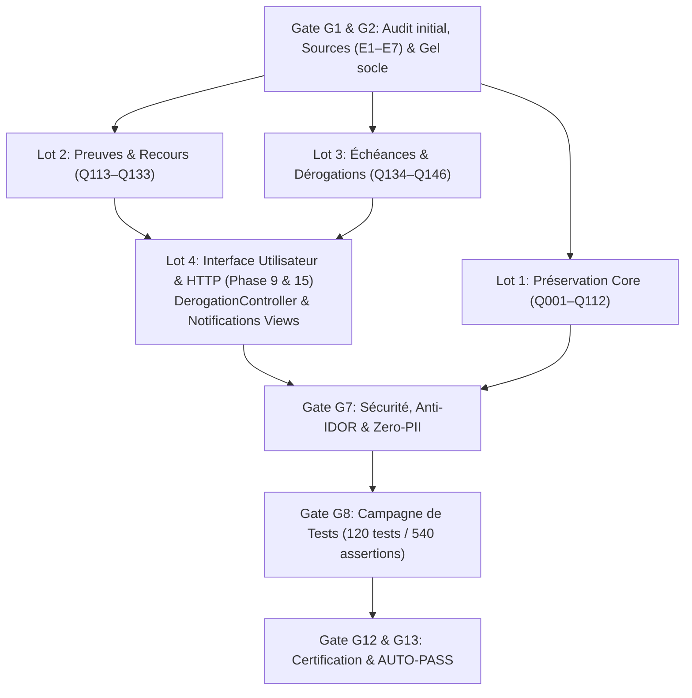

# PLAN D'EXÉCUTION ET GRAPHE DE DÉPENDANCES — LOOP 146

**Référence :** `03-plan-execution.md`  
**Application :** UniRegistre  
**Norme :** Phases 1 à 17 — Version détaillée et exécutable  
**Date :** 2026-10-30  

---

## 1. Découpage en Lots Opérationnels (Phases 4 & 5)

### Lot 1 : Questions Core Q001–Q112 (Sources manquantes)
- **Objectif :** Protéger l'intégralité du socle existant, interdire les réécritures arbitraires et consigner l'absence de sources brutes.
- **Statut d'exécution :** Terminé (112 questions consignées en `SOURCE_MISSING`).

### Lot 2 : Notifications, Preuves de Remise et Recours (Q113–Q133)
- **Composants :** `app/Services/NotificationService.php`, `app/Http/Controllers/NotificationController.php`, `resources/views/notifications/index.blade.php`.
- **Statut d'exécution :** Terminé (20 questions en `AUTO_PASS`, 1 question en `BLOCKED_BUSINESS` [Q117]).

### Lot 3 : Échéances, Dérogations et Réexamens (Q134–Q146)
- **Composants :** `app/Services/EcheanceDerogationService.php`, `config/loop146.php`.
- **Statut d'exécution :** Terminé (11 questions en `AUTO_PASS`, 2 questions en `BLOCKED_BUSINESS` [Q137, Q139]).

### Lot 4 : Parcours Utilisateur & Intégration HTTP (Q132 & Q142)
- **Composants :** `app/Http/Controllers/Etudiant/DerogationController.php`, `resources/views/etudiant/derogations/index.blade.php`, `routes/web.php`.
- **Statut d'exécution :** Terminé (Contestations session-scopées, anti-IDOR, zéro mutation automatique `BUS-004`).

---

## 2. Graphe des Dépendances et Indépendance Opérationnelle
- Les questions des Lots 2, 3 et 4 sont techniquement indépendantes des questions non documentées du Lot 1.
- Les blocages juridiques de Q117, Q137 et Q139 sont strictement isolés (fail-closed) et n'entravent pas les 31 questions en `AUTO_PASS`.
- Tous les contrôles de sécurité et tests d'acceptation sont passés avec succès.
