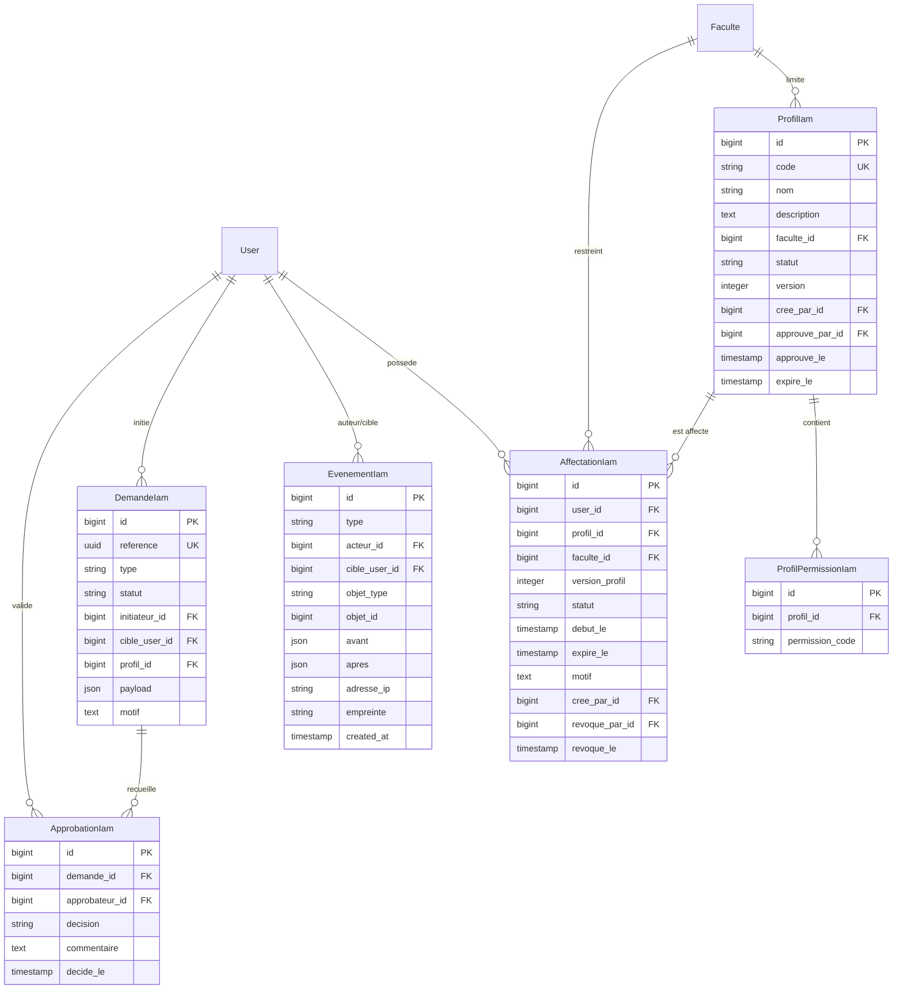
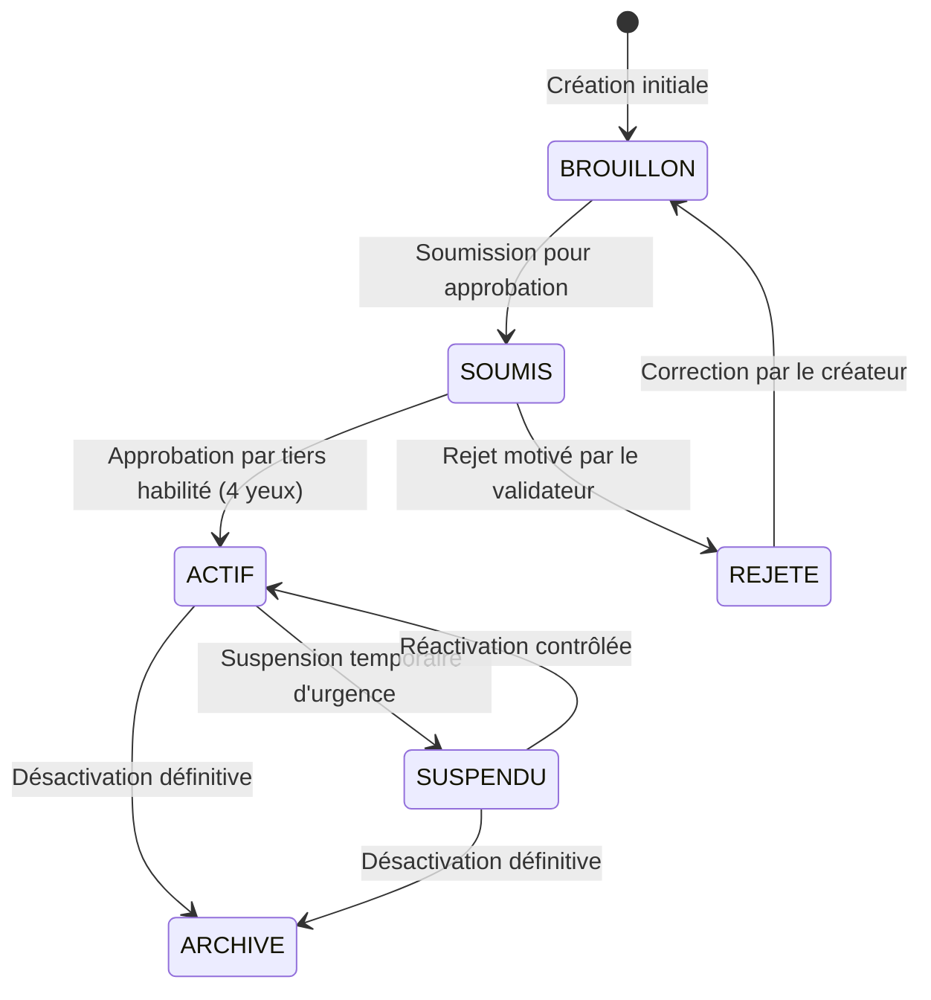

# Architecture Cible et Modèle de Gouvernance IAM/RBAC — UniRegistre

**Projet :** UniRegistre  
**Composant :** Gouvernance des Rôles, Permissions, Affectations et Sécurité  
**Date :** 31 Octobre 2026  
**Livrable :** Phase B — LOOP GLOBAL IAM/RBAC  

---

## 1. Principes Directeurs et Invariants

### 1.1 Invariants d'Architecture
1. **Source de Vérité Unique :** `App\Support\Permissions::TOUTES` est et reste la source canonique des codes de permission. Aucun CRUD ne peut insérer une permission inexistante dans le code.
2. **Moteur d'Autorisation Additif :** `App\Support\Iam\MoteurAutorisation` évalue les permissions en combinant la matrice du rôle système (`Permissions::pourRole()`) et les rôles personnalisés actifs (`ProfilIam` via `AffectationIam`).
3. **Protection Absolue des Rôles Système :** Les rôles système (`super_admin`, `admin_scolarite`, etc.) sont immuables : leurs codes et leurs permissions par défaut ne peuvent être modifiés ou supprimés via l'interface.
4. **Moindre Privilège & Refus par Défaut :** Toute permission non expressément accordée ou inconnue est rejetée côté serveur.
5. **Isolation Facultaire Stricte :** Le périmètre d'un administrateur ou d'un rôle facultaire est verrouillé par `faculte_id` côté serveur. Aucune modification du client HTTP ne peut élargir ce périmètre.
6. **Validation à Quatre Yeux :** Pour toute opération sensible (activation d'un profil avec permissions critiques, affectation critique), l'initiateur ne peut pas être l'approbateur.
7. **Traçabilité Immuable (Append-Only) :** Tous les événements sont enregistrés dans `iam_evenements` avec empreinte SHA-256 sans secret en clair.

---

## 2. Modèle des Données et Relations

---

## 3. Matrice de Délégation des Acteurs

| Rôle de l'Acteur | Consultation Rôles | Création Rôle Perso | Modification Rôle Perso | Attribution Permissions | Gestion Rôles Système | Quorum 4 Yeux Requis |
|---|---|---|---|---|---|---|
| `super_admin` | Tous | Global ou Facultaire | Tous les rôles perso | Toutes administrables | Attribution seule (via `AttributionRoleService`) | Oui si initiateur d'une demande critique |
| `admin_scolarite` (si `roles.manage`) | Périmètre autorisé | Non | Non | Non délégable sans mandat | Refus | Non applicable |
| `admin_faculte` (si mandaté) | Rôles de sa faculté | Rôle restreint à sa faculté | Rôles de sa faculté | Sous-ensemble de sa faculté | Refus | Exigé |
| Autres rôles (`agent`, `consultation`) | Refus (403) | Refus (403) | Refus (403) | Refus (403) | Refus (403) | Refus (403) |

---

## 4. Cycle de Vie d'un Rôle Personnalisé (`ProfilIam`)

---

## 5. Composants Logiciels

1. **Services :**
   - `App\Services\Iam\ServiceProfilsIam` : gestion du cycle de vie des profils et synchronisation des permissions.
   - `App\Services\Iam\ServiceAffectationsIam` : gestion des attributions/révocations de profils aux utilisateurs.
   - `App\Services\Iam\ServiceDemandesIam` : gestion du circuit d'approbation à 4 yeux.
   - `App\Services\Iam\ServiceAuditIam` : journalisation immuable.
   - `App\Support\Iam\MoteurAutorisation` : calcul et cache des permissions effectives.
   - `App\Support\Iam\CataloguePermissions` : catalogue fédéré et métadonnées.
2. **Contrôleurs Admin :**
   - `App\Http\Controllers\Admin\Iam\RoleCrudController` : CRUD des rôles (index, show, create, store, edit, update, suspendre, archiver).
   - `App\Http\Controllers\Admin\Iam\RolePermissionController` : gestion des permissions d'un rôle (attribution, retrait par domaines et checkboxes hiérarchiques).
   - `App\Http\Controllers\Admin\Iam\RoleAffectationController` : affectations et révocations des utilisateurs d'un rôle.
   - `App\Http\Controllers\Admin\Iam\DemandeApprobationController` : consultation et décision sur les demandes 4 yeux.
3. **Form Requests & Validation :**
   - Validation stricte côté serveur des codes (`regex:/^[a-z0-9_\-]+$/`, unicité, non-collision avec `Permissions::ROLES`), vérification des permissions existantes via `CataloguePermissions::existe()`, vérification de la faculté de rattachement.

